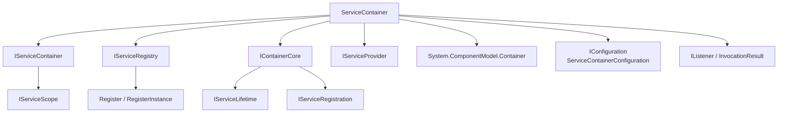

[All products](../) / [Saraff.IoC](./index.md)
# API Reference

All public types live in the `Saraff.IoC` namespace.



## `ServiceContainer`

The main container. Implements `IServiceProvider`, `IServiceContainer`, `IServiceRegistry`,
`IContainerCore` and derives from `System.ComponentModel.Container`.

### Constructors

```csharp
public ServiceContainer();
public ServiceContainer(IConfiguration configuration);
```

### Properties

```csharp
public ServiceContainer Parent { get; }
```

### Registration

```csharp
public void Register(Type serviceType, Type implementationType,
    ServiceLifetime lifetime = ServiceLifetime.Singleton, string name = null);

public void Register(Type serviceType, Type implementationType,
    IServiceLifetime lifetime, string name = null);

public void Register<TService, TImplementation>(
    ServiceLifetime lifetime = ServiceLifetime.Singleton, string name = null)
    where TImplementation : TService;

public void Register<TService, TImplementation>(IServiceLifetime lifetime, string name = null)
    where TImplementation : TService;

public void Register(Type serviceType, Func<IServiceProvider, object> factory,
    ServiceLifetime lifetime = ServiceLifetime.Singleton, string name = null);

public void Register(Type serviceType, Func<IServiceProvider, object> factory,
    IServiceLifetime lifetime, string name = null);

public void Register<TService>(Func<IServiceProvider, TService> factory,
    ServiceLifetime lifetime = ServiceLifetime.Singleton, string name = null);

public void Register<TService>(Func<IServiceProvider, TService> factory,
    IServiceLifetime lifetime, string name = null);

public void RegisterInstance(Type serviceType, object instance, string name = null);
public void RegisterInstance<TService>(TService instance, string name = null);
```

### Resolution

```csharp
public object Resolve(Type serviceType);
public T Resolve<T>();
public IEnumerable<T> ResolveAll<T>();
public object ResolveNamed(Type serviceType, string name);
public T ResolveNamed<T>(string name);
public bool IsRegistered(Type serviceType);
```

### Scopes and nesting

```csharp
public IServiceScope CreateScope();
public ServiceContainer CreateNestedContainer();
```

### Creation and legacy binding

```csharp
public object CreateInstance(Type type, params CtorCallback[] args);
public object CreateInstance(Type type, bool trackComponents, params CtorCallback[] args);
public T CreateInstance<T>(params CtorCallback[] args) where T : class;
public T CreateInstance<T>(bool trackComponents, params CtorCallback[] args) where T : class;

public void Bind(Type service, Type obj);
public void Bind<TService, T>();
public void Bind(Type service, object obj);
public void Bind<TService>(object obj);

public void Load(Assembly assembly);
```

### Async (`netstandard2.0`)

```csharp
public Task<object> ResolveAsync(Type serviceType,
    CancellationToken cancellationToken = default);

public Task<T> ResolveAsync<T>(CancellationToken cancellationToken = default);

public Task InitializeAsync(CancellationToken cancellationToken = default);

public ValueTask DisposeAsync();
```

### Configuration and disposal

```csharp
public void UseConfiguration(IConfiguration configuration);
public void Dispose(); // from IDisposable
```

## Core interfaces

### `IServiceContainer`

```csharp
public interface IServiceContainer : IServiceProvider, IDisposable
#if NETSTANDARD
    , IAsyncDisposable
#endif
{
    IServiceScope CreateScope();
    object Resolve(Type serviceType);
    T Resolve<T>();
    IEnumerable<T> ResolveAll<T>();
    object ResolveNamed(Type serviceType, string name);
    T ResolveNamed<T>(string name);
    bool IsRegistered(Type serviceType);

#if NETSTANDARD
    Task<object> ResolveAsync(Type serviceType, CancellationToken cancellationToken = default);
    Task<T> ResolveAsync<T>(CancellationToken cancellationToken = default);
    Task InitializeAsync(CancellationToken cancellationToken = default);
#endif
}
```

### `IServiceRegistry`

```csharp
public interface IServiceRegistry {
    void Register(Type serviceType, Type implementationType,
        ServiceLifetime lifetime = ServiceLifetime.Singleton, string name = null);

    void Register<TService, TImplementation>(
        ServiceLifetime lifetime = ServiceLifetime.Singleton, string name = null)
        where TImplementation : TService;

    void Register(Type serviceType, Func<IServiceProvider, object> factory,
        ServiceLifetime lifetime = ServiceLifetime.Singleton, string name = null);

    void Register<TService>(Func<IServiceProvider, TService> factory,
        ServiceLifetime lifetime = ServiceLifetime.Singleton, string name = null);

    void RegisterInstance(Type serviceType, object instance, string name = null);
    void RegisterInstance<TService>(TService instance, string name = null);
}
```

### `IServiceScope`

```csharp
public interface IServiceScope : IDisposable
#if NETSTANDARD
    , IAsyncDisposable
#endif
{
    IServiceProvider ServiceProvider { get; }
    object Resolve(Type serviceType);
    T Resolve<T>();
    object ResolveNamed(Type serviceType, string name);
    T ResolveNamed<T>(string name);

#if NETSTANDARD
    Task<object> ResolveAsync(Type serviceType, CancellationToken cancellationToken = default);
    Task<T> ResolveAsync<T>(CancellationToken cancellationToken = default);
    Task InitializeAsync(CancellationToken cancellationToken = default);
#endif
}
```

### `IContainerCore`

```csharp
public interface IContainerCore : IDisposable
#if NETSTANDARD
    , IAsyncDisposable
#endif
{
    IContainerCore Parent { get; }
    IContainerCore CreateNested();

    object Resolve(Type serviceType);
    object ResolveNamed(Type serviceType, string name);
    bool IsRegistered(Type serviceType);

    object CreateInstance(Type type, bool trackComponents, IDictionary<string, object> args);

    void Register(Type serviceType, Type implementationType, IServiceLifetime lifetime, string name);
    void Register(Type serviceType, Func<IServiceProvider, object> factory, IServiceLifetime lifetime, string name);
    void RegisterInstance(Type serviceType, object instance, string name);

#if NETSTANDARD
    Task<object> ResolveAsync(Type serviceType, CancellationToken cancellationToken);
    Task InitializeAsync(CancellationToken cancellationToken);
#endif
}
```

## Lifetimes

### `ServiceLifetime`

```csharp
public enum ServiceLifetime {
    Singleton,
    Scoped,
    Transient
}
```

### `IServiceLifetime`

```csharp
public interface IServiceLifetime {
    object Resolve(IServiceLifetimeContext context);
}
```

### `IServiceLifetimeContext`

```csharp
public interface IServiceLifetimeContext {
    Type ServiceType { get; }
    string Name { get; }
    IContainerCore Owner { get; }
    IContainerCore Scope { get; }

    object GetOrAddSingleton();
    object GetOrAddScoped();
    object Create();
}
```

### `IServiceLifetimeFactory`

```csharp
public interface IServiceLifetimeFactory {
    IServiceLifetime Create(ServiceLifetime lifetime);
}
```

### `ServiceLifetimes`

```csharp
public static class ServiceLifetimes {
    public static IServiceLifetime Singleton { get; }
    public static IServiceLifetime Scoped { get; }
    public static IServiceLifetime Transient { get; }
}
```

### `DefaultServiceLifetimeFactory`

```csharp
public sealed class DefaultServiceLifetimeFactory : IServiceLifetimeFactory {
    public static readonly DefaultServiceLifetimeFactory Instance;
    public IServiceLifetime Create(ServiceLifetime lifetime);
}
```

## Registration descriptors

### `IServiceRegistration`

```csharp
public interface IServiceRegistration {
    Type ServiceType { get; }
    Type ImplementationType { get; }
    object Instance { get; }
    Func<IServiceProvider, object> Factory { get; }
    IServiceLifetime Lifetime { get; }
    string Name { get; }
    Type GetImplementationType(Type requestedServiceType);
}
```

### `IServiceRegistrationFactory`

```csharp
public interface IServiceRegistrationFactory {
    IServiceRegistration Create(
        Type serviceType,
        Type implementationType,
        object instance,
        Func<IServiceProvider, object> factory,
        IServiceLifetime lifetime,
        string name);
}
```

## Injection

### `ServiceRequiredAttribute`

```csharp
[AttributeUsage(
    AttributeTargets.Property |
    AttributeTargets.Constructor |
    AttributeTargets.Parameter,
    AllowMultiple = false,
    Inherited = false)]
public sealed class ServiceRequiredAttribute : Attribute {
}
```

### `IContextBinder<TService, TContext>`

```csharp
public interface IContextBinder<TService, TContext> {
}
```

A marker key used for context-aware resolution. The implementation does not need to implement
this interface.

### `Lazy<T>`

```csharp
public delegate T Lazy<T>() where T : class;
```

## Interception

### `ProxyRequiredAttribute`

```csharp
[AttributeUsage(AttributeTargets.Class, AllowMultiple = false, Inherited = false)]
public sealed class ProxyRequiredAttribute : Attribute {
}
```

### `IListener`

```csharp
public interface IListener {
    InvocationResult OnInvoking(MethodBase method, object instance, object[] parameters);
    InvocationResult OnInvoked(MethodBase method, object instance, object result);
    InvocationResult OnCatch(MethodBase method, object instance, Exception ex);
}
```

### `InvocationResult`

```csharp
public struct InvocationResult : IInvocationResult {
    public InvocationResult(bool handled, object value);
    public bool Handled { get; }
    public object Value { get; }

    public static InvocationResult NotHandled { get; }
    public static InvocationResult FromResult(object value);
}
```

### `IInvocationResult`

```csharp
public interface IInvocationResult {
    bool Handled { get; }
    object Value { get; }
}
```

### Callback delegates

```csharp
public delegate InvocationResult InvokingCallback(
    object listener, MethodBase method, object instance, object[] parameters);

public delegate InvocationResult InvokedCallback(
    object listener, MethodBase method, object instance, object result);

public delegate InvocationResult CatchCallback(
    object listener, MethodBase method, object instance, Exception ex);

public delegate IInvocationResult InvokingResultCallback(
    object listener, MethodBase method, object instance, object[] parameters);

public delegate IInvocationResult InvokedResultCallback(
    object listener, MethodBase method, object instance, object result);

public delegate IInvocationResult CatchResultCallback(
    object listener, MethodBase method, object instance, Exception ex);
```

## Async

### `IAsyncInitializable` (`netstandard2.0`)

```csharp
public interface IAsyncInitializable {
    Task InitializeAsync(CancellationToken cancellationToken = default);
}
```

### `IAsyncInitializationAdapter`

```csharp
public interface IAsyncInitializationAdapter {
    bool CanInitialize(object instance);
    Task InitializeAsync(object instance, CancellationToken cancellationToken);
}
```

### `AsyncLazy<T>`

```csharp
public sealed class AsyncLazy<T> {
    public AsyncLazy(Func<Task<T>> factory);
    public AsyncLazy(Func<CancellationToken, Task<T>> factory);
    public AsyncLazy(Func<CancellationToken, Task<T>> factory, CancellationToken cancellationToken);

    public Task<T> Value { get; }
    public bool IsValueCreated { get; }
}
```

## Configuration

### `IConfiguration`

```csharp
public interface IConfiguration :
    IContainerBindingConfiguration,
    IContainerInjectionConfiguration,
    IContainerInterceptionConfiguration {
}
```

### Group interfaces

```csharp
public interface IContainerBindingConfiguration {
    Type BindServiceAttributeType { get; }
    BindServiceCallback BindServiceCallback { get; }
}

public interface IContainerInjectionConfiguration {
    Type ServiceRequiredAttributeType { get; }
    Type ContextBinderType { get; }
    Type LazyCallbackType { get; }
}

public interface IContainerInterceptionConfiguration {
    Type ProxyRequiredAttributeType { get; }
    Type ListenerType { get; }
    InvokingCallback InvokingCallback { get; }
    InvokedCallback InvokedCallback { get; }
    CatchCallback CatchCallback { get; }
}

public interface IContainerInvocationResultConfiguration {
    InvokingResultCallback InvokingResultCallback { get; }
    InvokedResultCallback InvokedResultCallback { get; }
    CatchResultCallback CatchResultCallback { get; }
}

public interface IContainerLifetimeConfiguration {
    IServiceLifetimeFactory ServiceLifetimeFactory { get; }
}

public interface IContainerRegistrationConfiguration {
    IServiceRegistrationFactory ServiceRegistrationFactory { get; }
}

public interface IContainerAsyncInitializationConfiguration {
    IAsyncInitializationAdapter AsyncInitializationAdapter { get; }
}
```

### `ServiceContainerConfiguration`

Implements `IConfiguration` and all optional groups. All properties are settable.

```csharp
public sealed class ServiceContainerConfiguration :
    IConfiguration,
    IContainerInvocationResultConfiguration,
    IContainerLifetimeConfiguration,
    IContainerRegistrationConfiguration,
    IContainerAsyncInitializationConfiguration {
    // ...
}
```

## Attributes

### `BindServiceAttribute`

```csharp
[AttributeUsage(AttributeTargets.Assembly, AllowMultiple = true, Inherited = false)]
public sealed class BindServiceAttribute : Attribute {
    public BindServiceAttribute(Type service, Type obj);
    public Type Service { get; }
    public Type ObjectType { get; }
}
```

## Exceptions

| Exception | When |
|---|---|
| `CircularDependencyException` | A dependency cycle is detected |
| `ServiceResolutionException` | No suitable constructor or creation failed |
| `ObjectDisposedException` | Container/scope used after disposal |
| `InvalidOperationException` | Invalid `Bind`, async-only service with sync `Dispose`, invalid `OnCatch` result |
| `ArgumentException` | Invalid registration, duplicate `Bind`, bad instance type |

## Default values

| Setting | Default |
|---|---|
| `Register` lifetime | `Singleton` |
| `Bind` lifetime | Singleton |
| `RegisterInstance` lifetime | Singleton |
| `ServiceRequiredAttribute` | `[ServiceRequired]` |
| `ProxyRequiredAttribute` | `[ProxyRequired]` |
| `BindServiceAttribute` | `[BindService]` |
| Listener | `IListener` |
| Context binder | `IContextBinder<,>` |
| Lazy delegate | `Saraff.IoC.Lazy<>` |
| Lifetime factory | `DefaultServiceLifetimeFactory.Instance` |
| Registration factory | `DefaultServiceRegistrationFactory.Instance` |
| Async adapter | `AsyncInitializableAdapter.Instance` |

## See also

* [Registration](./Registration.md)
* [Lifetimes and Scopes](./Lifetimes.md)
* [Injection Patterns](./InjectionPatterns.md)
* [Configuration](./Configuration.md)
* [Customization](./Customization.md)
