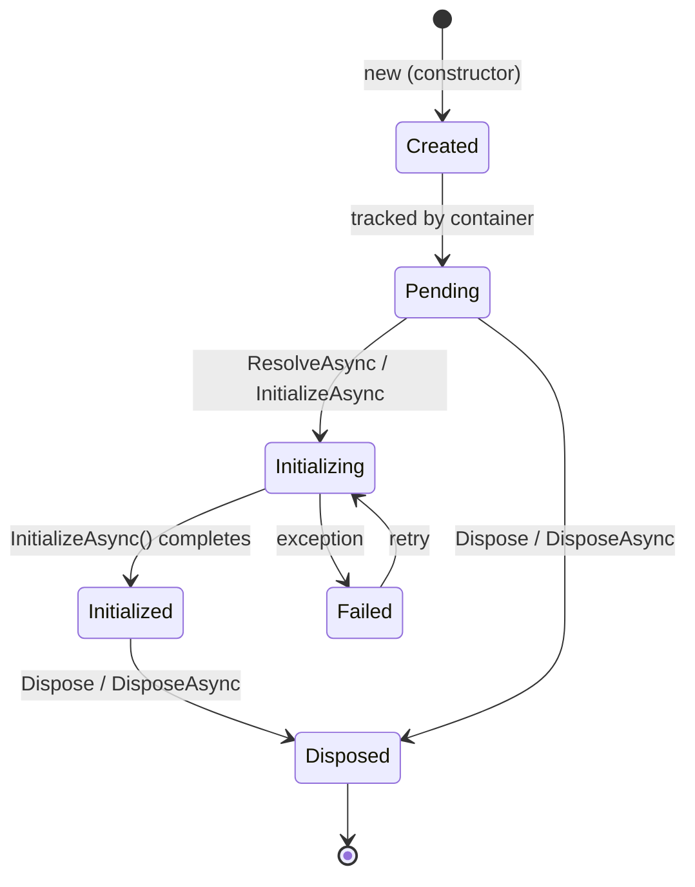
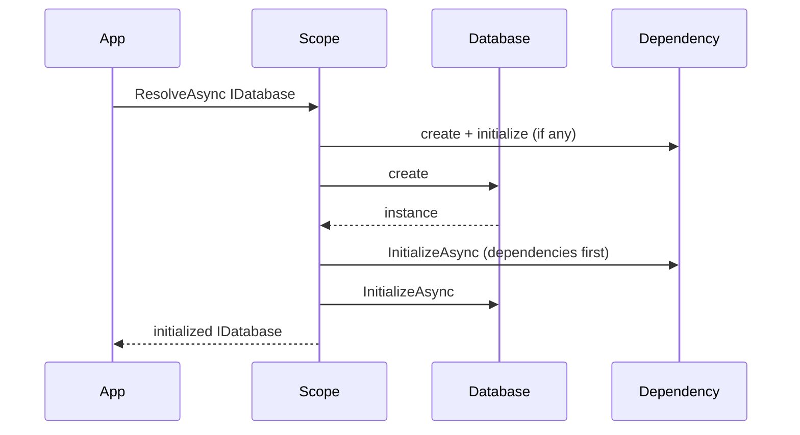

[All products](../) / [Saraff.IoC](./index.md)
# Async Initialization and Disposal

Some services cannot finish construction in a constructor: a database connection, an HTTP
client, a message queue consumer. Saraff.IoC supports **asynchronous initialization** and
**asynchronous disposal** for these services.

> Async initialization and `DisposeAsync` are available in the `netstandard2.0` assembly.
> `AsyncLazy<T>` is available on both `netstandard2.0` and `net40`.

## Lifecycle



## `IAsyncInitializable`

Implement `IAsyncInitializable` when a service needs asynchronous startup:

```csharp
public interface IAsyncInitializable {
    Task InitializeAsync(CancellationToken cancellationToken = default);
}
```

```csharp
public sealed class Database : IDatabase, IAsyncInitializable, IAsyncDisposable {
    private DbConnection _connection;

    public Task InitializeAsync(CancellationToken cancellationToken = default) {
        return this.ConnectAsync(cancellationToken);
    }

    public ValueTask DisposeAsync() {
        return this.DisconnectAsync();
    }

    private async Task ConnectAsync(CancellationToken cancellationToken) {
        this._connection = new DbConnection(/* ... */);
        await this._connection.OpenAsync(cancellationToken);
    }

    private async ValueTask DisconnectAsync() {
        if(this._connection != null) {
            await this._connection.CloseAsync();
            this._connection.Dispose();
            this._connection = null;
        }
    }
}
```

The container detects the interface through the configured
`IAsyncInitializationAdapter` (`AsyncInitializableAdapter` by default).

## `ResolveAsync`

`ResolveAsync<T>` resolves the service synchronously and then initializes every created but not
yet initialized service:

```csharp
await using (var container = new ServiceContainer()) {
    container.Register<IDatabase, Database>(ServiceLifetime.Scoped);

    await using (var scope = container.CreateScope()) {
        var database = await scope.ResolveAsync<IDatabase>();
        // database is created and initialized
    } // scope and its scoped services are disposed asynchronously
}
```



Ordering guarantees:

* Initialization runs **once per instance**.
* Dependencies are initialized before dependents (the container initializes in creation order,
  and dependencies are created first).
* The whole chain of containers is initialized, root first.
* A failed initialization can be retried: the entry is reset and the next `ResolveAsync` /
  `InitializeAsync` tries again.
* Cancellation is honored; a canceled initialization can be retried.

## `InitializeAsync`

If you created services with synchronous `Resolve`, you can initialize them later:

```csharp
using (var container = new ServiceContainer()) {
    container.Register<IDatabase, Database>();
    var database = container.Resolve<IDatabase>();

    // Not initialized yet.
    await container.InitializeAsync();

    // Now initialized.
}
```

`InitializeAsync` is available on containers and scopes. It initializes all pending services in
the current container and its parents.

## Shared instances

If the same object is registered under multiple service types, it is initialized once:

```csharp
var shared = new Database();
container.Register<IDatabase>(_ => shared);
container.Register<IHealthCheck>(_ => shared);

container.Resolve<IDatabase>();
container.Resolve<IHealthCheck>();

await container.InitializeAsync();
// shared.InitializeAsync is called once
```

Instances registered with `RegisterInstance` are not initialized automatically.

## Concurrency

Concurrent `ResolveAsync` and `InitializeAsync` calls share a single initialization task. The
service is initialized once, even if many callers race:

```csharp
var tasks = Enumerable.Range(0, 16)
    .Select(_ => container.ResolveAsync<IDatabase>())
    .ToArray();

var results = await Task.WhenAll(tasks);
// All results are the same instance; InitializeAsync ran once.
```

## `DisposeAsync`

`DisposeAsync` releases asynchronous resources and waits for in-flight initialization:

```csharp
var container = new ServiceContainer();
container.Register<IDatabase, Database>();

var database = await container.ResolveAsync<IDatabase>();

await container.DisposeAsync();
// Database.DisposeAsync() is awaited
```

Rules:

* `DisposeAsync` disposes `IAsyncDisposable` services; it also disposes synchronous
  `IDisposable` services.
* It waits for in-flight `ResolveAsync` / `InitializeAsync` tasks before disposing.
* It disposes nested containers first.
* It is idempotent and safe to call concurrently.
* `Component`-based services that implement `IAsyncDisposable` are removed from the component
  collection and disposed asynchronously.

```csharp
public async ValueTask DisposeAsync() {
    // ...
}
```

## Synchronous `Dispose`

Synchronous `Dispose` cannot await asynchronous cleanup. If an async-only service is tracked:

* synchronous services are disposed;
* then `InvalidOperationException` is thrown with a message telling you to use
  `DisposeAsync()`.

```csharp
container.Register<IAsyncDisposableService, AsyncDisposableService>();
container.Resolve<IAsyncDisposableService>();

container.Dispose(); // InvalidOperationException: use DisposeAsync()
```

Use `await using` or call `DisposeAsync()` when the container owns `IAsyncDisposable` services.

## `AsyncLazy<T>`

`AsyncLazy<T>` defers asynchronous construction and runs the factory once. It is useful for
expensive resources that should be created on first use:

```csharp
public sealed class ConnectionProvider {
    private readonly AsyncLazy<IConnection> _connection;

    public ConnectionProvider(AsyncLazy<IConnection> connection) {
        this._connection = connection;
    }

    public async Task<IConnection> GetAsync() {
        return await this._connection.Value;
    }
}
```

```csharp
container.RegisterInstance(new AsyncLazy<IConnection>(ct => ConnectAsync(ct)));

var lazy = container.Resolve<AsyncLazy<IConnection>>();
var connection = await lazy.Value;
```

Properties:

| Member | Meaning |
|---|---|
| `Value` | `Task<T>` that starts the factory on first access |
| `IsValueCreated` | Whether the factory has been started |
| `AsyncLazy(Func<Task<T>>)` | Factory without a cancellation token |
| `AsyncLazy(Func<CancellationToken, Task<T>>)` | Factory with a cancellation token |
| `AsyncLazy(Func<CancellationToken, Task<T>>, CancellationToken)` | Factory with a fixed token |

The result (or the exception) is cached. Use `AsyncLazy<T>` for "create once, asynchronously"
semantics without blocking a thread.

## Custom async adapter

If your services use a different startup interface, implement `IAsyncInitializationAdapter` and
configure it:

```csharp
public interface IStartable {
    Task StartAsync(CancellationToken cancellationToken);
}

public sealed class StartableAdapter : IAsyncInitializationAdapter {
    public bool CanInitialize(object instance) => instance is IStartable;

    public Task InitializeAsync(object instance, CancellationToken cancellationToken) {
        return ((IStartable)instance).StartAsync(cancellationToken);
    }
}
```

```csharp
var configuration = new ServiceContainerConfiguration {
    AsyncInitializationAdapter = new StartableAdapter()
};

using (var container = new ServiceContainer(configuration)) {
    // ...
}
```

## Platform differences

| Feature | `netstandard2.0` | `net40` |
|---|---|---|
| `IAsyncInitializable` | Yes | No |
| `ResolveAsync` / `InitializeAsync` | Yes | No |
| `DisposeAsync` | Yes | No |
| `AsyncLazy<T>` | Yes | Yes |
| `IAsyncDisposable` | Yes (`Microsoft.Bcl.AsyncInterfaces`) | No |

The `net40` assembly is synchronous. Use constructor initialization or an explicit `Start()`
method there.

## See also

* [Lifetimes and Scopes](./Lifetimes.md)
* [Configuration](./Configuration.md)
* [Customization](./Customization.md)
* [Troubleshooting](./Troubleshooting.md)
