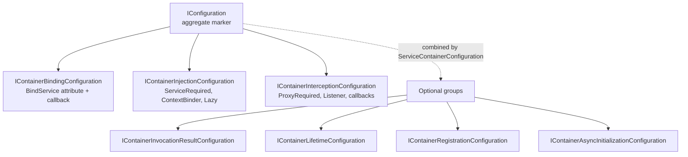
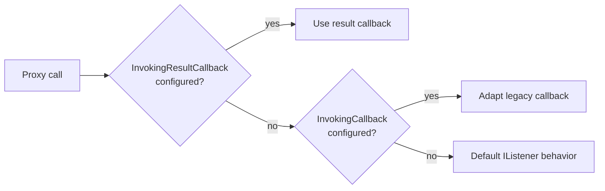

[All products](../) / [Saraff.IoC](./index.md)
# Configuration

Saraff.IoC is configured through small, focused interfaces. You can replace the attribute
types, callbacks, lifetime policy, registration descriptor and asynchronous initialization
adapter without forking the container.

```csharp
using (var container = new ServiceContainer(new ServiceContainerConfiguration {
    ServiceRequiredAttributeType = typeof(MyInjectAttribute),
    ListenerType = typeof(IMyListener)
})) {
    // ...
}
```



## Configuration groups

| Group | Purpose | Members |
|---|---|---|
| `IContainerBindingConfiguration` | Assembly binding attributes | `BindServiceAttributeType`, `BindServiceCallback` |
| `IContainerInjectionConfiguration` | Injection attributes and special types | `ServiceRequiredAttributeType`, `ContextBinderType`, `LazyCallbackType` |
| `IContainerInterceptionConfiguration` | Proxying and listeners | `ProxyRequiredAttributeType`, `ListenerType`, `InvokingCallback`, `InvokedCallback`, `CatchCallback` |
| `IContainerInvocationResultConfiguration` | Custom invocation result type | `InvokingResultCallback`, `InvokedResultCallback`, `CatchResultCallback` |
| `IContainerLifetimeConfiguration` | Lifetime policy factory | `ServiceLifetimeFactory` |
| `IContainerRegistrationConfiguration` | Registration descriptor factory | `ServiceRegistrationFactory` |
| `IContainerAsyncInitializationConfiguration` | Async initialization adapter | `AsyncInitializationAdapter` |

`IConfiguration` is the object you pass to the container. It inherits the binding, injection and
interception groups, so a custom configuration must implement at least those three. The
remaining groups are optional: a configuration can additionally implement only the optional
groups it needs, and missing optional groups fall back to defaults.

For simple overrides use `ServiceContainerConfiguration`, which implements every group:

```csharp
var configuration = new ServiceContainerConfiguration {
    ServiceRequiredAttributeType = typeof(MyInjectAttribute),
    ListenerType = typeof(IMyListener)
};
```

If you write a custom configuration type, implement `IConfiguration` and add any optional group
interfaces:

```csharp
public sealed class AppConfiguration : IConfiguration, IContainerLifetimeConfiguration {
    // IContainerBindingConfiguration
    public Type BindServiceAttributeType => typeof(BindServiceAttribute);
    public BindServiceCallback BindServiceCallback => null; // use the default callback

    // IContainerInjectionConfiguration
    public Type ServiceRequiredAttributeType => typeof(ServiceRequiredAttribute);
    public Type ContextBinderType => typeof(IContextBinder<,>);
    public Type LazyCallbackType => typeof(Lazy<>);

    // IContainerInterceptionConfiguration
    public Type ProxyRequiredAttributeType => typeof(ProxyRequiredAttribute);
    public Type ListenerType => typeof(IListener);
    public InvokingCallback InvokingCallback => null;
    public InvokedCallback InvokedCallback => null;
    public CatchCallback CatchCallback => null;

    // IContainerLifetimeConfiguration (optional)
    public IServiceLifetimeFactory ServiceLifetimeFactory => MyLifetimeFactory.Instance;
}
```


## `ServiceContainerConfiguration`

`ServiceContainerConfiguration` implements every group and exposes settable properties with
sensible defaults:

```csharp
var configuration = new ServiceContainerConfiguration {
    ServiceRequiredAttributeType = typeof(MyInjectAttribute),
    ProxyRequiredAttributeType = typeof(MyProxyAttribute),
    ListenerType = typeof(IMyListener),
    ServiceLifetimeFactory = MyLifetimeFactory.Instance,
    AsyncInitializationAdapter = MyAsyncAdapter.Instance
};
```

| Property | Default |
|---|---|
| `BindServiceAttributeType` | `typeof(BindServiceAttribute)` |
| `ServiceRequiredAttributeType` | `typeof(ServiceRequiredAttribute)` |
| `ContextBinderType` | `typeof(IContextBinder<,>)` |
| `LazyCallbackType` | `typeof(Saraff.IoC.Lazy<>)` |
| `ProxyRequiredAttributeType` | `typeof(ProxyRequiredAttribute)` |
| `ListenerType` | `typeof(IListener)` |
| `InvokingCallback` / `InvokedCallback` / `CatchCallback` | Default `IListener` adapters |
| `InvokingResultCallback` / `InvokedResultCallback` / `CatchResultCallback` | `null` (legacy callbacks are adapted) |
| `ServiceLifetimeFactory` | `DefaultServiceLifetimeFactory.Instance` |
| `ServiceRegistrationFactory` | `DefaultServiceRegistrationFactory.Instance` |
| `AsyncInitializationAdapter` | `AsyncInitializableAdapter.Instance` |

## Ways to supply configuration

### 1. Constructor

```csharp
var container = new ServiceContainer(configuration);
```

### 2. `UseConfiguration`

```csharp
using (var container = new ServiceContainer()) {
    container.UseConfiguration(configuration);
    // ...
}
```

`UseConfiguration` replaces the configuration for **this** container. Nested containers created
earlier keep their own settings. Nested containers created later inherit the new configuration.

### 3. Registered instance

```csharp
container.RegisterInstance<IConfiguration>(configuration);
```

### 4. Registered implementation

```csharp
container.Register<IConfiguration, MyConfiguration>();
```

### 5. Bound instance or type (legacy)

```csharp
container.Bind<IConfiguration>(configuration);
// or
container.Bind<IConfiguration, MyConfiguration>();
```

Configuration supplied through the constructor, `UseConfiguration`, `RegisterInstance` or
`Register` may be a plain class. Legacy `Bind` requires the configuration type to derive from
`Component`.

## Configuration is a snapshot

Configuration is captured as an **immutable snapshot** on first use. Later mutations of the
configuration object are not observed until you call `UseConfiguration` again.

```csharp
var configuration = new ServiceContainerConfiguration();

using (var container = new ServiceContainer(configuration)) {
    // The first registration/resolution captures the snapshot.
    container.Register<IGreeting, Greeting>();

    configuration.ServiceLifetimeFactory = new MyLifetimeFactory();

    container.Register<IPlugin, PluginA>(); // still uses the old snapshot

    container.UseConfiguration(configuration); // refresh the snapshot
    container.Register<IPlugin, PluginB>();    // now uses MyLifetimeFactory
}
```

Why a snapshot? It makes resolution predictable and thread-safe: a container never observes a
configuration object that is being mutated by another thread.

## Replacing the service-required attribute

```csharp
[AttributeUsage(AttributeTargets.Constructor | AttributeTargets.Property | AttributeTargets.Parameter)]
public sealed class MyInjectAttribute : Attribute {
}

var configuration = new ServiceContainerConfiguration {
    ServiceRequiredAttributeType = typeof(MyInjectAttribute)
};

using (var container = new ServiceContainer(configuration)) {
    // [MyInject] is now used for constructor, property and parameter injection
}
```

## Replacing the listener type

```csharp
public interface IMyListener {
    InvocationResult OnInvoking(MethodBase method, object instance, object[] parameters);
    InvocationResult OnInvoked(MethodBase method, object instance, object result);
    InvocationResult OnCatch(MethodBase method, object instance, Exception ex);
}

var configuration = new ServiceContainerConfiguration {
    ListenerType = typeof(IMyListener),
    InvokingCallback = (listener, method, instance, parameters) =>
        (listener as IMyListener)?.OnInvoking(method, instance, parameters)
        ?? InvocationResult.NotHandled
};
```

## Legacy callbacks vs result callbacks

The interception configuration has two generations of callbacks:

* **Legacy**: `InvokingCallback`, `InvokedCallback`, `CatchCallback` return `InvocationResult`.
* **Result-based**: `InvokingResultCallback`, `InvokedResultCallback`, `CatchResultCallback`
  return `IInvocationResult`.

The result-based callbacks take precedence. If they are not set, the container adapts the legacy
callbacks automatically, and if those are not set either, it uses the default `IListener`
behavior.



## Custom lifetime factory

```csharp
public sealed class MyLifetimeFactory : IServiceLifetimeFactory {
    public IServiceLifetime Create(ServiceLifetime lifetime) {
        return lifetime == ServiceLifetime.Scoped
            ? MyCustomScopedLifetime.Instance
            : DefaultServiceLifetimeFactory.Instance.Create(lifetime);
    }
}

var configuration = new ServiceContainerConfiguration {
    ServiceLifetimeFactory = new MyLifetimeFactory()
};
```

## Custom registration descriptor

```csharp
public sealed class MyRegistrationFactory : IServiceRegistrationFactory {
    public IServiceRegistration Create(
        Type serviceType,
        Type implementationType,
        object instance,
        Func<IServiceProvider, object> factory,
        IServiceLifetime lifetime,
        string name) {

        return new MyRegistration(serviceType, implementationType, instance, factory, lifetime, name);
    }
}
```

`MyRegistration` implements `IServiceRegistration`. See [Customization](./Customization.md).

## Custom async initialization adapter

```csharp
public sealed class MyAsyncAdapter : IAsyncInitializationAdapter {
    public bool CanInitialize(object instance) => instance is IStartable;

    public Task InitializeAsync(object instance, CancellationToken cancellationToken) {
        return ((IStartable)instance).StartAsync(cancellationToken);
    }
}

var configuration = new ServiceContainerConfiguration {
    AsyncInitializationAdapter = new MyAsyncAdapter()
};
```

On `net40`, the default adapter never initializes anything and returns a completed task.

## See also

* [Customization](./Customization.md)
* [Interception and Listeners](./Listener.md)
* [Async Initialization](./AsyncInitialization.md)
* [Troubleshooting](./Troubleshooting.md)
