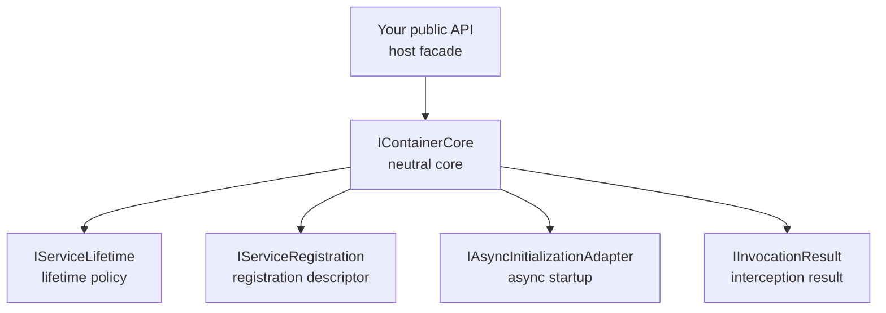

[All products](../) / [Saraff.IoC](./index.md)
# Customization

Saraff.IoC exposes several extension points. You can replace a single policy without replacing
the container, or wrap the container in your own public API.



## `IContainerCore`

`ServiceContainer` implements `IContainerCore`, a neutral API that does not depend on the
legacy public types (`IServiceContainer`, `IServiceRegistry`, `ServiceLifetime`,
`ServiceRegistration`, `InvocationResult`, `IAsyncInitializable`).

```csharp
public interface IContainerCore : IDisposable
#if NETSTANDARD
    , IAsyncDisposable
#endif
{
    IContainerCore Parent { get; }
    IContainerCore CreateNested();

    object Resolve(Type serviceType);
    object ResolveNamed(Type serviceType, string name);
    bool IsRegistered(Type serviceType);

    object CreateInstance(Type type, bool trackComponents, IDictionary<string, object> args);

    void Register(Type serviceType, Type implementationType, IServiceLifetime lifetime, string name);
    void Register(Type serviceType, Func<IServiceProvider, object> factory, IServiceLifetime lifetime, string name);
    void RegisterInstance(Type serviceType, object instance, string name);

#if NETSTANDARD
    Task<object> ResolveAsync(Type serviceType, CancellationToken cancellationToken);
    Task InitializeAsync(CancellationToken cancellationToken);
#endif
}
```

This is useful for frameworks and host applications that want a stable, minimal surface:

```csharp
public interface IMyContainer {
    T Resolve<T>();
}

public sealed class MyContainer : IMyContainer {
    private readonly IContainerCore _core;

    public MyContainer(IContainerCore core) {
        this._core = core;
    }

    public T Resolve<T>() => (T)this._core.Resolve(typeof(T));
}

var container = new ServiceContainer();
var api = new MyContainer(container);
```

The facade can use its own lifetime enum and translate it to `IServiceLifetime`:

```csharp
public enum MyLifetime {
    Singleton,
    Scoped,
    Transient
}

public static class MyLifetimes {
    public static IServiceLifetime ToServiceLifetime(this MyLifetime lifetime) {
        switch(lifetime) {
            case MyLifetime.Scoped:
                return ServiceLifetimes.Scoped;
            case MyLifetime.Transient:
                return ServiceLifetimes.Transient;
            default:
                return ServiceLifetimes.Singleton;
        }
    }
}
```

## Custom lifetimes

Implement `IServiceLifetime` to control caching:

```csharp
public sealed class CountingLifetime : IServiceLifetime {
    private int _created;

    public object Resolve(IServiceLifetimeContext context) {
        this._created++;
        return context.GetOrAddSingleton();
    }

    public int Created => this._created;
}
```

```csharp
var lifetime = new CountingLifetime();
container.Register(typeof(IGreeting), typeof(Greeting), lifetime, null);

var first = container.Resolve(typeof(IGreeting));
var second = container.Resolve(typeof(IGreeting));

// ReferenceEquals(first, second) == true
// lifetime.Created == 1
```

`IServiceLifetimeContext` gives you the requested type, name, owner container and current scope:

| Member | Use |
|---|---|
| `ServiceType` | Inspect the requested type |
| `Name` | Inspect the registration name |
| `Owner` | The container where the registration was made |
| `Scope` | The container/scope performing resolution |
| `GetOrAddSingleton()` | Cache in `Owner` |
| `GetOrAddScoped()` | Cache in `Scope` |
| `Create()` | Create a new instance |

The built-in policies are available as `ServiceLifetimes.Singleton`, `ServiceLifetimes.Scoped`
and `ServiceLifetimes.Transient`.

## Custom registration descriptors

`IServiceRegistration` describes a registration. The core depends on this interface, not on the
internal `ServiceRegistration` class.

```csharp
public interface IServiceRegistration {
    Type ServiceType { get; }
    Type ImplementationType { get; }
    object Instance { get; }
    Func<IServiceProvider, object> Factory { get; }
    IServiceLifetime Lifetime { get; }
    string Name { get; }
    Type GetImplementationType(Type requestedServiceType);
}
```

A custom factory can add metadata, validation or diagnostics:

```csharp
public sealed class MyRegistration : IServiceRegistration {
    public MyRegistration(
        Type serviceType,
        Type implementationType,
        object instance,
        Func<IServiceProvider, object> factory,
        IServiceLifetime lifetime,
        string name) {
        // ...
    }

    // Implement the interface...
}

public sealed class MyRegistrationFactory : IServiceRegistrationFactory {
    public IServiceRegistration Create(
        Type serviceType,
        Type implementationType,
        object instance,
        Func<IServiceProvider, object> factory,
        IServiceLifetime lifetime,
        string name) {

        return new MyRegistration(serviceType, implementationType, instance, factory, lifetime, name);
    }
}

var configuration = new ServiceContainerConfiguration {
    ServiceRegistrationFactory = new MyRegistrationFactory()
};
```

## Custom invocation results

By default, listeners return `InvocationResult`. You can use your own result type by
implementing `IInvocationResult` and configuring the result callbacks:

```csharp
public readonly struct Decision : IInvocationResult {
    public Decision(bool handled, object value) {
        this.Handled = handled;
        this.Value = value;
    }

    public bool Handled { get; }
    public object Value { get; }
}

var configuration = new ServiceContainerConfiguration {
    InvokingResultCallback = (listener, method, instance, parameters) =>
        ShouldBlock(method) ? new Decision(true, null) : new Decision(false, null)
};
```

The result callbacks take precedence over the legacy
`InvokingCallback`/`InvokedCallback`/`CatchCallback`. See [Configuration](./Configuration.md).

## Custom async initialization

Implement `IAsyncInitializationAdapter` to support a different startup interface:

```csharp
public sealed class StartableAdapter : IAsyncInitializationAdapter {
    public bool CanInitialize(object instance) => instance is IStartable;

    public Task InitializeAsync(object instance, CancellationToken cancellationToken) {
        return ((IStartable)instance).StartAsync(cancellationToken);
    }
}
```

```csharp
var configuration = new ServiceContainerConfiguration {
    AsyncInitializationAdapter = new StartableAdapter()
};
```

## Combining configuration groups

A configuration passed to the container must implement `IConfiguration` (binding, injection and
interception). Optional groups can be added on top of it. `ServiceContainerConfiguration`
implements every group, so it is the simplest way to combine them:

```csharp
var configuration = new ServiceContainerConfiguration {
    ServiceRequiredAttributeType = typeof(MyInjectAttribute),
    ListenerType = typeof(IMyListener),

    ServiceLifetimeFactory = new MyLifetimeFactory(),
    ServiceRegistrationFactory = new MyRegistrationFactory(),
    AsyncInitializationAdapter = new StartableAdapter()
};

using (var container = new ServiceContainer(configuration)) {
    // All groups are taken from the same snapshot.
}
```

If you write a custom configuration, implement `IConfiguration` and add the optional group
interfaces whose defaults you want to replace:

```csharp
public sealed class MyConfiguration :
    IConfiguration,
    IContainerLifetimeConfiguration {

    // IConfiguration members (binding, injection, interception) ...

    public IServiceLifetimeFactory ServiceLifetimeFactory => MyLifetimeFactory.Instance;
}
```

## Host facade checklist

When building a facade over `IContainerCore`:

1. Keep the facade free of legacy Saraff.IoC types if API isolation matters.
2. Translate your lifetime enum to `IServiceLifetime`.
3. Expose only the operations your host needs.
4. Own the root container's lifetime in the host.
5. Create a scope per request/operation.
6. Dispose scopes before the root container.

```csharp
public sealed class AppHost : IDisposable {
    private readonly ServiceContainer _container;

    public AppHost() {
        this._container = new ServiceContainer();
        this.Container = new MyContainer(this._container);
    }

    public IMyContainer Container { get; }

    public void Dispose() {
        this._container.Dispose();
    }
}
```

## See also

* [Configuration](./Configuration.md)
* [Lifetimes and Scopes](./Lifetimes.md)
* [Interception and Listeners](./Listener.md)
* [Async Initialization](./AsyncInitialization.md)
* [API Reference](./ApiReference.md)
