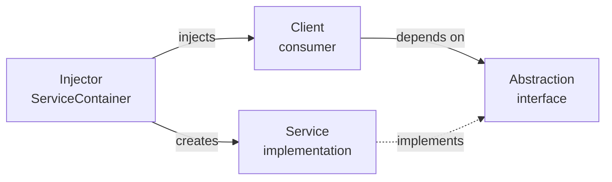

[All products](../) / [Saraff.IoC](./index.md)
# Dependency Injection

**Dependency Injection (DI)** is a design pattern that implements Inversion of Control for
object creation. Instead of a class creating its dependencies, the dependencies are supplied
from outside.

A DI scenario involves three roles:

| Role | Responsibility |
|---|---|
| **Client** (consumer) | Depends on abstractions and uses them |
| **Service** (dependency) | Provides behavior through an abstraction |
| **Injector** | Creates the service and passes it to the client |

In Saraff.IoC the injector is the `ServiceContainer`.



## Three ways to inject

### 1. Constructor injection

The dependency is passed through the constructor. This is the most common and the safest form:
the object cannot be created without its dependencies.

```csharp
public sealed class UserLogic {
    private readonly IAuthService _authService;
    private readonly IEmailService _emailService;

    [ServiceRequired]
    public UserLogic(IAuthService authService, IEmailService emailService) {
        this._authService = authService;
        this._emailService = emailService;
    }

    public void Register(string emailAddress, string password) {
        var result = this._authService.RegisterUser(emailAddress, password);
        this._emailService.SendMail(emailAddress, result.ConfirmationMessage);
    }
}
```

```csharp
container.Register<IAuthService, OAuthService>();
container.Register<IEmailService, EmailService>();
container.Register<UserLogic, UserLogic>();

var logic = container.Resolve<UserLogic>();
```

### 2. Property (setter) injection

The dependency is assigned to a public property after construction. Use it when the dependency
is optional or when the object is created by a framework that requires a parameterless
constructor.

```csharp
public sealed class UserLogic {
    [ServiceRequired]
    public IAuthService AuthService { get; set; }

    [ServiceRequired]
    public IEmailService EmailService { get; set; }

    public void Register(string emailAddress, string password) {
        var result = this.AuthService.RegisterUser(emailAddress, password);
        this.EmailService.SendMail(emailAddress, result.ConfirmationMessage);
    }
}
```

### 3. Method injection

The dependency is passed to a method. In Saraff.IoC this is available through a proxy: mark
the class with `[ProxyRequired]` and the parameter with `[ServiceRequired]`.

```csharp
public interface IUserLogic {
    void Register(string emailAddress, string password, IEmailService emailService);
}

[ProxyRequired]
public sealed class UserLogic : Component, IUserLogic {
    public void Register(
        string emailAddress,
        string password,
        [ServiceRequired] IEmailService emailService) {

        var result = new RegistrationResult();
        emailService.SendMail(emailAddress, result.ConfirmationMessage);
    }
}
```

Register and resolve it as `IUserLogic`; the proxy fills `emailService` when the caller passes
`null`.

See [Injection Patterns](./InjectionPatterns.md) for the full list, including lazy injection,
`IEnumerable<T>` and context-aware injection.

## Why constructor injection is the default choice

| Criterion | Constructor | Property | Method |
|---|---|---|---|
| Object is always valid after creation | Yes | Not guaranteed | No |
| Dependencies are explicit | Yes | Less explicit | Local to the method |
| Works without a proxy | Yes | Yes | No (`[ProxyRequired]`) |
| Easy to unit test | Yes | Yes | Yes |
| Recommended for required dependencies | Yes | No | No |

## DI without a container

You can apply DI manually:

```csharp
var auth = new OAuthService();
var email = new EmailService();
var logic = new UserLogic(auth, email);
```

A container is useful when the object graph grows, when lifetimes matter, or when you need
scopes and interception. The pattern stays the same; the container only automates the wiring.

## Read next

* [Inversion of Control](./InversionOfControl.md)
* [Dependency Inversion Principle](./DependencyInversionPrinciple.md)
* [IoC Container](./IoCContainer.md)
* [Injection Patterns](./InjectionPatterns.md)
