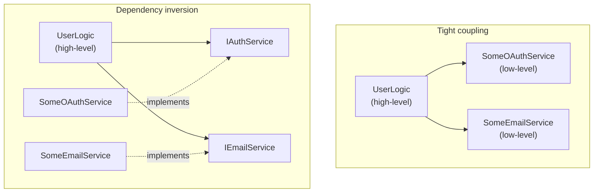

[All products](../) / [Saraff.IoC](./index.md)
# Dependency Inversion Principle

The **Dependency Inversion Principle (DIP)** is one of the SOLID principles. It says two things:

1. **High-level modules should not depend on low-level modules. Both should depend on
   abstractions.**
2. **Abstractions should not depend on details. Details should depend on abstractions.**

In other words: business logic should not know whether data is stored in SQL Server, a file or
a web service. It should know only the abstraction it uses.



## A tightly coupled example

```csharp
public sealed class UserLogic {
    private readonly SomeOAuthService _authService = new SomeOAuthService();
    private readonly SomeEmailService _emailService = new SomeEmailService();

    public void Register(string emailAddress, string password) {
        var result = this._authService.RegisterUser(emailAddress, password);
        this._emailService.SendMail(emailAddress, result.ConfirmationMessage);
    }
}

public sealed class SomeOAuthService {
    public RegistrationResult RegisterUser(string emailAddress, string password) {
        // register a new user
        return new RegistrationResult();
    }
}

public sealed class SomeEmailService {
    public void SendMail(string emailAddress, string message) {
        // send an email
    }
}
```

Changing `SomeEmailService` means changing `UserLogic`. If the same service is used in many
places, the change spreads through the codebase.

## The same code with DIP

```csharp
public interface IAuthService {
    RegistrationResult RegisterUser(string emailAddress, string password);
}

public interface IEmailService {
    void SendMail(string emailAddress, string message);
}

public sealed class UserLogic {
    private readonly IAuthService _authService;
    private readonly IEmailService _emailService;

    [ServiceRequired]
    public UserLogic(IAuthService authService, IEmailService emailService) {
        this._authService = authService;
        this._emailService = emailService;
    }

    public void Register(string emailAddress, string password) {
        var result = this._authService.RegisterUser(emailAddress, password);
        this._emailService.SendMail(emailAddress, result.ConfirmationMessage);
    }
}
```

Both `UserLogic` and the implementations now depend on abstractions. The concrete classes are
selected at the composition root:

```csharp
using (var container = new ServiceContainer()) {
    container.Register<IAuthService, SomeOAuthService>();
    container.Register<IEmailService, SomeEmailService>();
    container.Register<UserLogic, UserLogic>();

    var logic = container.Resolve<UserLogic>();
    logic.Register("user@example.com", "secret");
}
```

## DIP and DI are not the same

* **DIP** is a principle about the direction of dependencies.
* **DI** is a pattern for supplying dependencies from outside.
* **IoC** is the broader principle of inverting control.
* A container is a tool that helps apply DI at scale.

You can follow DIP without a container (manual constructor calls), and you can use a container
without following DIP (registering concrete classes everywhere). The best results come from
using both together.

## Read next

* [Inversion of Control](./InversionOfControl.md)
* [Dependency Injection](./DependencyInjection.md)
* [IoC Container](./IoCContainer.md)
