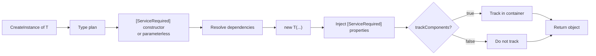
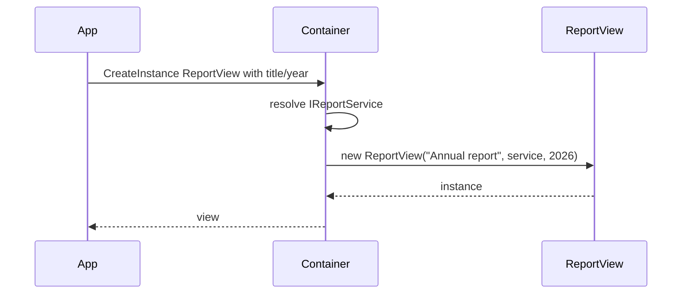

[All products](../) / [Saraff.IoC](./index.md)
# Factories and `CreateInstance`

The container can create an object even when it is not registered. This is useful for
controllers, view models, commands and other objects that are created on demand but still need
dependency injection.

## `CreateInstance`

```csharp
using (var container = new ServiceContainer()) {
    container.Register<IGreeting, Greeting>();

    var consumer = container.CreateInstance<CtorConsumer>();
    // equivalent:
    // var consumer = (CtorConsumer)container.CreateInstance(typeof(CtorConsumer));
}
```

```csharp
public sealed class CtorConsumer {
    [ServiceRequired]
    public CtorConsumer(IGreeting greeting) {
        this.Greeting = greeting;
    }

    public IGreeting Greeting { get; }
}
```

`CreateInstance`:

* resolves constructor and property dependencies the same way as `Resolve`;
* does **not** require the type to be registered;
* does **not** use the type's registration lifetime — it always creates a new object;
* tracks the created `IComponent`/`IDisposable` in the container by default;
* throws `ServiceResolutionException` when no suitable constructor exists.



## Constructor arguments

When you need to pass values that are not registered, use `CtorCallback`:

```csharp
public sealed class ReportView {
    [ServiceRequired]
    public ReportView(
        string title,
        IReportService service,
        int year) {

        this.Title = title;
        this.Service = service;
        this.Year = year;
    }

    public string Title { get; }
    public IReportService Service { get; }
    public int Year { get; }
}
```

```csharp
var view = container.CreateInstance<ReportView>(
    x => x("title", "Annual report"),
    x => x("year", 2026));
```

The callback receives the parameter name and value. Parameters that are not supplied are
resolved from the container. Value-type parameters (such as `int`) cannot be resolved from the
container, so supply them explicitly.



## Tracking created objects

By default, `CreateInstance<T>()` tracks the created object:

* if it implements `IComponent`, it is added to `container.Components`;
* if it implements `IDisposable`, it is disposed with the container/scope.

Pass `trackComponents: false` when the caller owns the object:

```csharp
var view = container.CreateInstance<ReportView>(false, x => x("title", "Draft"));
// The container will not dispose the view.
```

```csharp
using (var container = new ServiceContainer()) {
    var tracked = container.CreateInstance<DisposableService>();
    var untracked = container.CreateInstance<DisposableService>(false);
}
// tracked.Disposed == true
// untracked.Disposed == false
```

## Non-generic overloads

```csharp
object a = container.CreateInstance(
    typeof(ReportView),
    x => x("title", "Annual report"),
    x => x("year", 2026));

object b = container.CreateInstance(
    typeof(ReportView),
    false,
    x => x("title", "Annual report"),
    x => x("year", 2026));
```

## `Resolve` vs `CreateInstance`

| | `Resolve<T>()` | `CreateInstance<T>()` |
|---|---|---|
| Uses a registration if present | Yes | No |
| Uses lifetime | Yes | No, always creates |
| Uses registered implementation | Yes | No |
| Can create an unregistered concrete type | No, returns `null` | Yes |
| Constructor args | No | Yes |
| Tracking | Yes | Yes (unless disabled) |
| Typical use | Application services | Controllers, view models, commands |

`Resolve<T>()` first looks for a registration. If none exists, it falls back to legacy
bindings and returns `null` otherwise. `CreateInstance<T>()` always creates the requested
concrete type.

## Factory registrations vs `CreateInstance`

A **factory registration** is used when a service is resolved from the container:

```csharp
container.Register<IPlugin>(provider => new Plugin(provider));
var plugin = container.Resolve<IPlugin>(); // factory is called
```

`CreateInstance` is used when the caller wants a new object directly:

```csharp
var view = container.CreateInstance<ReportView>(); // always new
```

## `IContainerCore.CreateInstance`

The neutral core API exposes the same operation with a dictionary of arguments:

```csharp
IContainerCore core = container;

var args = new Dictionary<string, object> {
    ["title"] = "Annual report",
    ["year"] = 2026
};

var view = (ReportView)core.CreateInstance(typeof(ReportView), true, args);
```

This form is convenient for framework integrations that do not want to depend on the
`CtorCallback` delegate. See [Customization](./Customization.md).

## See also

* [Registration](./Registration.md)
* [Injection Patterns](./InjectionPatterns.md)
* [Lifetimes and Scopes](./Lifetimes.md)
* [Customization](./Customization.md)
