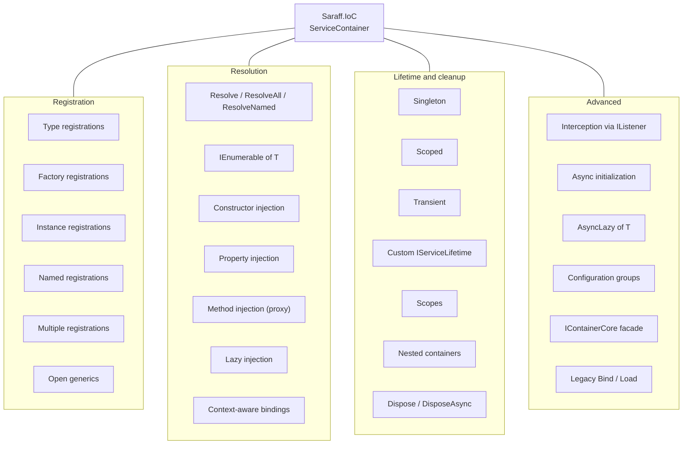

[All products](../) / [Saraff.IoC](./index.md)
# Saraff.IoC Container Features

Saraff.IoC combines a small, predictable core with the features needed by real applications:
lifetimes, scopes, multiple registrations, interception and asynchronous startup.

## Feature map

## Supported scenarios

| Feature | Status | Notes |
|---|---|---|
| Constructor injection | Yes | Mark the constructor with `[ServiceRequired]` |
| Property injection | Yes | Mark properties with `[ServiceRequired]` |
| Method injection | Yes | Requires `[ProxyRequired]` on the class |
| Lazy injection | Yes | `Saraff.IoC.Lazy<T>` delegate |
| Context-aware injection | Yes | `IContextBinder<TService, TContext>` |
| `IServiceProvider` | Yes | `ServiceContainer` implements `IServiceProvider` |
| Singleton lifetime | Yes | Default for `Register`; `Bind` is also singleton |
| Scoped lifetime | Yes | One instance per scope |
| Transient lifetime | Yes | New instance per resolution |
| Custom lifetime | Yes | Implement `IServiceLifetime` |
| Named registrations | Yes | `ResolveNamed` |
| Multiple registrations | Yes | `ResolveAll<T>` / `IEnumerable<T>` |
| Open generics | Yes | `Register(typeof(IRepository<>), typeof(Repository<>))` |
| Instance registration | Yes | Container does not dispose the instance |
| Factory registration | Yes | Full control over creation |
| Scopes | Yes | `CreateScope()` |
| Nested containers | Yes | `CreateNestedContainer()` |
| Deterministic disposal | Yes | Disposes tracked services in reverse order |
| Async disposal | `netstandard2.0` | `DisposeAsync()` |
| Async initialization | `netstandard2.0` | `IAsyncInitializable`, `ResolveAsync` |
| Interception | Yes | `[ProxyRequired]`, `IListener` |
| Custom configuration | Yes | Configuration groups + snapshot |
| Neutral core API | Yes | `IContainerCore` |
| Legacy `Bind` / `Load` | Yes | Requires `IComponent` for type bindings |

## Design goals

* **Lightweight.** No external container framework is required; the public API is small.
* **Predictable.** The lifetime rules are explicit and the same in every container.
* **Thread-safe.** Public operations are safe for concurrent use. Singletons are created once
  even when many threads resolve them at the same time.
* **Testable.** Services depend on abstractions; the container can be replaced with a fake
  `IServiceProvider` in tests.
* **Extensible.** Every important policy (lifetime, registration descriptor, async adapter,
  invocation result) can be replaced.
* **Backward compatible.** The original `Bind`/`Load` API and `[BindService]` attributes keep
  working next to the new `Register` API.

## What Saraff.IoC is not

* It is not a full application framework: it does not scan assemblies automatically unless you
  call `Load`.
* It does not use a service locator by default; injection happens through marked constructors,
  properties and parameters.
* It does not hide lifetime mistakes. A singleton that depends on a scoped service is allowed
  by the container but is usually a design error; see
  [Lifetimes and Scopes](./Lifetimes.md#captive-dependencies).

## See also

* [Getting Started](./GettingStarted.md)
* [Registration](./Registration.md)
* [Lifetimes and Scopes](./Lifetimes.md)
* [API Reference](./ApiReference.md)
