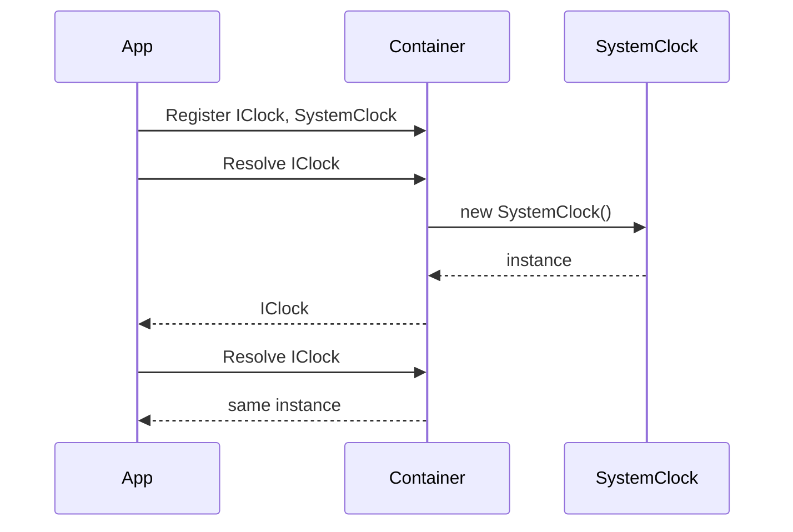
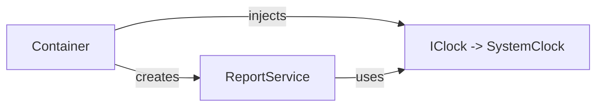
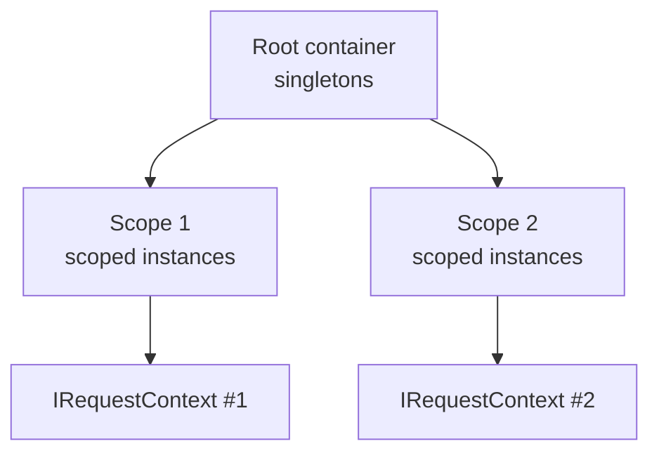

[All products](../) / [Saraff.IoC](./index.md)
# Getting Started

This page takes you from an empty project to a working container with constructor injection,
a scope and deterministic disposal.

## 1. Install

```powershell
dotnet add package Saraff.IoC
```

Or add a package reference manually:

```xml
<ItemGroup>
  <PackageReference Include="Saraff.IoC" Version="2.0.0" />
</ItemGroup>
```

| Target | Async initialization | `DisposeAsync` | `AsyncLazy<T>` |
|---|---|---|---|
| `netstandard2.0` | Yes | Yes | Yes |
| `net40` | No | No | Yes |

The `net40` assembly is fully synchronous. Async APIs are available only in the
`netstandard2.0` assembly.

## 2. Define an abstraction and an implementation

```csharp
using Saraff.IoC;

public interface IClock {
    DateTime Now { get; }
}

public sealed class SystemClock : IClock {
    public DateTime Now => DateTime.Now;
}
```

## 3. Create a container and register the service

```csharp
using System;
using Saraff.IoC;

using (var container = new ServiceContainer()) {
    container.Register<IClock, SystemClock>();

    var clock = container.Resolve<IClock>();
    Console.WriteLine(clock.Now);
}
```

`Register<IClock, SystemClock>()` uses the default **singleton** lifetime: the container creates
`SystemClock` once and returns the same instance for every resolution.



## 4. Inject the dependency into a consumer

Mark the constructor with `[ServiceRequired]`. Parameters are resolved by type.

```csharp
public sealed class ReportService {
    private readonly IClock _clock;

    [ServiceRequired]
    public ReportService(IClock clock) {
        this._clock = clock;
    }

    public string BuildHeader() => $"Report generated at {this._clock.Now:O}";
}
```

```csharp
using (var container = new ServiceContainer()) {
    container.Register<IClock, SystemClock>();
    container.Register<ReportService, ReportService>();

    var report = container.Resolve<ReportService>();
    Console.WriteLine(report.BuildHeader());
}
```



> **Important:** the container selects a constructor that is explicitly marked with
> `[ServiceRequired]`. If no constructor is marked, it uses the parameterless constructor.
> It does not guess between several public constructors.

## 5. Use a scope for per-request state

A scope is an isolated resolution context. Scoped services are created once per scope and
disposed with that scope.

```csharp
public interface IRequestContext {
    Guid Id { get; }
}

public sealed class RequestContext : IRequestContext, IDisposable {
    public Guid Id { get; } = Guid.NewGuid();

    public void Dispose() {
        // release request-specific resources
    }
}
```

```csharp
using (var container = new ServiceContainer()) {
    container.Register<IRequestContext, RequestContext>(ServiceLifetime.Scoped);

    using (var request1 = container.CreateScope()) {
        var a = request1.Resolve<IRequestContext>();
        var b = request1.Resolve<IRequestContext>();
        // a and b are the same instance
    }

    using (var request2 = container.CreateScope()) {
        var c = request2.Resolve<IRequestContext>();
        // c is a different instance
    }
}
```



## 6. Async startup and async disposal (`netstandard2.0`)

If a service needs asynchronous startup, implement `IAsyncInitializable`. Resolve it with
`ResolveAsync` so the container can initialize it (and its dependencies) before returning.

```csharp
public sealed class Database : IDatabase, IAsyncInitializable, IAsyncDisposable {
    public Task InitializeAsync(CancellationToken cancellationToken = default) {
        return this.ConnectAsync(cancellationToken);
    }

    public ValueTask DisposeAsync() {
        return this.DisconnectAsync();
    }

    // ...
}
```

```csharp
await using (var container = new ServiceContainer()) {
    container.Register<IDatabase, Database>(ServiceLifetime.Scoped);

    await using (var scope = container.CreateScope()) {
        var database = await scope.ResolveAsync<IDatabase>();
        // database is created and initialized
    } // scope is disposed asynchronously
}
```

See [Async Initialization](./AsyncInitialization.md) for the full lifecycle.

## 7. Where to go next

* [Registration](./Registration.md) — all registration overloads and rules
* [Lifetimes and Scopes](./Lifetimes.md) — choose the right lifetime
* [Injection Patterns](./InjectionPatterns.md) — property, method, lazy and context injection
* [Interception](./Listener.md) — logging, security and exception mapping
* [Configuration](./Configuration.md) — fine-tune attributes, callbacks and policies
* [Samples](./Samples.md) — downloadable sample applications
