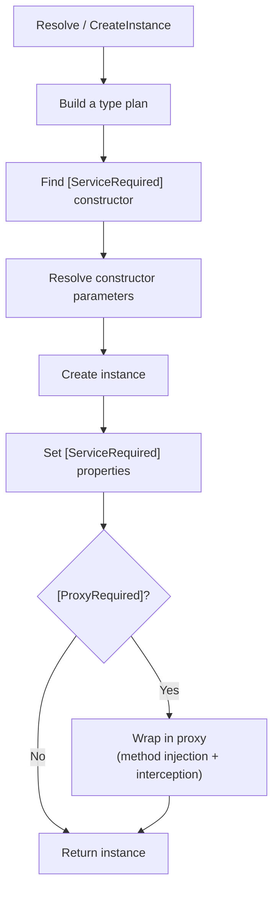
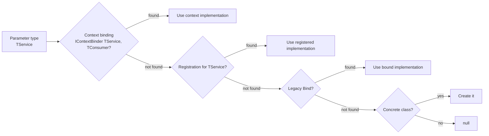
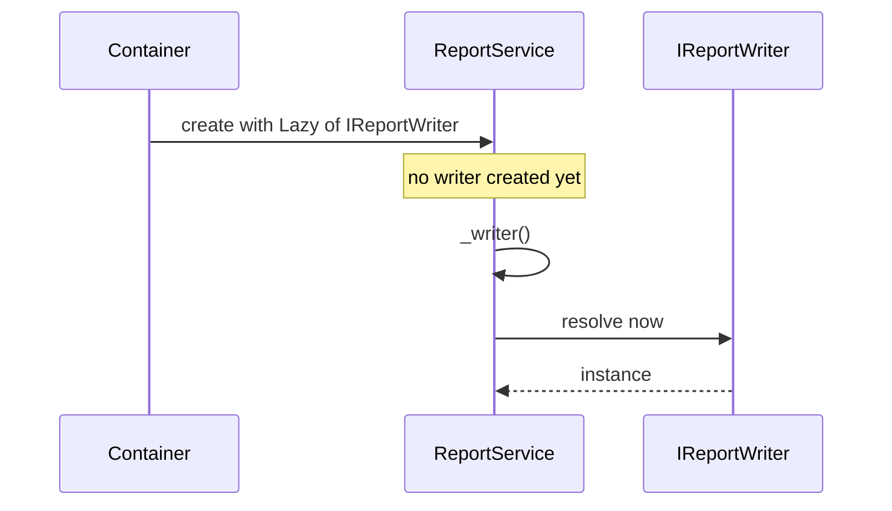
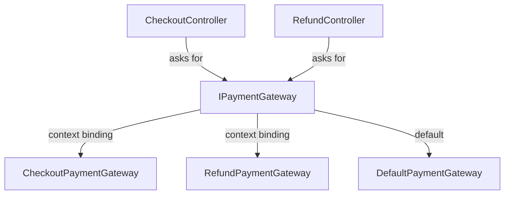

[All products](../) / [Saraff.IoC](./index.md)
# Injection Patterns

Saraff.IoC supports several injection styles. All of them use the same marker attribute,
`[ServiceRequired]`, and the same resolution rules.



## How a dependency is selected

For each constructor parameter or property type, the container tries the following:

1. A **context binding** for the consumer type:
   `IContextBinder<TService, TConsumer>`.
2. A **registration** for `TService` (exact type or open generic).
3. A **legacy binding** for `TService` (if `Bind` was used).
4. If `TService` is a **concrete class**, the container creates it (and injects its own
   dependencies).
5. Otherwise the dependency is `null`.



## Constructor injection

Mark exactly one constructor with `[ServiceRequired]`:

```csharp
public sealed class OrderService {
    private readonly IOrderRepository _repository;
    private readonly ILogger _logger;

    [ServiceRequired]
    public OrderService(IOrderRepository repository, ILogger logger) {
        this._repository = repository;
        this._logger = logger;
    }

    public void Place(Order order) {
        this._logger.Info($"Placing {order.Id}");
        this._repository.Save(order);
    }
}
```

```csharp
container.Register<IOrderRepository, SqlOrderRepository>();
container.Register<ILogger, ConsoleLogger>();
container.Register<OrderService, OrderService>();

var service = container.Resolve<OrderService>();
```

Rules:

* If a constructor is marked, the container uses it.
* If no constructor is marked, the container uses the **parameterless** constructor.
* If there is no marked constructor and no parameterless constructor,
  `ServiceResolutionException` is thrown. The container does not guess.
* Parameters without a registration resolve to `null` (or are created if they are concrete
  classes).

## Property injection

Mark public properties with `[ServiceRequired]`:

```csharp
public sealed class OrderController {
    [ServiceRequired]
    public IOrderService Orders { get; set; }

    [ServiceRequired]
    public ILogger Logger { get; set; }

    public void Place(Order order) {
        this.Logger.Info("Placing order");
        this.Orders.Place(order);
    }
}
```

Property injection runs **after** construction. Use it for optional or framework-created
objects. For required dependencies, constructor injection is safer because it guarantees the
object is fully initialized.

## Method injection

Method injection is available for proxied services. Mark the class with `[ProxyRequired]` and
the injected parameters with `[ServiceRequired]`:

```csharp
[ProxyRequired]
public sealed class ReportService : Component, IReportService {
    public void Export(
        Report report,
        [ServiceRequired] IReportWriter writer,
        [ServiceRequired] ILogger logger) {

        logger.Info("Exporting report");
        writer.Write(report);
    }
}
```

```csharp
container.Bind<IReportService, ReportService>();
container.Bind<IReportWriter, PdfReportWriter>();
container.Bind<ILogger, ConsoleLogger>();

var service = container.Resolve<IReportService>();
service.Export(report, null, null); // parameters are filled by the proxy
```

The proxy fills a parameter only when the caller passes `null` and the parameter is marked with
`[ServiceRequired]`. This keeps method injection explicit and avoids surprising replacements of
caller-provided values.

> Method injection requires a proxy. See [Interception and Listeners](./Listener.md) for the
> proxy pipeline and the supported method shapes.

## Lazy injection

`Saraff.IoC.Lazy<T>` is a delegate that resolves the service when you call it:

```csharp
public sealed class ReportService {
    private readonly Lazy<IReportWriter> _writer;

    [ServiceRequired]
    public ReportService(Lazy<IReportWriter> writer) {
        this._writer = writer;
    }

    public void Export(Report report) {
        // The writer is resolved only here, on first use.
        this._writer().Write(report);
    }
}
```

Lazy injection is useful for:

* breaking a dependency cycle;
* deferring expensive construction;
* resolving a service only on a code path that needs it.



## `IEnumerable<T>` injection

When a constructor asks for `IEnumerable<T>`, the container injects **all** registrations of
`T`:

```csharp
public sealed class PluginHost {
    private readonly IEnumerable<IPlugin> _plugins;

    [ServiceRequired]
    public PluginHost(IEnumerable<IPlugin> plugins) {
        this._plugins = plugins;
    }

    public void RunAll() {
        foreach (var plugin in this._plugins) {
            plugin.Run();
        }
    }
}
```

```csharp
container.Register<IPlugin, EmailPlugin>(ServiceLifetime.Transient);
container.Register<IPlugin, SmsPlugin>(ServiceLifetime.Transient);
container.Register<PluginHost, PluginHost>();
```

The order is the same as `ResolveAll<T>()`: current container first, then parents.

## Context-aware injection

Sometimes the same abstraction should resolve to different implementations depending on the
**consumer**. Use `IContextBinder<TService, TContext>` as the registration key:

```csharp
public sealed class CheckoutController {
    [ServiceRequired]
    public CheckoutController(IPaymentGateway gateway) {
        this.Gateway = gateway;
    }

    public IPaymentGateway Gateway { get; }
}

public sealed class RefundController {
    [ServiceRequired]
    public RefundController(IPaymentGateway gateway) {
        this.Gateway = gateway;
    }

    public IPaymentGateway Gateway { get; }
}
```

```csharp
container.Register<IPaymentGateway, DefaultPaymentGateway>();
container.Register(
    typeof(IContextBinder<IPaymentGateway, CheckoutController>),
    typeof(CheckoutPaymentGateway));
container.Register(
    typeof(IContextBinder<IPaymentGateway, RefundController>),
    typeof(RefundPaymentGateway));

var checkout = container.CreateInstance<CheckoutController>();
var refund = container.CreateInstance<RefundController>();

// checkout.Gateway is CheckoutPaymentGateway
// refund.Gateway is RefundPaymentGateway
```



The implementation type does not need to implement `IContextBinder`; the marker interface is
only a resolution key. The same mechanism applies to listeners:
`IContextBinder<IListener, TService>` selects a listener for a specific service type.

## `IServiceProvider`

`ServiceContainer` implements `IServiceProvider`, so it can be used where the standard
abstraction is expected:

```csharp
IServiceProvider provider = container;
var greeting = (IGreeting)provider.GetService(typeof(IGreeting));
```

You can also inject `IServiceProvider` itself. The container does not register itself
automatically, so register the instance first:

```csharp
container.RegisterInstance<IServiceProvider>(container);
```

```csharp
public sealed class LateBoundService {
    private readonly IServiceProvider _provider;

    [ServiceRequired]
    public LateBoundService(IServiceProvider provider) {
        this._provider = provider;
    }

    public void Run() {
        var plugin = (IPlugin)this._provider.GetService(typeof(IPlugin));
        plugin?.Run();
    }
}
```

Prefer constructor injection of the actual dependency. Use `IServiceProvider` only when the
set of services is not known at design time.

> `GetService` and `Resolve<T>` return `null` for unregistered services. They do not create
> arbitrary concrete types on demand; use `CreateInstance<T>` when you need a new object.

## Attribute configuration

The attribute used for injection can be replaced. Set `ServiceRequiredAttributeType` on a
configuration and pass it to the container:

```csharp
var configuration = new ServiceContainerConfiguration {
    ServiceRequiredAttributeType = typeof(MyInjectAttribute)
};

using (var container = new ServiceContainer(configuration)) {
    // [MyInject] is now used instead of [ServiceRequired]
}
```

See [Configuration](./Configuration.md).

## See also

* [Registration](./Registration.md)
* [Lifetimes and Scopes](./Lifetimes.md)
* [Interception and Listeners](./Listener.md)
* [Factories and CreateInstance](./Factory.md)
* [Configuration](./Configuration.md)
