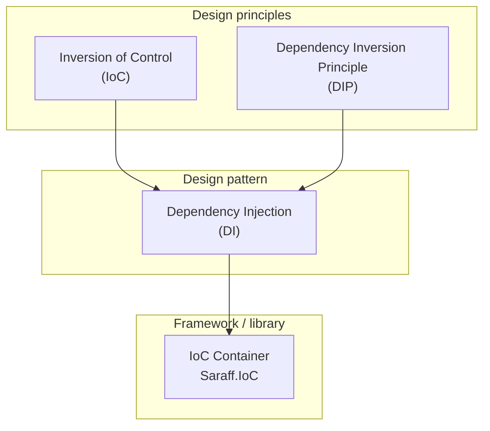

[All products](../) / [Saraff.IoC](./index.md)
# Introduction

The terms **Inversion of Control (IoC)**, **Dependency Inversion Principle (DIP)**,
**Dependency Injection (DI)** and **IoC container** are related, but they are not the same thing.
The following diagram shows how they fit together.



| Term | Kind | What it answers |
|---|---|---|
| **IoC** | Principle | Who controls object creation and the flow of the application? |
| **DIP** | Principle | Which direction should dependencies point? |
| **DI** | Pattern | How are dependencies supplied to a class? |
| **IoC container** | Framework | Who creates objects, injects dependencies and disposes them? |

The principles are recommendations. The pattern is a concrete way to implement the
recommendations. The container is a tool that automates the pattern.

## Why this matters

A class that creates its own dependencies is hard to test and hard to change:

```csharp
public sealed class OrderService {
    private readonly SqlOrderRepository _repository = new SqlOrderRepository();

    public void Place(Order order) {
        this._repository.Save(order);
    }
}
```

`OrderService` is glued to `SqlOrderRepository`. A unit test needs a real database, and replacing
the storage requires editing `OrderService`. With DI, the dependency becomes an abstraction
provided from outside:

```csharp
public interface IOrderRepository {
    void Save(Order order);
}

public sealed class OrderService {
    private readonly IOrderRepository _repository;

    [ServiceRequired]
    public OrderService(IOrderRepository repository) {
        this._repository = repository;
    }

    public void Place(Order order) {
        this._repository.Save(order);
    }
}
```

Now the class depends on an abstraction. The container decides which implementation to pass.

## Read next

* [Inversion of Control](./InversionOfControl.md)
* [Dependency Inversion Principle](./DependencyInversionPrinciple.md)
* [Dependency Injection](./DependencyInjection.md)
* [IoC Container](./IoCContainer.md)
* [Saraff.IoC Container Features](./Features.md)
