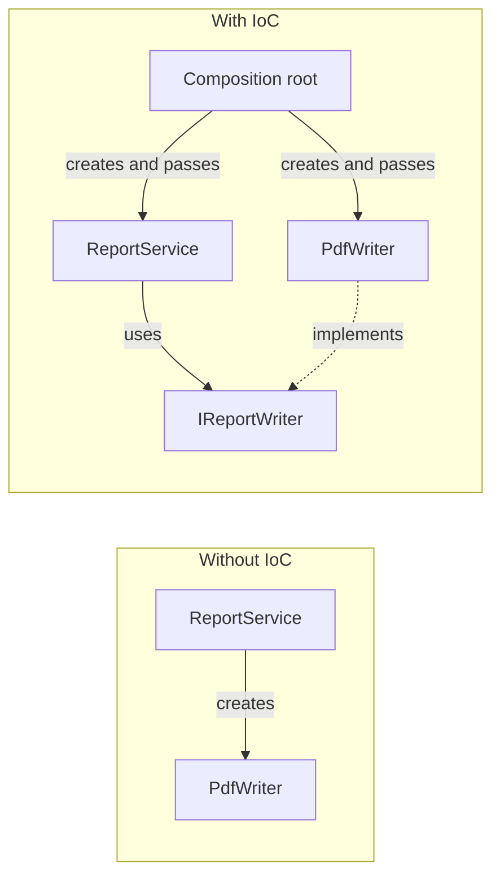

[All products](../) / [Saraff.IoC](./index.md)
# Inversion of Control Principle

**Inversion of Control (IoC)** is a design principle: a class should not control everything it
depends on. Responsibilities such as creating dependencies, choosing implementations and
managing object lifetime are moved outside the class.

The classic analogy: instead of driving a car yourself, you take a taxi. You still decide where
to go, but the driving is delegated. In software, the class keeps its main responsibility and
delegates object creation and wiring to someone else.

## Without IoC

```csharp
public sealed class ReportService {
    private readonly PdfWriter _writer = new PdfWriter();

    public void Export(Report report) {
        this._writer.Write(report);
    }
}
```

`ReportService` controls the creation of `PdfWriter`. It is coupled to a concrete class, hard to
test without producing a PDF, and impossible to switch to another writer without editing the
class.

## With IoC

```csharp
public interface IReportWriter {
    void Write(Report report);
}

public sealed class ReportService {
    private readonly IReportWriter _writer;

    [ServiceRequired]
    public ReportService(IReportWriter writer) {
        this._writer = writer;
    }

    public void Export(Report report) {
        this._writer.Write(report);
    }
}
```

`ReportService` no longer creates the writer. It receives an abstraction. The control over
creation has been inverted: the caller (or the container) decides which writer to use.



## Benefits

* **Loose coupling.** A class depends on abstractions, not on concrete implementations.
* **Testability.** Tests can pass fakes or mocks without touching real infrastructure.
* **Maintainability.** Replacing an implementation does not require editing every consumer.
* **Extensibility.** New implementations can be plugged in through the composition root.

## Relationship to DIP and DI

IoC is the broad principle. The **Dependency Inversion Principle** tells you *which way*
dependencies should point. **Dependency Injection** is one pattern for implementing IoC.
An **IoC container** automates dependency injection.

## Read next

* [Dependency Inversion Principle](./DependencyInversionPrinciple.md)
* [Dependency Injection](./DependencyInjection.md)
* [IoC Container](./IoCContainer.md)
