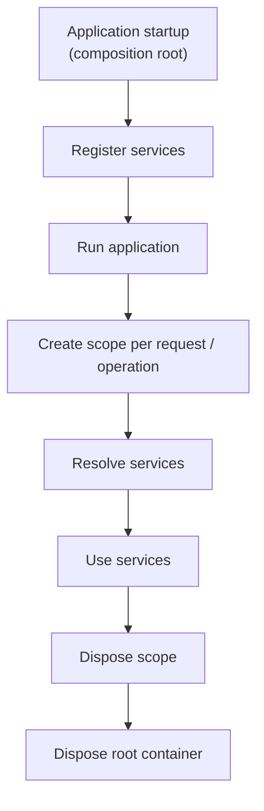
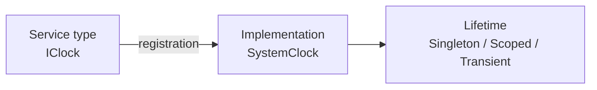
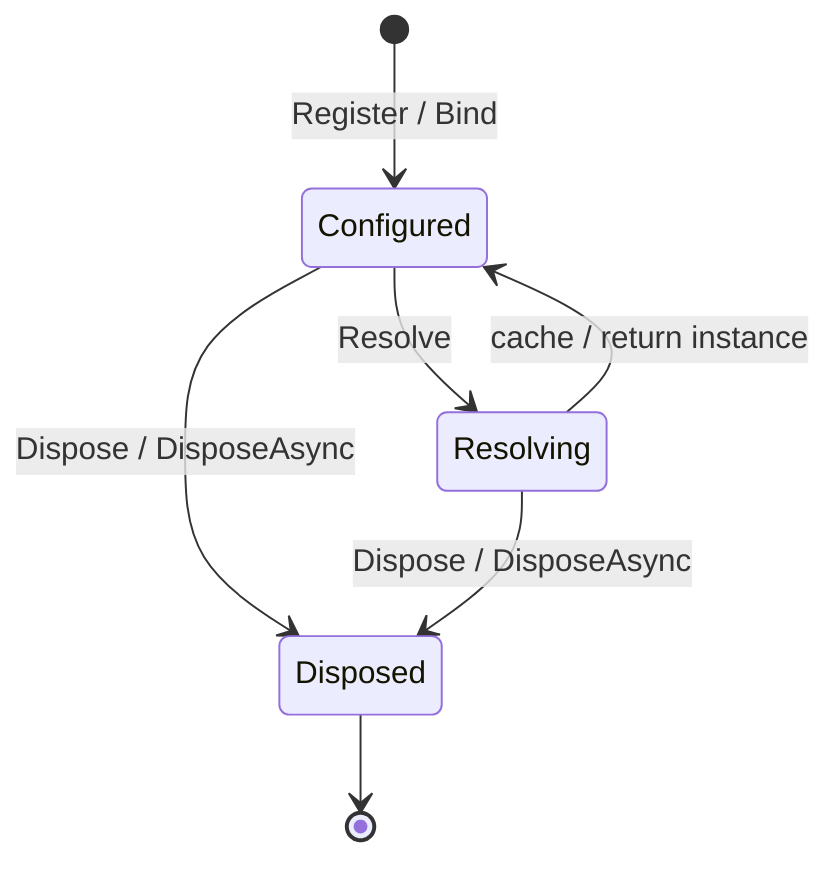

[All products](../) / [Saraff.IoC](./index.md)
# IoC Container

An **IoC container** is a framework that automates dependency injection. Instead of writing
`new` for every dependency, you describe how services are wired, and the container creates
objects, injects dependencies and disposes objects when their lifetime ends.

## The composition root

An application should configure the container once, at startup. This place is called the
**composition root**.



```csharp
public static class Program {
    public static void Main() {
        using (var container = new ServiceContainer()) {
            Configure(container);

            using (var scope = container.CreateScope()) {
                var app = scope.Resolve<Application>();
                app.Run();
            }
        }
    }

    private static void Configure(ServiceContainer container) {
        container.Register<IClock, SystemClock>();
        container.Register<IReportWriter, PdfReportWriter>();
        container.Register<ReportService, ReportService>();
        container.Register<Application, Application>();
    }
}
```

## The three container operations

### Register

Registration tells the container which implementation to use for a service type and how long
an instance should live.

```csharp
container.Register<IClock, SystemClock>();                          // singleton
container.Register<IReportWriter, PdfReportWriter>(ServiceLifetime.Transient);
container.Register<IRequestContext, RequestContext>(ServiceLifetime.Scoped);
```



### Resolve

Resolution asks the container for an instance. The container creates the object if needed,
resolves constructor and property dependencies, and returns the result.

```csharp
var clock = container.Resolve<IClock>();
var writer = container.Resolve<IReportWriter>();
var all = container.ResolveAll<IPlugin>();
var named = container.ResolveNamed<IPlugin>("primary");
```

If a service is not registered, `Resolve` returns `null` instead of throwing. Use
`IsRegistered` or `ResolveAll` when the absence of a registration is normal.

### Release

The container owns the services it creates. `Dispose` releases synchronous resources;
`DisposeAsync` (on `netstandard2.0`) also releases asynchronous resources.

```csharp
using (var container = new ServiceContainer()) {
    // ...
} // Dispose is called automatically
```



## Types of containers in Saraff.IoC

| Type | Created by | Purpose |
|---|---|---|
| **Root container** | `new ServiceContainer()` | Owns singletons and nested containers |
| **Nested container** | `CreateNestedContainer()` | Isolates registrations and can be disposed early |
| **Scope** | `CreateScope()` | Owns scoped instances for a request or operation |

A scope is implemented as a nested container with its own scoped cache. See
[Nested Containers](./Nested.md) and [Lifetimes and Scopes](./Lifetimes.md).

## What the container does not do

* It does not scan assemblies automatically. Call `Load` or register services explicitly.
* It does not select a constructor by "the most parameters". Mark one with
  `[ServiceRequired]`.
* It does not prevent captive dependencies (a singleton holding a scoped service). That is a
  design decision; see [Lifetimes and Scopes](./Lifetimes.md#captive-dependencies).

## Read next

* [Introduction](./Introduction.md)
* [Inversion of Control](./InversionOfControl.md)
* [Dependency Inversion Principle](./DependencyInversionPrinciple.md)
* [Dependency Injection](./DependencyInjection.md)
* [Saraff.IoC Container Features](./Features.md)
* [Getting Started](./GettingStarted.md)
