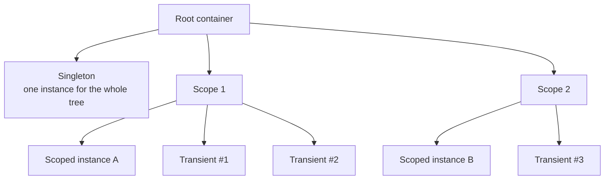
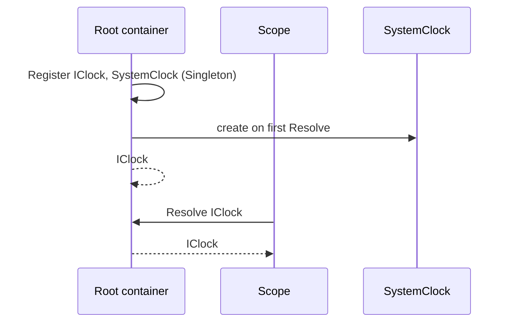
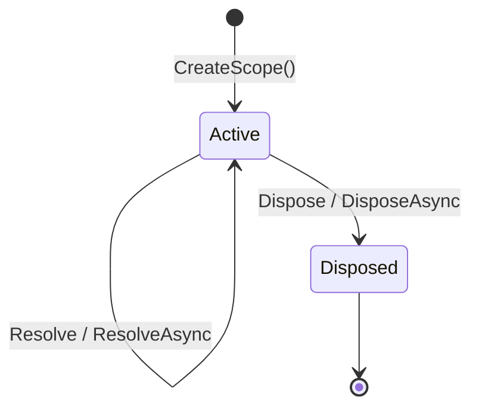
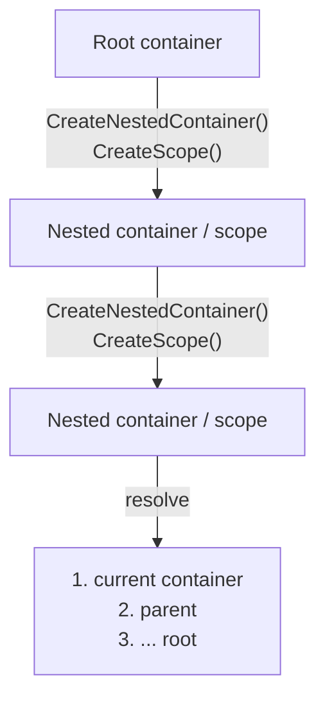

[All products](../) / [Saraff.IoC](./index.md)
# Lifetimes and Scopes

A **lifetime** answers one question: *when the container resolves a service, should it create a
new instance or reuse an existing one?* Saraff.IoC has three built-in lifetimes and supports
custom policies.

| Lifetime | One instance per | Created | Disposed with |
|---|---|---|---|
| `Singleton` | Container where the registration was made | First resolution | Owner container |
| `Scoped` | Scope | First resolution in that scope | Scope |
| `Transient` | Resolution | Every resolution | The resolving scope/container |

`Register` uses `Singleton` by default. `RegisterInstance` and `Bind(instance)` are always
singleton and are not disposed by the container.



## Singleton

One instance is created per owner container and shared by that container and all its
descendants.

```csharp
public interface IClock {
    DateTime Now { get; }
}

public sealed class SystemClock : IClock {
    public DateTime Now => DateTime.Now;
}

container.Register<IClock, SystemClock>(); // Singleton
// or explicitly:
container.Register<IClock, SystemClock>(ServiceLifetime.Singleton);

var a = container.Resolve<IClock>();
var b = container.Resolve<IClock>();
// ReferenceEquals(a, b) == true
```

The singleton is stored in the container where the registration was made. If a parent registers
the service, all children share the parent's instance:

```csharp
using (var root = new ServiceContainer()) {
    root.Register<IClock, SystemClock>();

    using (var scope = root.CreateScope()) {
        // Same instance as root.Resolve<IClock>()
        var clock = scope.Resolve<IClock>();
    }
}
```



## Scoped

A scoped service is created once per scope and shared by everything resolved from that scope.

```csharp
public sealed class RequestContext : IRequestContext, IDisposable {
    public Guid Id { get; } = Guid.NewGuid();

    public void Dispose() {
        // release request resources
    }
}

container.Register<IRequestContext, RequestContext>(ServiceLifetime.Scoped);

using (var request1 = container.CreateScope())
using (var request2 = container.CreateScope()) {
    var a = request1.Resolve<IRequestContext>();
    var b = request1.Resolve<IRequestContext>();
    var c = request2.Resolve<IRequestContext>();

    // ReferenceEquals(a, b) == true
    // ReferenceEquals(a, c) == false
}
```

Scoped instances are stored in the **resolving scope**, even when the registration lives in a
parent container. This is what makes a parent registration usable as a per-request service:

```csharp
using (var root = new ServiceContainer()) {
    root.Register<IRequestContext, RequestContext>(ServiceLifetime.Scoped);

    using (var scope = root.CreateScope()) {
        var context = scope.Resolve<IRequestContext>(); // stored in the scope
    } // context is disposed here
}
```

> If you resolve a scoped service from the root container itself, the root acts as the scope.
> The instance then lives until the root is disposed. Prefer resolving scoped services from a
> real scope.

## Transient

A new instance is created on every resolution. The resolving scope/container tracks disposable
transients it creates and disposes them at the end of its lifetime.

```csharp
container.Register<IReportWriter, PdfReportWriter>(ServiceLifetime.Transient);

var first = container.Resolve<IReportWriter>();
var second = container.Resolve<IReportWriter>();
// ReferenceEquals(first, second) == false
```

## Scope API

`CreateScope()` returns `IServiceScope`:

```csharp
using (var scope = container.CreateScope()) {
    var service = scope.Resolve<IMyService>();
    var named = scope.ResolveNamed<IMyService>("primary");

    // The scope also exposes IServiceProvider:
    var provider = scope.ServiceProvider;
    var fromProvider = (IMyService)provider.GetService(typeof(IMyService));
}
```

On `netstandard2.0` the scope also supports asynchronous resolution and disposal:

```csharp
await using (var scope = container.CreateScope()) {
    var service = await scope.ResolveAsync<IMyService>();
} // DisposeAsync is called automatically
```

After a scope is disposed:

* `scope.ServiceProvider` throws `ObjectDisposedException`.
* `Resolve`, `ResolveNamed`, `ResolveAsync` and `InitializeAsync` throw
  `ObjectDisposedException`.



## Ownership and disposal matrix

| How the service was obtained | Created by | Disposed by |
|---|---|---|
| `Register<T>()` singleton | Owner container | Owner container |
| `Register<T>(Scoped)` | Scope | Scope |
| `Register<T>(Transient)` | Resolving scope/container | Resolving scope/container |
| `Register<T>(factory)` | Factory, tracked by resolver | Resolving scope/container |
| `RegisterInstance<T>(instance)` | Caller | Caller (not the container) |
| `Bind<T>(instance)` | Caller | Caller (not the container) |
| `CreateInstance<T>()` | Container | Container (unless `trackComponents: false`) |
| `CreateInstance<T>(false)` | Caller | Caller (not tracked) |

Disposal rules:

* `IDisposable` services are disposed in reverse order of creation.
* `IComponent` services are added to the container's `Components` collection and disposed with it.
* On `netstandard2.0`, `DisposeAsync()` also awaits `IAsyncDisposable` services.
* `Dispose()` and `DisposeAsync()` are idempotent: calling them twice is safe.
* A parent container disposes its nested containers.
* A nested container can be disposed before its parent; it is then removed from the parent.

## Nested containers and scopes

A scope is a nested container with its own scoped cache. Nested containers are useful for
isolating registrations and for releasing objects early.



Resolution walks upward: current container, then parent, then root. Registrations in a child are
not visible to the parent. See [Nested Containers](./Nested.md).

## Captive dependencies

A **captive dependency** is a long-lived service that captures a short-lived one. For example,
a singleton constructor that asks for a scoped service:

```csharp
// Anti-pattern: the singleton keeps the first scoped instance forever.
public sealed class SingletonService {
    [ServiceRequired]
    public SingletonService(IRequestContext context) {
        this.Context = context; // captured for the lifetime of the singleton
    }

    public IRequestContext Context { get; }
}
```

The container allows this, but the scoped service effectively becomes a singleton. Symptoms:
stale request data, objects used after their scope was disposed, memory leaks.

**Rule of thumb:** a service may depend only on services with the **same or longer** lifetime.

| Consumer lifetime | Can safely depend on |
|---|---|
| Singleton | Singleton |
| Scoped | Scoped, Singleton |
| Transient | Transient, Scoped, Singleton |

## Custom lifetimes

Implement `IServiceLifetime` when the built-in policies are not enough:

```csharp
public sealed class PooledLifetime : IServiceLifetime {
    public object Resolve(IServiceLifetimeContext context) {
        // context.ServiceType, context.Name, context.Owner, context.Scope
        // context.GetOrAddSingleton(), context.GetOrAddScoped(), context.Create()
        return context.GetOrAddSingleton();
    }
}

container.Register(typeof(IGreeting), typeof(Greeting), new PooledLifetime(), "pooled");
```

`IServiceLifetimeContext` exposes:

| Member | Meaning |
|---|---|
| `ServiceType` | Requested service type |
| `Name` | Registration name |
| `Owner` | Container where the registration was made |
| `Scope` | Container/scope performing the resolution |
| `GetOrAddSingleton()` | Use the owner's singleton cache |
| `GetOrAddScoped()` | Use the scope's scoped cache |
| `Create()` | Create a new instance |

The default factory is `DefaultServiceLifetimeFactory.Instance`; replace it through
`IContainerLifetimeConfiguration.ServiceLifetimeFactory` if you need to map the
`ServiceLifetime` enum to custom policies. See [Customization](./Customization.md).

## Async disposal

On `netstandard2.0`:

* `DisposeAsync()` disposes `IAsyncDisposable` services (sync `IDisposable` services too).
* `DisposeAsync()` waits for in-flight `ResolveAsync` / `InitializeAsync` work before disposing.
* Synchronous `Dispose()` throws `InvalidOperationException` if an async-only service was
  tracked. It still disposes the synchronous services first.
* `Component`-based services that implement `IAsyncDisposable` are removed from the component
  collection and disposed asynchronously.

```csharp
await using (var container = new ServiceContainer()) {
    container.Register<IDatabase, Database>(ServiceLifetime.Scoped);

    await using (var scope = container.CreateScope()) {
        var database = await scope.ResolveAsync<IDatabase>();
        // ...
    }
}
```

See [Async Initialization](./AsyncInitialization.md).

## See also

* [Registration](./Registration.md)
* [Nested Containers](./Nested.md)
* [Async Initialization](./AsyncInitialization.md)
* [Troubleshooting](./Troubleshooting.md)
