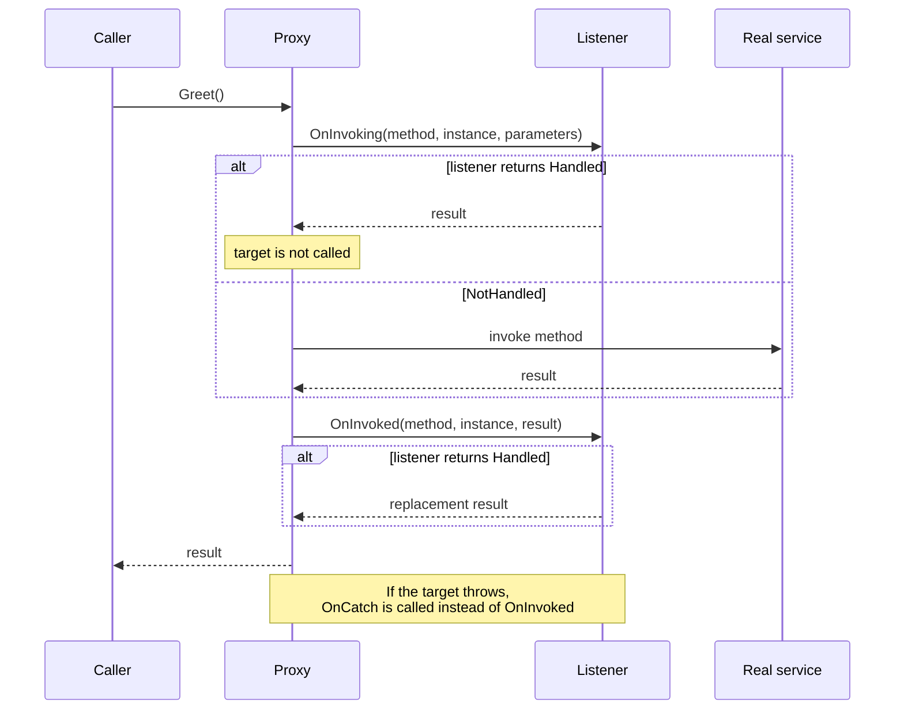
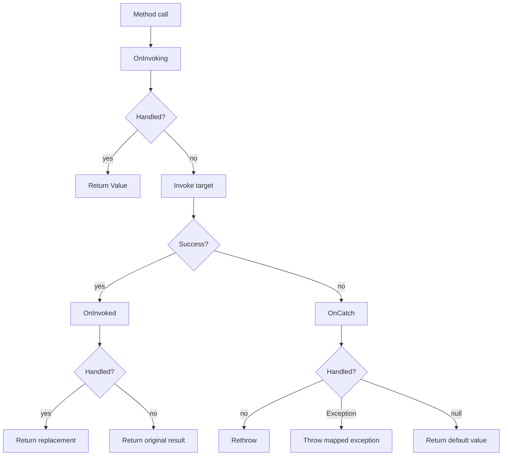
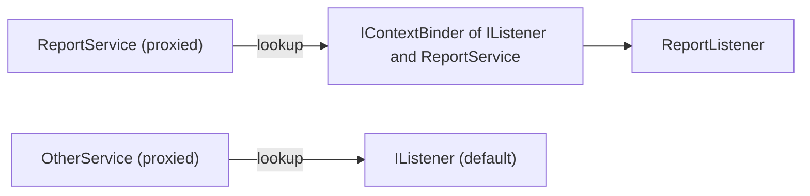

[All products](../) / [Saraff.IoC](./index.md)
# Interception and Listeners

Saraff.IoC can wrap selected services in a proxy and notify a **listener** around every method
call. This is useful for logging, security checks, performance measurement, auditing, unit
testing with mocks and exception translation.

```csharp
[ProxyRequired]
public sealed class GreetingService : Component, IGreeting {
    public string Greet() => "hello";
}
```

```csharp
public sealed class LoggingListener : Component, IListener {
    public InvocationResult OnInvoking(MethodBase method, object instance, object[] parameters) {
        Console.WriteLine($"-> {method.Name}");
        return InvocationResult.NotHandled;
    }

    public InvocationResult OnInvoked(MethodBase method, object instance, object result) {
        Console.WriteLine($"<- {method.Name}: {result}");
        return InvocationResult.NotHandled;
    }

    public InvocationResult OnCatch(MethodBase method, object instance, Exception ex) {
        Console.WriteLine($"!! {method.Name}: {ex.Message}");
        return InvocationResult.NotHandled;
    }
}
```

```csharp
using (var container = new ServiceContainer()) {
    container.Register<IListener, LoggingListener>();
    container.Register<IGreeting, GreetingService>();

    var greeting = container.Resolve<IGreeting>();
    Console.WriteLine(greeting.Greet());
}
```

## The invocation pipeline



The listener receives:

| Callback | When | What it can do |
|---|---|---|
| `OnInvoking` | Before the target method | Inspect/replace parameters, short-circuit the call |
| `OnInvoked` | After a successful call | Replace the result (including with `null`) |
| `OnCatch` | When the target throws | Map the exception, suppress it, or rethrow |

Each callback returns `InvocationResult`:

```csharp
InvocationResult.NotHandled                 // continue the normal pipeline
InvocationResult.FromResult(value)          // take control; use "value" as the result
```

`InvocationResult` is a small struct:

```csharp
public struct InvocationResult {
    public bool Handled { get; }
    public object Value { get; }
}
```

## Short-circuiting a call

Return a handled result from `OnInvoking` to skip the target method:

```csharp
public InvocationResult OnInvoking(MethodBase method, object instance, object[] parameters) {
    if(method.Name == nameof(IGreeting.Greet)) {
        return InvocationResult.FromResult("cached value");
    }
    return InvocationResult.NotHandled;
}
```

This works for methods with return values, `void` methods and methods that would return `null`:

```csharp
return InvocationResult.FromResult(null); // skip the call; void or null result
```

## Replacing the result

`OnInvoked` can replace a successful result:

```csharp
public InvocationResult OnInvoked(MethodBase method, object instance, object result) {
    if(method.Name == nameof(IGreeting.Greet)) {
        return InvocationResult.FromResult(result + " (decorated)");
    }
    return InvocationResult.NotHandled;
}
```

`FromResult(null)` replaces the result with `null`, even if the original method returned a value.

## Handling exceptions

`OnCatch` runs when the target method throws. It can:

* **map** an exception to another exception:

```csharp
public InvocationResult OnCatch(MethodBase method, object instance, Exception ex) {
    return InvocationResult.FromResult(new MyDomainException(ex.Message, ex));
}
```

* **suppress** the exception and return a default value:

```csharp
public InvocationResult OnCatch(MethodBase method, object instance, Exception ex) {
    return InvocationResult.FromResult(null);
}
```

For a value-type return, suppression returns `default(T)` (for example `0` for `int`).

* **rethrow** by returning `NotHandled`:

```csharp
return InvocationResult.NotHandled;
```

`OnCatch` must return either an `Exception`, `null`, or `NotHandled`. Any other value causes
`InvalidOperationException`.



## Method injection through the proxy

A proxied method can receive dependencies through `[ServiceRequired]` parameters. The proxy
fills a parameter only when the caller passes `null`:

```csharp
[ProxyRequired]
public sealed class ReportService : Component, IReportService {
    public void Export(
        Report report,
        [ServiceRequired] IReportWriter writer,
        [ServiceRequired] ILogger logger) {

        writer.Write(report);
        logger.Info("Report exported");
    }
}
```

```csharp
var service = container.Resolve<IReportService>();
service.Export(report, null, null); // writer and logger are injected
```

The proxy preserves `out` and `ref` parameters, supports generic methods and explicit interface
implementations.

## Registering the listener

The listener can be bound or registered:

```csharp
container.Bind<IListener>(listener);                 // existing instance, not disposed
container.Register<IListener, LoggingListener>();  // container creates and disposes it
```

The listener type itself is configurable:

```csharp
var configuration = new ServiceContainerConfiguration {
    ListenerType = typeof(IMyListener)
};
```

If no listener is registered, the proxy still works: the default callbacks return
`NotHandled`, so calls behave as if no interception was configured.

## Context-bound listeners

A specific listener can be selected for a specific service type by registering a context
binding:

```csharp
container.Bind<IContextBinder<IListener, ReportService>, ReportListener>();
```



The lookup order is:

1. `IContextBinder<IListener, TImplementation>` for the concrete proxied type.
2. `IListener` (or the configured listener type).

## Supported method shapes

| Shape | Supported |
|---|---|
| Methods with return values | Yes |
| `void` methods | Yes |
| Generic methods | Yes |
| Explicit interface implementations | Yes |
| `out` / `ref` parameters | Yes |
| Non-generic services | Yes |
| Async methods | Yes, as ordinary methods (the returned `Task` is the result) |

## Proxy implementation

| Target framework | Proxy mechanism |
|---|---|
| `netstandard2.0` | `System.Reflection.DispatchProxy` |
| `net40` | `System.Runtime.Remoting.Proxies.RealProxy` |

The proxy is transparent: callers use the service interface as usual.

## Lifetime of proxied services

Interception does not change lifetimes. A proxied singleton is cached as a singleton; a proxied
transient is created per resolution; a proxied scoped service is cached per scope.

```csharp
container.Register<IProxyService, ProxyService>(); // singleton proxy
container.Register<IListener, LoggingListener>();
```

## Custom invocation results

If you need a custom result type instead of `InvocationResult`, implement `IInvocationResult`
and configure the result callbacks:

```csharp
public readonly struct MyInvocationResult : IInvocationResult {
    public MyInvocationResult(bool handled, object value) {
        this.Handled = handled;
        this.Value = value;
    }

    public bool Handled { get; }
    public object Value { get; }
}

var configuration = new ServiceContainerConfiguration {
    InvokingResultCallback = (listener, method, instance, parameters) =>
        new MyInvocationResult(true, 123)
};
```

See [Customization](./Customization.md).

## See also

* [Injection Patterns](./InjectionPatterns.md)
* [Configuration](./Configuration.md)
* [Customization](./Customization.md)
* [Troubleshooting](./Troubleshooting.md)
