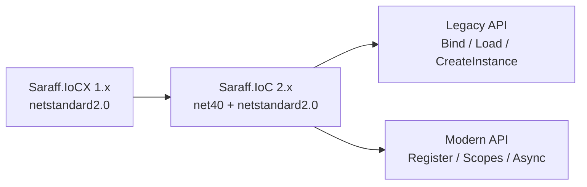

[All products](../) / [Saraff.IoC](./index.md)
# Migration from Saraff.IoCX

`Saraff.IoCX` (netstandard2.0) is superseded by **Saraff.IoC 2.x**, which ships both
`net40` and `netstandard2.0` assemblies under the `Saraff.IoC` package ID.

## Package replacement

```powershell
dotnet remove package Saraff.IoCX
dotnet add package Saraff.IoC
```

```xml
<!-- Before -->
<PackageReference Include="Saraff.IoCX" Version="1.x" />

<!-- After -->
<PackageReference Include="Saraff.IoC" Version="2.0.0" />
```

The namespace `Saraff.IoC` and the `ServiceContainer` type are unchanged. Existing code that
uses `Bind`, `Load`, `CreateInstance` and `[BindService]` continues to work.



## What changed in 2.0

### Added

* `IServiceRegistry` and `IServiceContainer` with `Register`, `Resolve`, `ResolveAll`,
  `ResolveNamed`, `IsRegistered` and `CreateScope`.
* `Singleton`, `Scoped` and `Transient` lifetimes.
* Scopes and nested containers with deterministic disposal.
* Multiple registrations, named registrations, open generics and `IEnumerable<T>`.
* POCO registrations (no `IComponent` requirement for `Register`).
* `ServiceContainerConfiguration` and configuration groups.
* `CircularDependencyException` and `ServiceResolutionException`.
* Async initialization (`IAsyncInitializable`, `ResolveAsync`, `InitializeAsync`).
* Async disposal (`DisposeAsync`) for `netstandard2.0`.
* `AsyncLazy<T>`.
* `IContainerCore` and replaceable policies (`IServiceLifetime`, `IServiceRegistration`,
  `IInvocationResult`, `IAsyncInitializationAdapter`).

### Changed

* A single multi-target project `Saraff.IoC.csproj` (`net40;netstandard2.0`).
  `Saraff.IoCX.csproj`, `Saraff.IoC.nuspec` and `packages.config` are removed.
* Versioning is centralized in `Directory.Build.props`.
* `Dispose` is idempotent; resolution after disposal throws `ObjectDisposedException`.
* Resolution is thread-safe; cycle detection spans nested containers.
* Interception fixes: non-generic proxies, `out`/`ref` propagation, explicit interface
  implementations, generic methods and a configurable service-required attribute.
* `IConfiguration` is an aggregate marker; settings live in group interfaces.
* Configuration is read through an immutable `ContainerSettings` snapshot.
* `ServiceRegistration` is no longer public; the core uses `IServiceRegistration`.
* `ServiceContainer` implements `IContainerCore`.

### Breaking

* Members of `IConfiguration` moved to base group interfaces. Binary compatibility with older
  assemblies is broken; recompile against 2.x.
* `ServiceRegistration.Lifetime` is now `IServiceLifetime` (the type is internal).

## API mapping

| 1.x / `Saraff.IoCX` | 2.x |
|---|---|
| `Bind<IService, Service>()` | `Register<IService, Service>()` (POCO friendly) or keep `Bind` |
| `Bind<IService>(instance)` | `RegisterInstance<IService>(instance)` or keep `Bind` |
| `Load(assembly)` | `Load(assembly)` or explicit `Register` calls |
| `CreateInstance<T>()` | `CreateInstance<T>()` (still available) |
| Singleton only | `Singleton`, `Scoped`, `Transient`, custom `IServiceLifetime` |
| No scopes | `CreateScope()` / `CreateNestedContainer()` |
| `IConfiguration` with all members | `IConfiguration` + configuration groups |
| Listener returns `object` | Listener returns `InvocationResult` |
| No async startup | `IAsyncInitializable`, `ResolveAsync` (`netstandard2.0`) |
| No async disposal | `DisposeAsync` (`netstandard2.0`) |

## Migration steps

1. Replace the package reference.
2. Recompile. Fix any code that implemented the old `IConfiguration` shape.
3. Replace listener implementations that returned `object` with `InvocationResult`.
4. Move new code to `Register` and scopes.
5. Keep `Bind` for existing `Component`-based code; migrate gradually.
6. If you target `netstandard2.0`, use `DisposeAsync` when services hold async resources.

## Listener migration

Before:

```csharp
public object OnInvoking(MethodBase method, object instance, object[] parameters) {
    if(method.Name == "MethodA") {
        return "short";
    }
    return null; // null means "not handled"
}

public object OnInvoked(MethodBase method, object instance, object result) {
    return result;
}

public Exception OnCatch(MethodBase method, object instance, Exception ex) {
    return null; // null means "not handled"
}
```

After:

```csharp
public InvocationResult OnInvoking(MethodBase method, object instance, object[] parameters) {
    if(method.Name == "MethodA") {
        return InvocationResult.FromResult("short");
    }
    return InvocationResult.NotHandled;
}

public InvocationResult OnInvoked(MethodBase method, object instance, object result) {
    return InvocationResult.NotHandled;
}

public InvocationResult OnCatch(MethodBase method, object instance, Exception ex) {
    return InvocationResult.NotHandled;
}
```

The new result type removes the "`null` means not handled" ambiguity: a listener can now
explicitly return `null` as a handled result.

## Configuration migration

Old code implemented `IConfiguration` with all properties. New code can:

* keep `IConfiguration` and implement the base groups;
* use `ServiceContainerConfiguration` or compose it;
* add only the optional group interfaces you need to `IConfiguration`.

```csharp
var configuration = new ServiceContainerConfiguration {
    ServiceRequiredAttributeType = typeof(MyInjectAttribute),
    ListenerType = typeof(IMyListener)
};
```

See [Configuration](./Configuration.md).

## Compatibility notes

* `net40` has no async initialization/disposal. `AsyncLazy<T>` is still available.
* `RegisterInstance` and `Bind(instance)` do not transfer ownership; the caller disposes the
  instance.
* `Resolve<T>()` returns `null` for unregistered services. Check `IsRegistered` if that is not
  expected.
* `Bind` requires `IComponent`; `Register` does not.

## See also

* [Registration](./Registration.md)
* [Lifetimes and Scopes](./Lifetimes.md)
* [Configuration](./Configuration.md)
* [Listener](./Listener.md)
* [Troubleshooting](./Troubleshooting.md)
