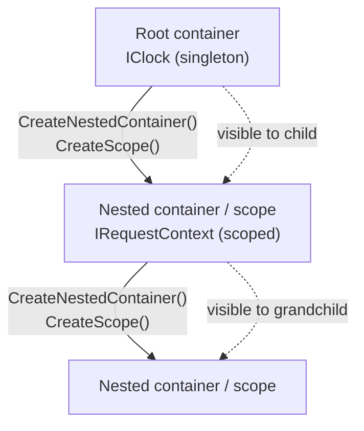
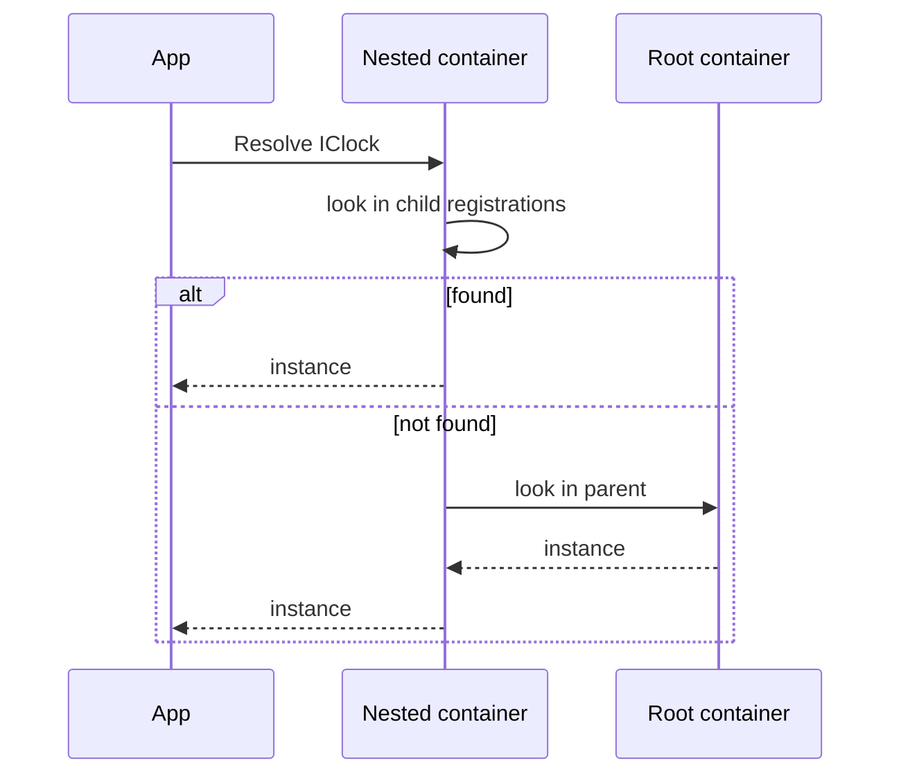
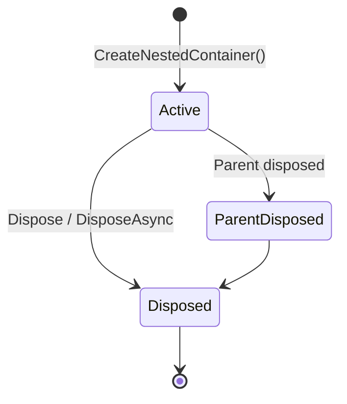
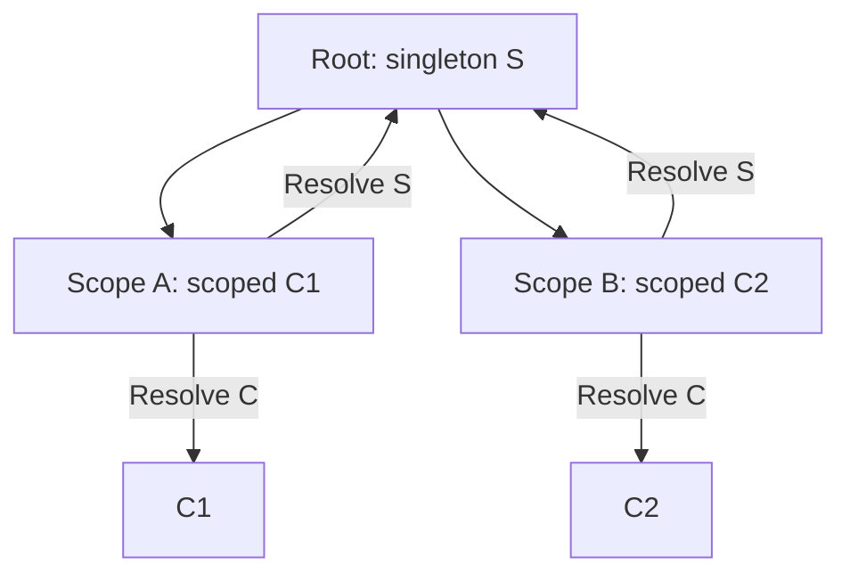

[All products](../) / [Saraff.IoC](./index.md)
# Nested Containers and Scopes

Nested containers let you create an isolated child context that can:

* resolve everything registered in its parent;
* add its own registrations without affecting the parent;
* release objects early without waiting for the root container;
* implement a scope for per-request services.

A **scope** (`CreateScope()`) is a nested container with a dedicated scoped cache and a
convenient `IServiceScope` API.

```csharp
using (var root = new ServiceContainer()) {
    root.Register<IClock, SystemClock>();

    using (var child = root.CreateNestedContainer()) {
        child.Register<IRequestContext, RequestContext>(ServiceLifetime.Scoped);

        var clock = child.Resolve<IClock>();   // from root
        var context = child.Resolve<IRequestContext>(); // owned by child
    } // child and its scoped services are disposed here
} // root is disposed here
```



## Resolution order

Resolution starts at the current container and walks up to the root:



Consequences:

* A child sees all parent registrations.
* A parent does **not** see child registrations.
* If both register the same service, the child's registration wins for resolutions performed
  through the child.
* `ResolveAll<T>()` combines registrations from the current container and all parents.

```csharp
using (var root = new ServiceContainer()) {
    root.Register<IGreeting, RootGreeting>(ServiceLifetime.Transient, "root");

    using (var child = root.CreateNestedContainer()) {
        child.Register<IGreeting, ChildGreeting>(ServiceLifetime.Transient, "child");

        child.ResolveNamed<IGreeting>("root");  // RootGreeting
        child.ResolveNamed<IGreeting>("child"); // ChildGreeting

        var all = child.ResolveAll<IGreeting>(); // ChildGreeting, RootGreeting
    }
}
```

## Isolation

Registrations are isolated in the downward direction:

```csharp
using (var root = new ServiceContainer()) {
    using (var child = root.CreateNestedContainer()) {
        child.Register<IGreeting, Greeting>();

        Assert.NotNull(child.Resolve<IGreeting>());
        Assert.Null(root.Resolve<IGreeting>()); // not visible to the parent
    }
}
```

This is useful for plugins, tests, request-specific overrides and feature modules.

## Disposal

Nested containers have independent lifetimes:

* Disposing a child disposes its scoped/tracked services and removes it from the parent.
* Disposing a parent disposes all remaining children.
* Disposing a child does **not** dispose the parent.
* Disposal is idempotent.
* On `netstandard2.0`, `DisposeAsync` also disposes `IAsyncDisposable` services and nested
  containers.

```csharp
var root = new ServiceContainer();
root.Register<IClock, SystemClock>();

var child = root.CreateNestedContainer();
var clock = child.Resolve<IClock>(); // singleton owned by root

child.Dispose();   // child is released; clock is still alive
root.Dispose();    // clock is disposed here
```



## Scopes

`CreateScope()` is the recommended way to model a request or a unit of work:

```csharp
using (var scope = container.CreateScope()) {
    var request = scope.Resolve<IRequestContext>();
    var handler = scope.Resolve<RequestHandler>();

    handler.Handle(request);
}
```

| | `CreateNestedContainer()` | `CreateScope()` |
|---|---|---|
| Return type | `ServiceContainer` | `IServiceScope` |
| Scoped cache | Yes (it is a container) | Yes |
| `ServiceProvider` property | No (container is a provider) | Yes |
| Intended use | Modules, plugins, isolation | Requests, operations |
| Async methods | Yes (`ResolveAsync`, `DisposeAsync`) | Yes (`ResolveAsync`, `DisposeAsync`) |
| Dispose semantics | Same | Same |

Use `CreateScope()` in application code. Use `CreateNestedContainer()` when you need the full
container API or a long-lived child context.

## Nested containers and lifetimes

* **Singleton** — stored in the container where the registration was made. A child resolving a
  parent singleton gets the parent's instance.
* **Scoped** — stored in the resolving scope (the container on which `Resolve` was called).
  The same parent registration can produce a different scoped instance per scope.
* **Transient** — created per resolution and tracked by the resolving scope/container.



## Cycle detection across containers

Cycle detection works across nested containers. If a dependency chain forms a cycle, the
container throws `CircularDependencyException` with a readable trace:

```text
IoC. Обнаружена циклическая зависимость в "MyApp.ServiceA".
Трассировка:
  в MyApp.ServiceA
  в MyApp.ServiceB
  в MyApp.ServiceA
```

## Thread safety

Creating and disposing nested containers is thread-safe. Concurrent resolutions of a singleton
return the same instance, and concurrent disposal does not deadlock or dispose an object twice.

## See also

* [Lifetimes and Scopes](./Lifetimes.md)
* [Registration](./Registration.md)
* [Async Initialization](./AsyncInitialization.md)
* [Troubleshooting](./Troubleshooting.md)
