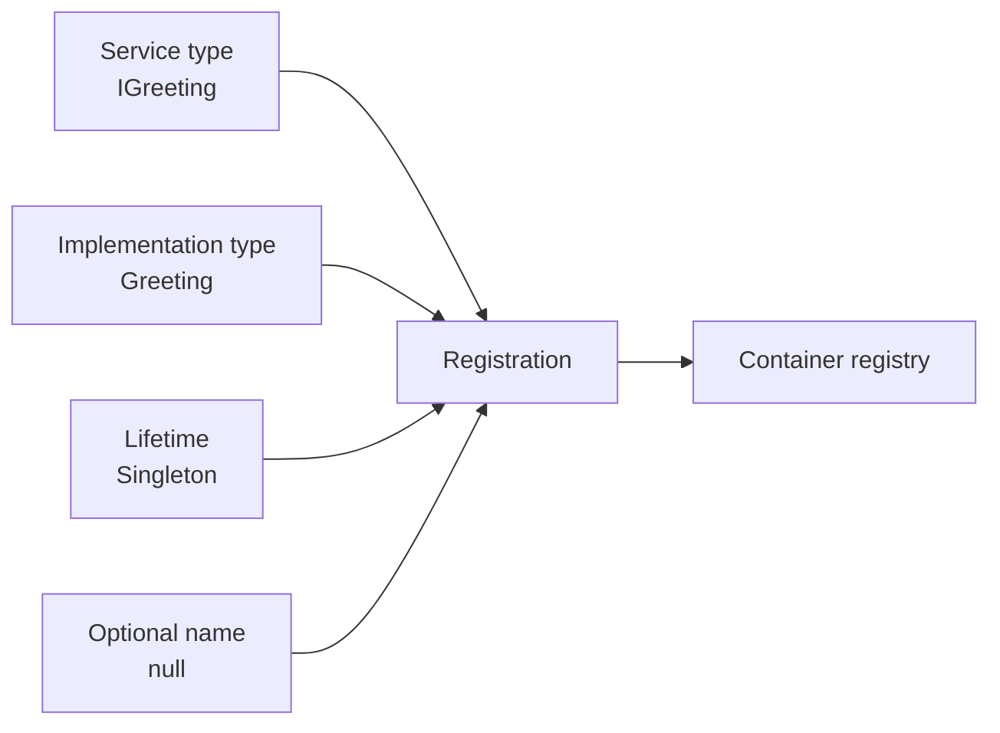
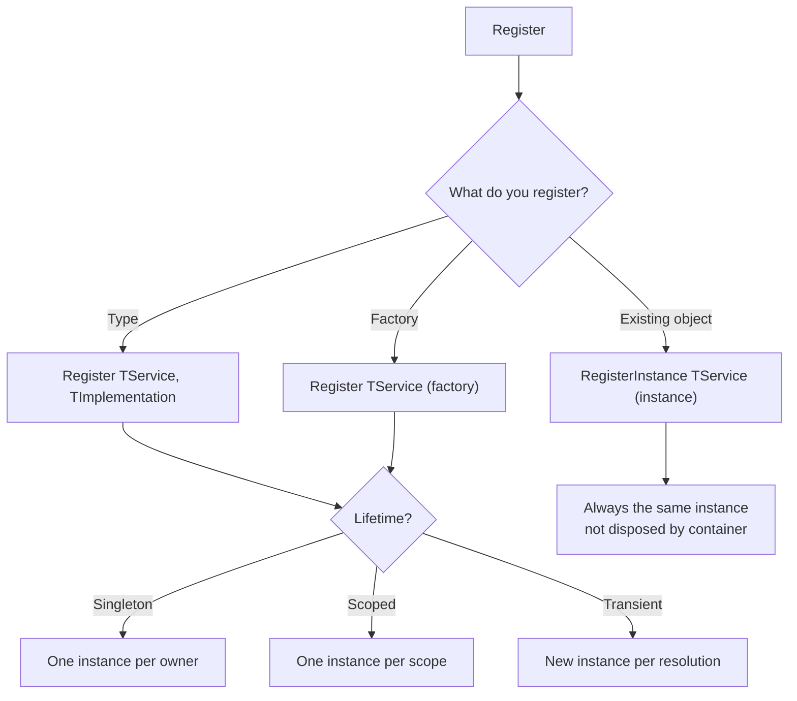
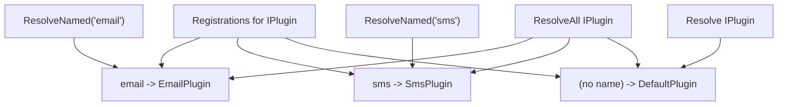

[All products](../) / [Saraff.IoC](./index.md)
# Registration

Registration tells the container **what** to create for a service type and **how long** the
created instance should live. `ServiceContainer` implements `IServiceRegistry`, so the same
operations are available through the interface.

```csharp
using Saraff.IoC;

using (var container = new ServiceContainer()) {
    container.Register<IGreeting, Greeting>();
}
```



## Registration overloads

| Method | Creates | Default lifetime |
|---|---|---|
| `Register<TService, TImplementation>()` | Implementation type | `Singleton` |
| `Register<TService, TImplementation>(ServiceLifetime)` | Implementation type | As specified |
| `Register<TService, TImplementation>(IServiceLifetime)` | Implementation type with custom policy | As specified |
| `Register(Type serviceType, Type implementationType, ...)` | Implementation type (non-generic) | `Singleton` |
| `Register<TService>(Func<IServiceProvider, TService> factory, ...)` | Factory | `Singleton` |
| `Register(Type, Func<IServiceProvider, object> factory, ...)` | Factory (non-generic) | `Singleton` |
| `RegisterInstance<TService>(TService instance, string name = null)` | Existing instance | Always singleton |
| `RegisterInstance(Type serviceType, object instance, string name = null)` | Existing instance | Always singleton |

All overloads accept an optional `name` used by `ResolveNamed`.

> **Default lifetime is `Singleton`.** This is different from some containers that default to
> transient. Choose the lifetime explicitly when it matters.



## Type registrations

```csharp
public interface IGreeting {
    string Greet();
}

public sealed class Greeting : IGreeting {
    public string Greet() => "hello";
}

container.Register<IGreeting, Greeting>(); // singleton
container.Register<IGreeting, Greeting>(ServiceLifetime.Transient);
container.Register<IGreeting, Greeting>(ServiceLifetime.Scoped, "primary");
```

The implementation type does **not** need to inherit from `System.ComponentModel.Component`.
Plain POCOs are supported.

```csharp
public sealed class PlainGreeting : IGreeting {
    public string Greet() => "hello";
}

container.Register<IGreeting, PlainGreeting>(); // works
```

The legacy `Bind` API still requires `IComponent`; see [Bind (legacy API)](./bind.md).

## Factory registrations

A factory gives you full control over creation:

```csharp
container.Register<IPlugin>(provider => {
    var logger = (ILogger)provider.GetService(typeof(ILogger));
    return new Plugin(logger);
});
```

```csharp
container.Register<IClock>(_ => new SystemClock(), ServiceLifetime.Singleton);
```

The factory receives the resolving `IServiceProvider`. If the factory returns `null`, the
service resolves to `null` and is not cached.

## Instance registrations

Use `RegisterInstance` when the object already exists and its lifetime is managed outside the
container:

```csharp
var configuration = new AppConfiguration();
container.RegisterInstance<IAppConfiguration>(configuration);

var same = container.Resolve<IAppConfiguration>();
// ReferenceEquals(configuration, same) == true
```

The container **does not dispose** instances registered with `RegisterInstance` or `Bind<T>(instance)`.

## Named registrations

Names allow several implementations of the same service:

```csharp
container.Register<IPlugin, EmailPlugin>(ServiceLifetime.Transient, "email");
container.Register<IPlugin, SmsPlugin>(ServiceLifetime.Transient, "sms");

var email = container.ResolveNamed<IPlugin>("email");
var sms = container.ResolveNamed<IPlugin>("sms");
```

| Situation | Result |
|---|---|
| `ResolveNamed<IPlugin>("missing")` | `null` |
| `Resolve<IPlugin>()` with only named registrations | `null` |
| `Resolve<IPlugin>()` with a named and an unnamed registration | The **unnamed** registration |
| Several unnamed registrations | The **last registered** unnamed registration |



## Multiple registrations

Every call to `Register` adds a registration. It does not replace the previous one.

```csharp
container.Register<IPlugin, PluginA>(ServiceLifetime.Transient);
container.Register<IPlugin, PluginB>(ServiceLifetime.Transient);

var plugins = container.ResolveAll<IPlugin>().ToList(); // PluginA, PluginB
var same = container.Resolve<IEnumerable<IPlugin>>();  // PluginA, PluginB
```

`ResolveAll<T>()` and `IEnumerable<T>` return registrations in this order:

1. Registrations from the current container, exact type first, then open generic matches.
2. The same for each parent container, moving up to the root.

This makes a nested container able to add plugins without replacing the parent's plugins.

> Multiple registrations that share the same name (including `null`) and a cached lifetime
> (`Singleton` or `Scoped`) share the same cache entry. Give each registration a distinct name,
> or use `Transient`, when you need independent instances.

## Open generics

Register an open generic abstraction against an open generic implementation:

```csharp
public interface IRepository<T> {
    Type ItemType { get; }
}

public sealed class Repository<T> : IRepository<T> {
    public Type ItemType => typeof(T);
}

container.Register(typeof(IRepository<>), typeof(Repository<>));

var customers = container.Resolve<IRepository<Customer>>();
// Repository<Customer>
```

Rules:

* Both types must be open generic definitions or both must be closed.
* The number of generic parameters must match.
* The implementation is closed with the requested type's generic arguments.
* Exact closed registrations and open generic registrations can coexist and are both returned
  by `ResolveAll`.

```csharp
container.Register<IRepository<Customer>, CustomerRepository>(ServiceLifetime.Transient);
container.Register(typeof(IRepository<>), typeof(Repository<>), ServiceLifetime.Transient);

var all = container.ResolveAll<IRepository<Customer>>();
// CustomerRepository + Repository<Customer>
```

## Validation

Invalid registrations throw `ArgumentException` immediately:

```csharp
container.Register(typeof(IGreeting), typeof(PluginA));      // PluginA does not implement IGreeting
container.Register(typeof(IRepository<>), typeof(Repository<Customer>)); // mixed open/closed
container.Register(typeof(IRepository<>), typeof(TwoArgumentRepository<,>)); // arity mismatch
container.RegisterInstance(typeof(IGreeting), new PluginA()); // wrong instance type
```

## Registrations and nested containers

A registration made in a container is visible to that container and all its descendants, but
not to its parent.

```csharp
using (var root = new ServiceContainer()) {
    root.Register<IGreeting, Greeting>();

    using (var child = root.CreateNestedContainer()) {
        child.Register<IGreeting, ChildGreeting>(ServiceLifetime.Transient, "child");

        child.Resolve<IGreeting>();             // Greeting (from root)
        child.ResolveNamed<IGreeting>("child"); // ChildGreeting
    }

    root.ResolveNamed<IGreeting>("child"); // null
}
```

See [Nested Containers](./Nested.md) for details.

## Thread safety

`Register` is thread-safe. Concurrent registrations are all retained; they are not lost or
overwritten. Singletons are created once even when many threads resolve them concurrently.

## See also

* [Lifetimes and Scopes](./Lifetimes.md)
* [Injection Patterns](./InjectionPatterns.md)
* [Nested Containers](./Nested.md)
* [Factories and CreateInstance](./Factory.md)
* [Customization](./Customization.md) — custom lifetimes and registration descriptors
