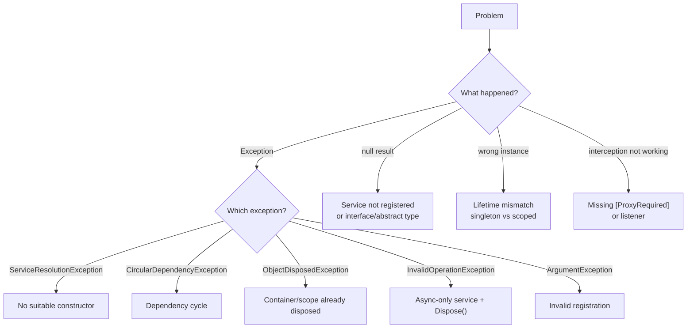

[All products](../) / [Saraff.IoC](./index.md)
# Troubleshooting

This page lists the most common problems and the fastest way to diagnose them.



## `Resolve<T>()` returns `null`

`Resolve` returns `null` when no registration and no legacy binding exist for the requested
type. This is normal for interfaces and abstract classes.

```csharp
var service = container.Resolve<IMyService>();
if(service == null) {
    // IMyService is not registered.
}
```

Fixes:

* Register the service: `container.Register<IMyService, MyService>();`
* Check `container.IsRegistered(typeof(IMyService))`.
* If the dependency is optional, use `ResolveAll<T>()` or handle `null`.
* Remember that `Register(typeof(IMyService), typeof(MyService))` requires `MyService` to
  implement `IMyService`.

> `Resolve<T>()` does not create unregistered concrete types; it returns `null` for them too.
> Use `CreateInstance<T>()` when you need a new object without registration.

## `ServiceResolutionException`

The container could not find a suitable constructor.

```text
IoC. Не удалось найти подходящий конструктор для создания экземпляра "MyApp.MyService".
```

Cause: the type has neither a constructor marked with `[ServiceRequired]` nor a public
parameterless constructor. The container does not guess between constructors.

Fix:

```csharp
public sealed class MyService {
    [ServiceRequired]
    public MyService(IDependency dependency) {
        // ...
    }
}
```

Or add a parameterless constructor if the type really has no dependencies.

## `CircularDependencyException`

A depends on B, and B depends on A (directly or through a longer chain).

```text
IoC. Обнаружена циклическая зависимость в "MyApp.ServiceA".
Трассировка:
  в MyApp.ServiceA
  в MyApp.ServiceB
  в MyApp.ServiceA
```

Fixes:

* Break the cycle with an abstraction and a mediator.
* Use lazy injection (`Lazy<T>`) for one side of the cycle.
* Use method injection for one side.
* Reconsider the design: a cycle often means the responsibilities are mixed.

```csharp
public sealed class ServiceA {
    [ServiceRequired]
    public ServiceA(Lazy<IServiceB> b) {
        this.B = b;
    }

    public Lazy<IServiceB> B { get; }
}
```

## `ObjectDisposedException`

The container or scope has already been disposed. Resolution after disposal is not allowed.

```csharp
var container = new ServiceContainer();
container.Dispose();

container.Resolve<IMyService>(); // ObjectDisposedException
```

A disposed scope behaves the same way:

```csharp
var scope = container.CreateScope();
scope.Dispose();

scope.ServiceProvider;          // ObjectDisposedException
scope.Resolve<IMyService>();    // ObjectDisposedException
```

Do not cache scopes or services from a disposed scope. Create a new scope for each request.

## `InvalidOperationException`: use `DisposeAsync()`

On `netstandard2.0`, synchronous `Dispose()` throws when an async-only service is tracked:

```text
Среди сервисов есть IAsyncDisposable. Используйте DisposeAsync().
```

Fix:

```csharp
await container.DisposeAsync();
// or
await using (var container = new ServiceContainer()) {
    // ...
}
```

Synchronous services have already been disposed when the exception is thrown.

## `ArgumentException` on registration

| Message / cause | Fix |
|---|---|
| Implementation does not implement the service | Register a compatible type |
| Mixed open/closed generic registration | Use both open or both closed |
| Generic arity mismatch | Use the same number of type parameters |
| Instance is not an instance of the service | Pass a compatible instance |
| Service type is not an interface (`Bind`) | `Bind` supports interfaces only; use `Register` |
| Implementation is not a `Component` (`Bind`) | Use `Register`, or derive from `Component` |
| Duplicate `Bind` | Use `Register` for multiple registrations |

## `[ProxyRequired]` has no effect

Check the following:

1. The service is registered or bound. A proxy is created only when the container resolves it.
2. The class is marked with `[ProxyRequired]`.
3. The service is resolved as an interface, not by creating the class manually with `new`.
4. For method injection, the parameter has `[ServiceRequired]` and the caller passes `null`.
5. A listener is registered, if you expect listener callbacks.

```csharp
[ProxyRequired]
public sealed class MyService : Component, IMyService { ... }

container.Register<IMyService, MyService>();
container.Register<IListener, MyListener>();
```

## Interception callbacks are not called

* Is the class marked with `[ProxyRequired]`?
* Is the service resolved through the container (`Resolve`), not created with `new`?
* Is the listener registered or bound? Without a listener, the proxy pipeline still runs but the
  callbacks are no-ops.
* If you use a custom `ListenerType`, is the listener implementation registered under that type?

## Wrong instance / stale data

This is usually a lifetime problem:

| Symptom | Likely cause | Fix |
|---|---|---|
| The same object appears in different requests | Singleton used for request data | Use `Scoped` |
| Request data changes unexpectedly | Captive dependency (singleton captures scoped) | Make the consumer scoped/transient |
| A new object is created every time | `Transient` used for shared state | Use `Singleton` or `Scoped` |
| Disposed object is used | Service escaped a disposed scope | Do not cache scoped services |

See [Lifetimes and Scopes](./Lifetimes.md#captive-dependencies).

## Configuration changes are ignored

Configuration is an immutable snapshot. Mutating the configuration object after the first use
does not affect the container until you call `UseConfiguration` again:

```csharp
configuration.ListenerType = typeof(MyListener);
container.UseConfiguration(configuration);
```

Also note that nested containers created before `UseConfiguration` keep their old settings.

## Async initialization runs twice

A service is initialized once per instance. If initialization appears to run twice, check that
you are not creating two instances:

* `Transient` services are initialized per instance.
* Two different scopes create two scoped instances.
* A factory that returns a new object on each call creates a new instance each time.

Shared instances registered under multiple service types are initialized once.

## Deadlocks or hangs during disposal

`DisposeAsync` waits for in-flight initialization. If an initialization task never completes,
disposal waits forever. Ensure that `InitializeAsync` honors cancellation and does not wait on
the container itself.

## How to diagnose

```csharp
// Is the service registered?
Console.WriteLine(container.IsRegistered(typeof(IMyService)));

// Which container/scope am I using?
Console.WriteLine(container.Parent == null ? "root" : "nested");

// What does the container return?
var service = container.Resolve<IMyService>();
Console.WriteLine(service?.GetType().FullName ?? "<null>");
```

For lifetime issues, log the hash code of the resolved instance and the scope:

```csharp
var service = scope.Resolve<IMyService>();
Console.WriteLine($"{service.GetHashCode()} in scope {scope.GetHashCode()}");
```

## See also

* [Registration](./Registration.md)
* [Lifetimes and Scopes](./Lifetimes.md)
* [Interception and Listeners](./Listener.md)
* [Async Initialization](./AsyncInitialization.md)
* [API Reference](./ApiReference.md)
