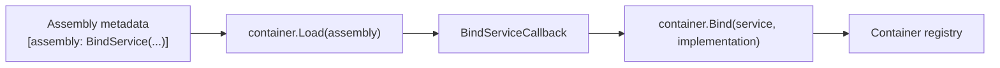
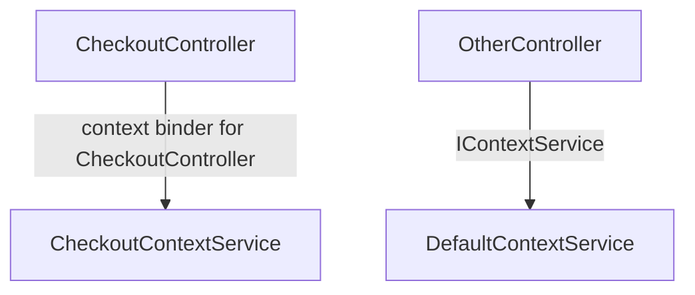

[All products](../) / [Saraff.IoC](./index.md)
# Bind (Legacy API)

`Bind` and `Load` are the original registration API of Saraff.IoC. They are fully supported
and can be used side by side with the newer [`Register`](./Registration.md) API.

> **Prefer `Register` for new code.** `Register` supports POCOs, named registrations, multiple
> registrations, factories and lifetimes. `Bind` is kept for backward compatibility and for
> integration with `System.ComponentModel` components.

## Bind a service to a type

```csharp
public sealed class Service1 : Component, IService1 {
    // ...
}

using (var container = new ServiceContainer()) {
    container.Bind(typeof(IService1), typeof(Service1));
    // or
    container.Bind<IService1, Service1>();
}
```

Requirements:

* The service type must be an **interface**.
* The implementation type must derive from `System.ComponentModel.Component`
  (and therefore implement `IComponent`).
* The bound type is a **singleton** in the container and its descendants.
* Binding the same service twice throws `ArgumentException`.

```csharp
container.Bind<IGreeting, GreetingService>();     // OK
container.Bind<IGreeting, PlainGreeting>();       // InvalidOperationException:
                                                  // PlainGreeting is not a Component
container.Bind<GreetingService, GreetingService>(); // InvalidOperationException:
                                                  // the service type is not an interface
```

## Bind a service to an instance

```csharp
var instance = new Service1();
container.Bind<IService1>(instance);
// or
container.Bind(typeof(IService1), instance);
```

The instance is returned as-is. The container **does not dispose** it. The instance's type must
still be a `Component` because `Bind(instance)` delegates to `Bind(type)`.

```csharp
using (var container = new ServiceContainer()) {
    var instance = new GreetingService();
    container.Bind<IGreeting>(instance);

    var resolved = container.Resolve<IGreeting>();
    // ReferenceEquals(instance, resolved) == true

} // instance is NOT disposed
```

## Bind from assembly attributes

Declare bindings once in an assembly:

```csharp
using Saraff.IoC;

[assembly: BindService(typeof(IService1), typeof(Service1))]
[assembly: BindService(typeof(IService2), typeof(Service2))]
[assembly: BindService(
    typeof(IContextBinder<IService2, MyCustomComponent>),
    typeof(Service2A))]
```

Load them into a container:

```csharp
using (var container = new ServiceContainer()) {
    container.Load(typeof(Program).Assembly);

    var service = container.Resolve<IService1>();
}
```

`Load` scans the assembly for the attribute type configured by
`IContainerBindingConfiguration.BindServiceAttributeType` and calls the configured
`BindServiceCallback`. You can replace the attribute type and the callback through
[configuration](./Configuration.md).



## Contextual binding with `Bind`

`IContextBinder<TService, TContext>` is a resolution key that selects an implementation for a
specific consumer type:

```csharp
container.Bind<IContextService, DefaultContextService>();
container.Bind<IContextBinder<IContextService, CheckoutController>, CheckoutContextService>();

var checkout = container.CreateInstance<CheckoutController>();
var other = container.CreateInstance<OtherController>();

// checkout receives CheckoutContextService
// other receives DefaultContextService
```



## Bind vs Register

| Aspect | `Bind` | `Register` |
|---|---|---|
| Implementation must be `Component` | Yes | No |
| Lifetime control | Singleton only | Singleton, Scoped, Transient, custom |
| Named registrations | No | Yes |
| Multiple registrations | No (duplicate throws) | Yes |
| Factory | No | Yes |
| Instance registration | Yes (`Bind(instance)`) | Yes (`RegisterInstance`) |
| Assembly scanning | Yes (`Load` + `[BindService]`) | Manual |
| Recommended for new code | No | Yes |

Both APIs share the same resolution pipeline. A service bound with `Bind` can be injected into
a service registered with `Register`, and vice versa.

## Duplicate bindings

`Bind` does not replace an existing binding; it throws:

```csharp
container.Bind<IGreeting, GreetingService>();
container.Bind<IGreeting, OtherGreetingService>(); // ArgumentException
```

Use `Register` if you need multiple implementations of the same service:

```csharp
container.Register<IGreeting, GreetingService>(ServiceLifetime.Transient);
container.Register<IGreeting, OtherGreetingService>(ServiceLifetime.Transient);

var all = container.ResolveAll<IGreeting>();
```

## See also

* [Registration](./Registration.md) — the modern API
* [Injection Patterns](./InjectionPatterns.md)
* [Configuration](./Configuration.md)
* [Migration](./Migration.md)
