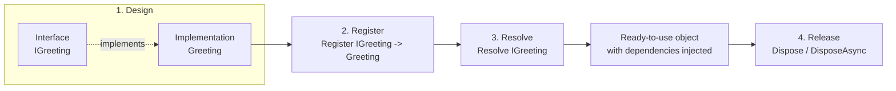

[All products](../)
# Saraff.IoC

**Saraff.IoC** is a lightweight, thread-safe dependency injection (DI) container for .NET.
It helps you split an application into loosely-coupled, highly-cohesive pieces and glue
them back together in a flexible way — with constructor, property and method injection,
scopes, lifetimes, interception and asynchronous initialization.

| | |
|---|---|
| **Package** | [`Saraff.IoC`](https://www.nuget.org/packages/Saraff.IoC/) |
| **Version** | 2.0 |
| **Target frameworks** | `net40`, `netstandard2.0` |
| **Namespace** | `Saraff.IoC` |
| **License** | LGPL-3.0-or-later |

> **Migrating from `Saraff.IoCX`?** The package is now `Saraff.IoC` 2.x. The namespace and
> the `ServiceContainer` type are unchanged. See [Migration](./Migration.md).

## The container in one picture



The container has four responsibilities:

1. **Register** — learn which implementation to create for a service type.
2. **Resolve** — create the object and inject its dependencies.
3. **Control lifetime** — decide whether an instance is reused, scoped or created every time.
4. **Release** — dispose created services and nested scopes at the right moment.

## Quick start

```csharp
using System;
using Saraff.IoC;

public interface IGreeting {
    string Greet();
}

public sealed class Greeting : IGreeting {
    public string Greet() => "hello";
}

using (var container = new ServiceContainer()) {
    container.Register<IGreeting, Greeting>();

    var greeting = container.Resolve<IGreeting>();
    Console.WriteLine(greeting.Greet()); // hello
}
```

Install the package:

```powershell
dotnet add package Saraff.IoC
```

## What is inside

| Area | What you get |
|---|---|
| **Registration** | Type, factory and instance registrations; named registrations; multiple registrations; open generics; `IEnumerable<T>` resolution |
| **Lifetimes** | `Singleton`, `Scoped`, `Transient`; custom lifetimes through `IServiceLifetime` |
| **Scopes** | `CreateScope()` for request/unit-of-work isolation; deterministic disposal |
| **Injection** | Constructor, property, method and lazy injection; context-aware bindings; `IServiceProvider` support |
| **Interception** | `[ProxyRequired]` services, `IListener`, short-circuiting, result replacement, exception mapping |
| **Async** | `IAsyncInitializable`, `ResolveAsync`, `InitializeAsync`, `DisposeAsync`, `AsyncLazy<T>` (`netstandard2.0`) |
| **Extensibility** | Configuration groups, custom lifetimes, registration descriptors, async adapters, neutral `IContainerCore` API |
| **Legacy** | The original `Bind`/`Load`/`[BindService]` API is preserved and works side by side with the new API |

## Documentation map

### Start here

* [Getting Started](./GettingStarted.md) — install, first container, first service
* [Introduction](./Introduction.md) — IoC, DIP, DI and containers in plain language
* [Features](./Features.md) — complete feature matrix

### Core concepts

* [Inversion of Control](./InversionOfControl.md)
* [Dependency Inversion Principle](./DependencyInversionPrinciple.md)
* [Dependency Injection](./DependencyInjection.md)
* [IoC Container](./IoCContainer.md)

### Using the container

* [Registration](./Registration.md) — `Register`, factories, instances, names, open generics
* [Lifetimes and Scopes](./Lifetimes.md) — singleton, scoped, transient, disposal rules
* [Injection Patterns](./InjectionPatterns.md) — constructor, property, method, lazy, context bindings
* [Nested Containers](./Nested.md) — container trees and isolation
* [Factories and `CreateInstance`](./Factory.md) — create objects that are not registered

### Advanced topics

* [Async Initialization](./AsyncInitialization.md) — async startup, async disposal, `AsyncLazy<T>`
* [Interception and Listeners](./Listener.md) — proxies, logging, security, exception handling
* [Configuration](./Configuration.md) — tuning the container through configuration groups
* [Customization](./Customization.md) — `IContainerCore`, custom lifetimes, custom API facade
* [API Reference](./ApiReference.md) — public types at a glance
* [Troubleshooting](./Troubleshooting.md) — common errors and how to fix them

### Legacy, samples and migration

* [Bind (legacy API)](./bind.md)
* [Samples](./Samples.md)
* [Migration from Saraff.IoCX](./Migration.md)

## Design principles

* **Explicit over implicit.** Mark the constructor, property or parameter that needs a dependency
  with `[ServiceRequired]`; the container never guesses a constructor.
* **Predictable lifetime.** `Singleton` lives with the registration owner, `Scoped` lives with the
  scope, `Transient` is created on every resolution.
* **Deterministic cleanup.** Disposing a scope releases only its scoped services; disposing the
  root releases nested scopes and root-owned services.
* **No hidden magic.** Registration and resolution are ordinary method calls; configuration is an
  immutable snapshot that you can refresh with `UseConfiguration`.
