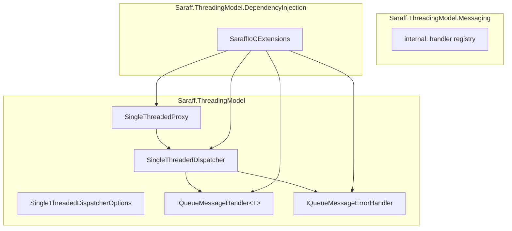

[All products](../) / [Saraff.ThreadingModel.NET](./index.md)
# API Reference

Public types live in three namespaces:



## `SingleThreadedDispatcher`

```csharp
public sealed class SingleThreadedDispatcher : IDisposable
#if NET8_0_OR_GREATER
    , IAsyncDisposable
#endif
{
    public SingleThreadedDispatcher(
        SingleThreadedDispatcherOptions? options = null,
        IServiceProvider? services = null);

    public SynchronizationContext SynchronizationContext { get; }
    public int ThreadId { get; }
    public bool IsDispatcherThread { get; }
    public static SingleThreadedDispatcher? Current { get; }

    public event Action<Exception>? UnhandledException;

    public void Send(Action action, TimeSpan? timeout = null);
    public T Invoke<T>(Func<T> func, TimeSpan? timeout = null);
    public Task<T> InvokeAsync<T>(Func<T> func,
        CancellationToken cancellationToken = default(CancellationToken));
    public void Post(Action action);
    public void Post<TMessage>(TMessage message) where TMessage : notnull;
    public Task PostAsync<TMessage>(TMessage message,
        CancellationToken cancellationToken = default(CancellationToken)) where TMessage : notnull;

    public void Dispose();
    public ValueTask DisposeAsync();   // net8.0-windows only
}
```

| Member | Description |
|---|---|
| `SynchronizationContext` | Context installed on the dispatcher thread |
| `ThreadId` | Managed thread id; valid after construction |
| `IsDispatcherThread` | `true` when called from the dispatcher thread |
| `Current` | Dispatcher of the current thread, otherwise `null` |
| `UnhandledException` | Errors from queued work, error handlers and fatal queue paths |
| `Send` | Blocking action; inline when already on the thread |
| `Invoke` | Blocking function with result |
| `InvokeAsync` | Non-blocking function with result |
| `Post(Action)` | Fire-and-forget action |
| `Post<TMessage>` | Fire-and-forget message |
| `PostAsync<TMessage>` | Message completion task |
| `Dispose`/`DisposeAsync` | Shutdown, up to `DisposeTimeout` |

## `SingleThreadedDispatcherOptions`

```csharp
public sealed class SingleThreadedDispatcherOptions {
    public string? ThreadName { get; set; }
    public ApartmentState ApartmentState { get; set; }          // STA
    public bool UseMessagePump { get; set; }                     // true
    public int MaxQueueLength { get; set; }                      // 0 = unlimited
    public TimeSpan? InvokeTimeout { get; set; }                 // null = infinite
    public TimeSpan? HandlerTimeout { get; set; }                // null = infinite
    public bool ContinueOnHandlerError { get; set; }             // true
    public bool IgnoreUnhandledMessages { get; set; }            // false
    public TimeSpan StartupTimeout { get; set; }                 // 10 s
    public TimeSpan DisposeTimeout { get; set; }                 // 5 s
}
```

## `SingleThreadedProxy`

```csharp
public sealed class SingleThreadedProxy
#if NETFRAMEWORK
    : RealProxy, IDisposable
#else
    : IDisposable
#endif
{
    public SingleThreadedProxy(object instance);
    public SingleThreadedProxy(Type type);
    public SingleThreadedProxy(Type type, params object[] args);
    public SingleThreadedProxy(object instance, SingleThreadedDispatcher dispatcher);
    public SingleThreadedProxy(Type type, SingleThreadedDispatcher dispatcher);
    public SingleThreadedProxy(Type type, SingleThreadedDispatcher dispatcher, params object[] args);
    public SingleThreadedProxy(Type serviceType, Type implementationType,
        SingleThreadedDispatcher? dispatcher = null, params object[] args);

    public TimeSpan? InvokeTimeout { get; set; }
    public T GetTransparentProxy<T>() where T : class;
    public object GetTransparentProxy();   // net8.0-windows; inherited from RealProxy on net462

    public void Dispose();

#if NETFRAMEWORK
    public override IMessage Invoke(IMessage msg);
#endif
}
```

| Target | Base type | Cast target |
|---|---|---|
| `net462` | `RealProxy` | interface or `MarshalByRefObject` |
| `net8.0-windows` | `IDisposable` (wraps `DispatchProxy`) | interface only |

## Messaging contracts

```csharp
public interface IQueueMessageHandler<in TMessage> {
    Task HandleAsync(TMessage message, CancellationToken cancellationToken);
}

public interface IQueueMessageErrorHandler {
    Task HandleAsync(object message, Exception error, CancellationToken cancellationToken);
}
```

Both interfaces are contravariant-friendly: a handler for a base message type receives derived
messages.

## Saraff.IoC extensions

```csharp
namespace Saraff.ThreadingModel.DependencyInjection {

    public static class SaraffIoCExtensions {
        public static void RegisterSingleThreadedDispatcher(
            this IServiceRegistry registry,
            string? name = null,
            Action<SingleThreadedDispatcherOptions>? configure = null);

        public static void RegisterSingleThreadedProxy<TService, TImplementation>(
            this IServiceRegistry registry,
            string? dispatcherName = null,
            ServiceLifetime lifetime = ServiceLifetime.Singleton,
            params object[] args)
            where TService : class
            where TImplementation : class, TService;

        public static void RegisterQueueMessageHandler<TMessage, THandler>(
            this IServiceRegistry registry,
            ServiceLifetime lifetime = ServiceLifetime.Transient)
            where THandler : class, IQueueMessageHandler<TMessage>;

        public static void RegisterQueueErrorHandler<THandler>(
            this IServiceRegistry registry,
            ServiceLifetime lifetime = ServiceLifetime.Transient)
            where THandler : class, IQueueMessageErrorHandler;
    }
}
```

| Helper | Registry entry |
|---|---|
| `RegisterSingleThreadedDispatcher` | `SingleThreadedDispatcher` singleton, optional name; ensures the internal handler registry |
| `RegisterSingleThreadedProxy` | `TService` factory returning the transparent proxy |
| `RegisterQueueMessageHandler` | `IQueueMessageHandler<TMessage>` under the implementation's full type name |
| `RegisterQueueErrorHandler` | `IQueueMessageErrorHandler` under the implementation's full type name |

## Internal types

The following types are implementation details and are not part of the public contract:

| Type | Purpose |
|---|---|
| `Saraff.ThreadingModel.Core.StaMessagePump` | Win32 message pump |
| `Saraff.ThreadingModel.Core.StaSynchronizationContext` | Context implementation |
| `Saraff.ThreadingModel.Core.EventAdapter` | Subscriber list and proxy delegate |
| `Saraff.ThreadingModel.Core.QueueMessageDispatcher` | Message processing and error policy |
| `Saraff.ThreadingModel.Core.MessageHandlerInvoker` | Cached compiled invokers |
| `Saraff.ThreadingModel.Messaging.QueueMessageHandlerRegistry` | Message -> handler map |
| `Saraff.ThreadingModel.Messaging.QueueMessageHandlerRegistration` | A named handler registration |
| Work item classes | Queue entries for actions, functions, continuations, messages |

They may change between minor versions; depend only on the public API.

## Versioning notes

* Public constructors of `SingleThreadedProxy` are preserved from 1.x.
* Removing `Core.EventHandlerHelper` (public in 1.x) in 2.0 is a breaking change if it was
  referenced or derived from directly; use the public proxy and dispatcher instead.
* The assembly is no longer strong-named; see [Migration](./Migration.md).
