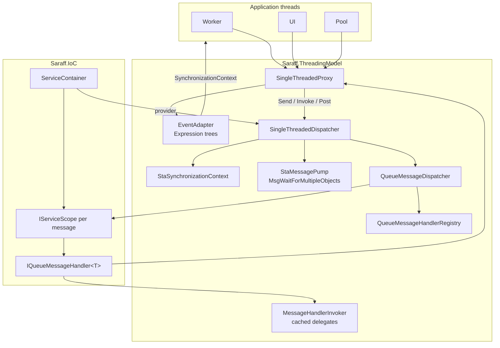
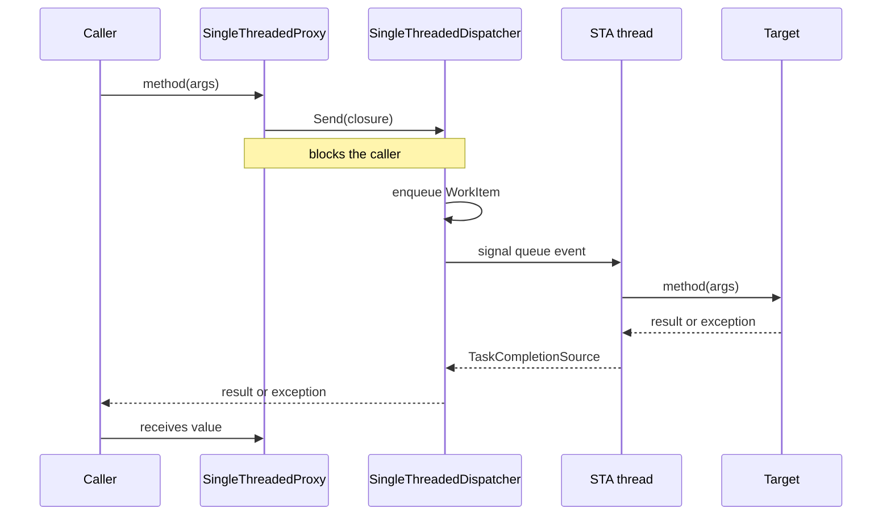
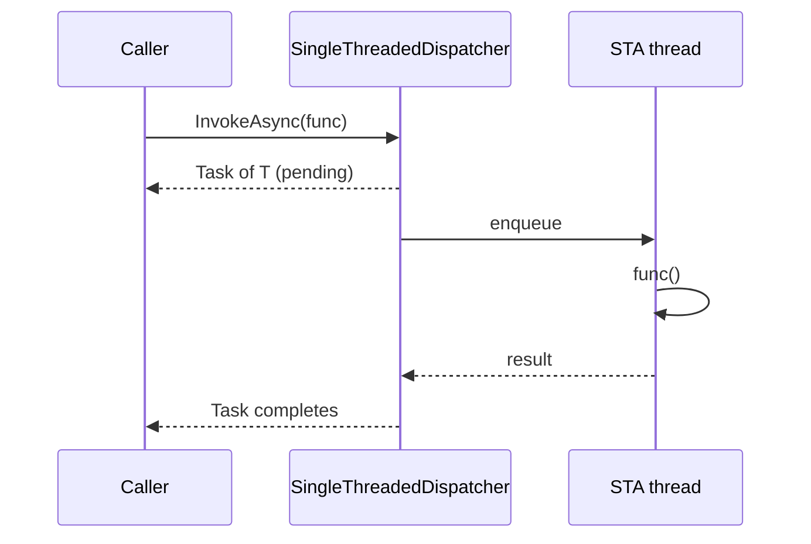
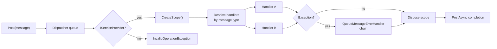
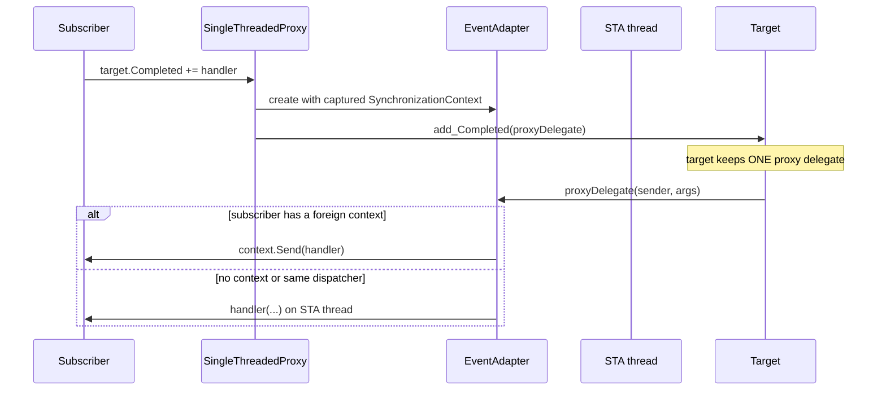
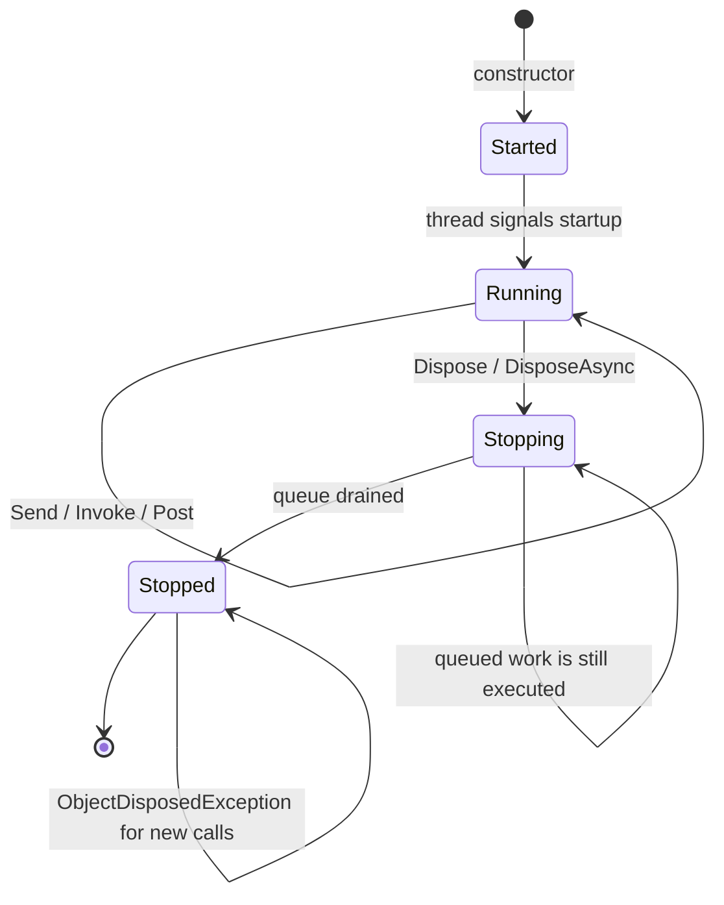

[All products](../) / [Saraff.ThreadingModel.NET](./index.md)
# Architecture

The library has three building blocks: a **dispatcher** (the thread), a **proxy** (the interception
layer) and a **queue** (the message pipeline). Events are a projection of the proxy layer.

## Responsibilities

| Component | Responsibility |
|---|---|
| `SingleThreadedProxy` | Intercepts every interface call and event accessor, forwards work to the dispatcher, rethrows original exceptions |
| `SingleThreadedDispatcher` | Owns the thread, serializes work, provides `Send`/`Invoke`/`InvokeAsync`/`Post`/`PostAsync`, pumps Win32 messages, handles shutdown |
| `StaSynchronizationContext` | `Post`/`Send` for async continuations; executes inline when already on the dispatcher thread |
| `StaMessagePump` | Keeps the STA thread responsive to COM/Win32 messages while waiting for work |
| `QueueMessageDispatcher` | Turns posted messages into handler invocations with a per-message scope and error policy |
| `QueueMessageHandlerRegistry` | Maps message types to registered service types (exact type, base type, `object` catch-all) |
| `MessageHandlerInvoker` | Compiles and caches `(handler, message, ct) => Task` delegates |
| `EventAdapter` | Holds the subscriber list, builds the proxy delegate with expression trees, delivers events |

Public types live in `Saraff.ThreadingModel`; internals are in `Saraff.ThreadingModel.Core` and
`Saraff.ThreadingModel.Messaging`.

## Synchronous call path

If the caller is already on the dispatcher thread (for example, inside a handler or an event
subscriber), the call is executed **inline** instead of being queued, so a handler does not deadlock
on itself.

## Asynchronous call path

`PostAsync` has the same shape, but the task completes after the message handlers (and their scope)
finish. `Post` returns immediately and reports errors through `UnhandledException`.

## Message queue path

* Handlers run **on the dispatcher thread**.
* If a handler returns a pending `Task`, the dispatcher keeps pumping messages and continuations
  until the task completes (or `HandlerTimeout` fires).
* Handlers are resolved from a fresh scope; scoped dependencies are disposed after the message.
* Base-type handlers and `object` catch-all handlers are included (registration order).

## Event path

One proxy delegate is attached to the target regardless of how many subscribers exist. `add` and
`remove` maintain the subscriber list inside the adapter; the last `remove` detaches the proxy
delegate from the target. See [Events](./Events.md) for details.

## Thread and lifetime model

* The dispatcher thread is a background thread, so it never keeps the process alive.
* `Dispose` waits up to `DisposeTimeout`; `Dispose` called from the dispatcher thread does not wait.
* A proxy created without an explicit dispatcher owns it and disposes it.
* A proxy created with a shared dispatcher does not own it.
* A dispatcher created through `RegisterSingleThreadedDispatcher` is owned by the container.

## Error propagation

| Layer | Behavior |
|---|---|
| Target method | Original exception is captured and rethrown with its stack (`ExceptionDispatchInfo`) |
| Proxy call | The caller receives the original exception type, not `TargetInvocationException` |
| Event handler | The exception propagates through the proxy call that raised the event |
| `Post` work item | Reported to `UnhandledException` |
| Queue handler | Sent to all `IQueueMessageErrorHandler`; the queue continues or stops according to `ContinueOnHandlerError` |
| Dispatcher thread | Exceptions never kill the thread; they are reported |

## Guarantees

* A target instance is touched by exactly one thread unless the application itself leaks it.
* Calls are serialized in FIFO order with respect to the moment they are enqueued.
* `Send`/`Invoke` either return a result, throw the original exception, or throw `TimeoutException`.
* After `Dispose`, new calls throw `ObjectDisposedException`.
* Messages are processed in FIFO order; each message sees a fresh DI scope.
* Win32/COM messages are pumped while idle **and** while a handler awaits asynchronous work.
