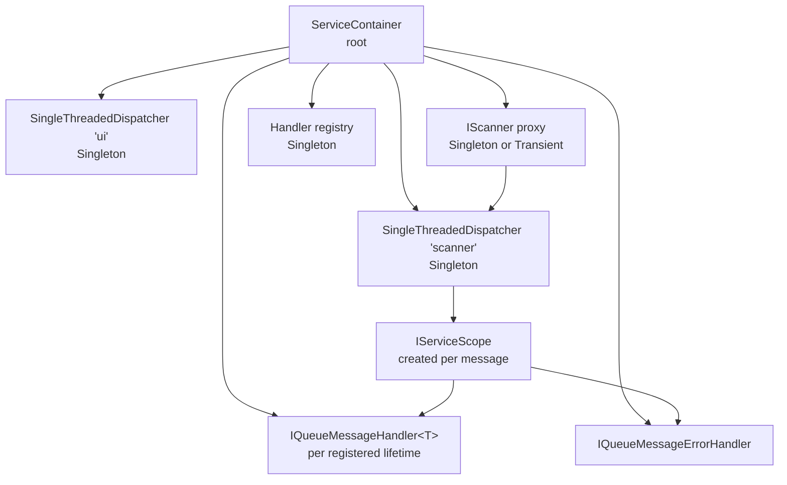
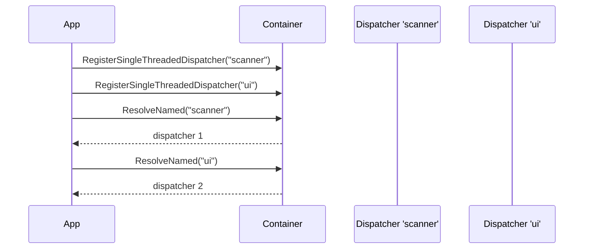
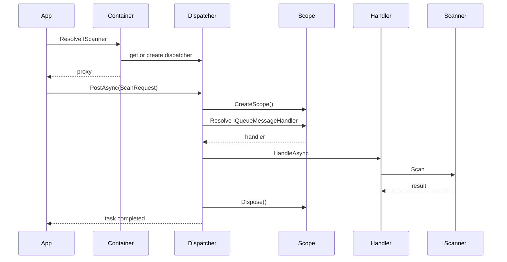
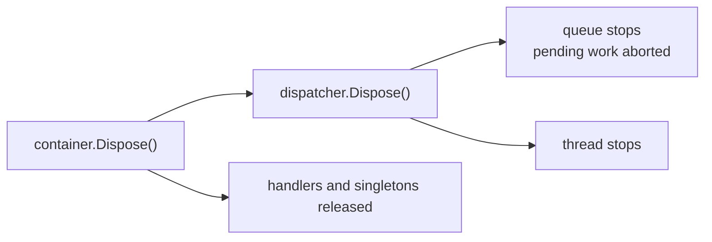

[All products](../) / [Saraff.ThreadingModel.NET](./index.md)
# Dependency Injection

Saraff.ThreadingModel integrates with [Saraff.IoC](https://www.nuget.org/packages/Saraff.IoC/) 2.0.
The integration is a set of extension methods in the `Saraff.ThreadingModel.DependencyInjection`
namespace; the package references `Saraff.IoC` directly, so there is no second package to install.

```csharp
using Saraff.IoC;
using Saraff.ThreadingModel;
using Saraff.ThreadingModel.DependencyInjection;
```

## Registration helpers

| Method | Lifetime | What it registers |
|---|---|---|
| `RegisterSingleThreadedDispatcher(string? name = null, Action<SingleThreadedDispatcherOptions>? configure = null)` | Singleton | a dispatcher; also ensures the handler registry |
| `RegisterSingleThreadedProxy<TService, TImplementation>(string? dispatcherName = null, ServiceLifetime lifetime = Singleton, params object[] args)` | configurable | the transparent proxy as `TService` |
| `RegisterQueueMessageHandler<TMessage, THandler>(ServiceLifetime lifetime = Transient)` | configurable | `IQueueMessageHandler<TMessage>` under the handler's type name |
| `RegisterQueueErrorHandler<THandler>(ServiceLifetime lifetime = Transient)` | configurable | `IQueueMessageErrorHandler` under the handler's type name |

All methods are extension methods on `IServiceRegistry`, so they work on `ServiceContainer`,
nested containers and any Saraff.IoC registry implementation.

## The container in one picture



## Named dispatchers

Multiple dispatchers can coexist; each has its own thread, apartment and options.

```csharp
using (var container = new ServiceContainer()) {
    container.RegisterSingleThreadedDispatcher("scanner", options => {
        options.ThreadName = "Scanner STA";
        options.HandlerTimeout = TimeSpan.FromSeconds(10);
    });
    container.RegisterSingleThreadedDispatcher("ui", options => {
        options.ThreadName = "UI STA";
        options.InvokeTimeout = TimeSpan.FromSeconds(2);
    });

    var scannerDispatcher = container.ResolveNamed<SingleThreadedDispatcher>("scanner");
    var uiDispatcher = container.ResolveNamed<SingleThreadedDispatcher>("ui");

    Console.WriteLine(scannerDispatcher.ThreadId != uiDispatcher.ThreadId);   // true
}
```

Without a name the dispatcher is the default one:

```csharp
container.RegisterSingleThreadedDispatcher();
var dispatcher = container.Resolve<SingleThreadedDispatcher>();
```



## Proxies

```csharp
container.RegisterSingleThreadedDispatcher("scanner");
container.RegisterSingleThreadedProxy<IScanner, Scanner>("scanner");

var scanner = container.Resolve<IScanner>();
```

* The proxy is a **singleton by default**; it shares one dispatcher thread with every other proxy
  registered for the same name.
* Pass `ServiceLifetime.Transient` to create a new proxy (and a new target instance) per resolution.
* Constructor arguments are passed through the `args` parameter:

```csharp
container.RegisterSingleThreadedProxy<IDevice, Device>("scanner", ServiceLifetime.Singleton, "COM1");
```

`RegisterSingleThreadedProxy` uses the explicit `(serviceType, implementationType, dispatcher, args)`
constructor, so multiple interfaces on the implementation are fine.

## Handlers

```csharp
container.RegisterQueueMessageHandler<ScanRequest, ScanRequestHandler>();                            // transient
container.RegisterQueueMessageHandler<ScanRequest, AuditHandler>(ServiceLifetime.Scoped);
container.RegisterQueueErrorHandler<ConsoleErrorHandler>(ServiceLifetime.Singleton);
```

Registration details:

* The implementation type is registered as `IQueueMessageHandler<TMessage>` **under its full type
  name**; the dispatcher resolves it from the message scope by name. This avoids the Saraff.IoC
  singleton cache collision when several implementations share one service type.
* `Transient` (default) creates a handler per message, `Scoped` creates one per message scope, and
  `Singleton` reuses the instance.
* Multiple handlers for the same message type are supported; all are invoked in registration order.
* Error handlers are resolved as `IEnumerable<IQueueMessageErrorHandler>`; several registrations
  are supported, including `Singleton`.

## Full example

```csharp
using System;
using System.Threading;
using System.Threading.Tasks;
using Saraff.IoC;
using Saraff.ThreadingModel;
using Saraff.ThreadingModel.DependencyInjection;

using (var container = new ServiceContainer()) {
    container.RegisterSingleThreadedDispatcher("scanner", options => {
        options.ThreadName = "SARAFF STA Scanner";
        options.HandlerTimeout = TimeSpan.FromSeconds(10);
    });
    container.RegisterSingleThreadedProxy<IScanner, Scanner>("scanner");
    container.Register<ScanSession, ScanSession>(ServiceLifetime.Scoped);
    container.RegisterQueueMessageHandler<ScanRequest, ScanRequestHandler>();
    container.RegisterQueueErrorHandler<ConsoleErrorHandler>(ServiceLifetime.Singleton);

    var dispatcher = container.ResolveNamed<SingleThreadedDispatcher>("scanner");
    var scanner = container.Resolve<IScanner>();

    scanner.Completed += (sender, args) =>
        Console.WriteLine($"event: {args.Pages} pages on thread {Thread.CurrentThread.ManagedThreadId}");

    dispatcher.Post(new ScanRequest(3, "invoice"));
    await dispatcher.PostAsync(new ScanRequest(7, "passport"));
}
```



## Lifetimes and disposal

| Object | Owner | Disposed by |
|---|---|---|
| Dispatcher registered with `RegisterSingleThreadedDispatcher` | container | container `Dispose`/`DisposeAsync` |
| Dispatcher passed to a proxy explicitly | caller | caller |
| Dispatcher created by a proxy without a name/instance | proxy | proxy `Dispose` |
| Transparent proxy (`TService`) | container as a singleton | not `IDisposable`; the dispatcher it uses is disposed by the container |
| Message scope and its scoped services | dispatcher | after every message |
| Handler instance | scope/container per lifetime | scope/container |
| Error handlers | container | container |



> Because the transparent proxy is not `IDisposable`, disposing the container does not clear the
> proxy's event adapters. It does stop the dispatcher, so any later call throws
> `ObjectDisposedException`. Subscribe with `-=` or keep proxies short-lived if that matters.

## Notes

* `RegisterSingleThreadedDispatcher` calls `EnsureHandlerRegistry` internally; you do not need to
  register the registry yourself.
* If a named dispatcher was not registered, resolving a proxy bound to it throws
  `InvalidOperationException` with the dispatcher name.
* The same `IServiceProvider` passed to the dispatcher is used to resolve error handlers from the
  root container, so error handlers do not depend on a message scope.
