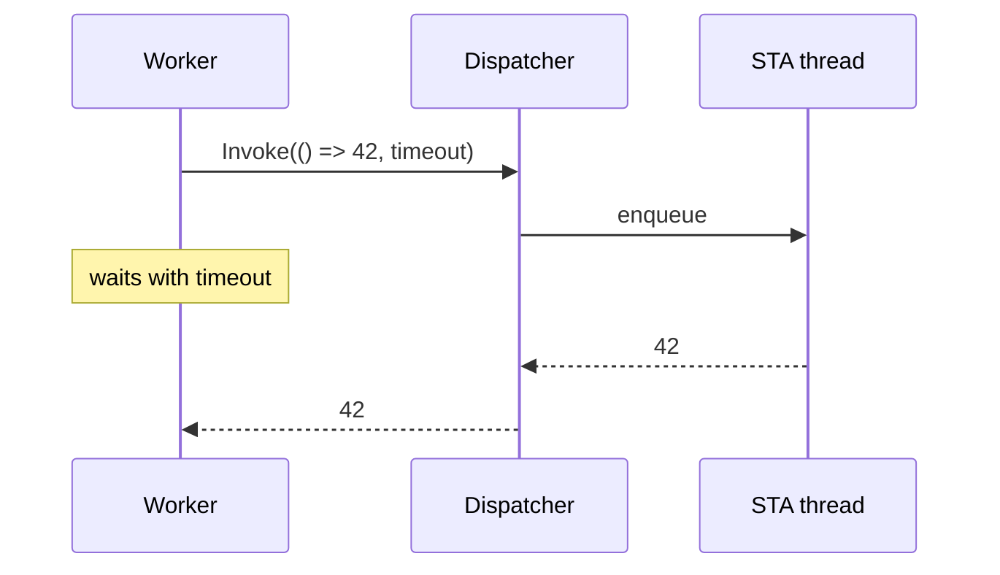
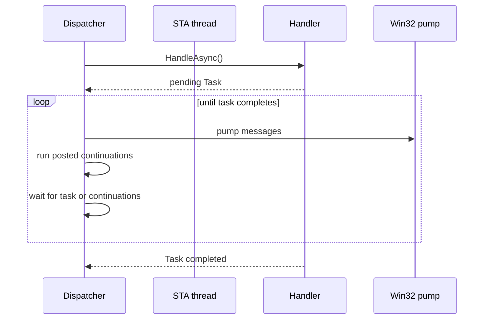
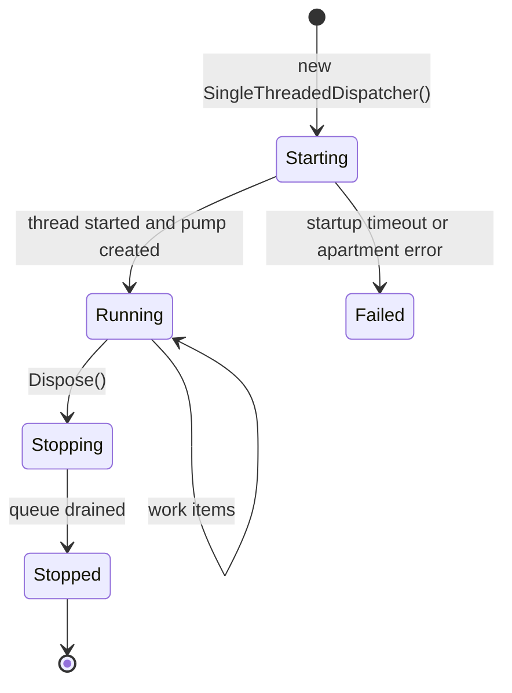

[All products](../) / [Saraff.ThreadingModel.NET](./index.md)
# Dispatcher

`SingleThreadedDispatcher` owns one thread, serializes work on it, and optionally pumps Win32
messages so that STA/COM objects stay responsive.

```csharp
using Saraff.ThreadingModel;

using (var dispatcher = new SingleThreadedDispatcher(new SingleThreadedDispatcherOptions {
    ThreadName = "Device STA",
    ApartmentState = ApartmentState.STA,
    UseMessagePump = true,
    InvokeTimeout = TimeSpan.FromSeconds(30),
    HandlerTimeout = TimeSpan.FromSeconds(10)
})) {
    var threadId = dispatcher.Invoke(() => Thread.CurrentThread.ManagedThreadId);
    Console.WriteLine(threadId == dispatcher.ThreadId);   // true
}
```

## Constructors

```csharp
public SingleThreadedDispatcher(
    SingleThreadedDispatcherOptions? options = null,
    IServiceProvider? services = null);
```

* `options` — thread name, apartment, queue limits, timeouts, error policy.
* `services` — service provider used to resolve queue handlers. Pass `null` to use the dispatcher
  only for `Send`/`Invoke`/`Post(Action)`; posting messages then throws `InvalidOperationException`.
* The constructor starts the thread and waits for startup (see `StartupTimeout`).

## Options

| Option | Default | Meaning |
|---|---|---|
| `ThreadName` | `Saraff.ThreadingModel dispatcher` | Name of the worker thread |
| `ApartmentState` | `STA` | `STA`, `MTA` or `Unknown` (do not change) |
| `UseMessagePump` | `true` | Pump Win32 messages; required for many COM objects |
| `MaxQueueLength` | `0` | Maximum queued work items; `0` = unlimited; overflow throws `InvalidOperationException` |
| `InvokeTimeout` | `null` (infinite) | Default timeout for `Send`/`Invoke` |
| `HandlerTimeout` | `null` (infinite) | Timeout for one queue message handler (including async awaits) |
| `ContinueOnHandlerError` | `true` | Continue processing the queue after a handler fails |
| `IgnoreUnhandledMessages` | `false` | Do not report messages with no registered handler |
| `StartupTimeout` | 10 s | Maximum time the constructor waits for the thread |
| `DisposeTimeout` | 5 s | Maximum time `Dispose` waits for the thread to stop |

## API

| Member | Blocking | Notes |
|---|---|---|
| `void Send(Action action, TimeSpan? timeout = null)` | yes | Executes inline if already on the dispatcher thread |
| `T Invoke<T>(Func<T> func, TimeSpan? timeout = null)` | yes | Same rules as `Send` |
| `Task<T> InvokeAsync<T>(Func<T> func, CancellationToken ct = default)` | no | Cancellation is checked before execution |
| `void Post(Action action)` | no | Errors go to `UnhandledException` |
| `void Post<TMessage>(TMessage message)` | no | Requires `services`; errors go to the queue error policy |
| `Task PostAsync<TMessage>(TMessage message, CancellationToken ct = default)` | no | Completes after the message is processed |
| `SynchronizationContext SynchronizationContext { get; }` | — | Context of the dispatcher thread |
| `int ThreadId { get; }` | — | Managed id of the dispatcher thread |
| `bool IsDispatcherThread { get; }` | — | `true` when called from the dispatcher thread |
| `static SingleThreadedDispatcher? Current { get; }` | — | Dispatcher of the current thread (inside work items) |
| `event Action<Exception>? UnhandledException` | — | Fatal/unobserved errors from queued work |
| `void Dispose()` / `ValueTask DisposeAsync()` | — | Starts shutdown; `DisposeAsync` only on `net8.0-windows` |

## Execution semantics

### Blocking calls from other threads



If the timeout expires first, the caller gets `TimeoutException`. The queued item is not removed:
if it has not started yet, it will still run later. The dispatcher remains usable.

### Reentrancy from the dispatcher thread

```csharp
dispatcher.Send(() => {
    dispatcher.Send(() => Console.WriteLine("inline"));
    var value = dispatcher.Invoke(() => 42);      // inline
    var task = dispatcher.InvokeAsync(() => 43);  // completed inline
});
```

This is what makes proxy calls from inside queue handlers and event subscribers safe.

### Ordering

Work is processed in FIFO order. `Send`, `Invoke`, `InvokeAsync`, `Post`, `PostAsync` and proxy calls
all share the same queue, so the order in which they are enqueued is the order of execution.


### Awaiting a queue handler

When a handler returns a pending task, the dispatcher does not block the STA thread blindly:



This keeps COM messages flowing while a handler awaits I/O or `Task.Delay`.

## Lifecycle



* New work is rejected immediately once shutdown starts.
* Work already queued is processed before the thread exits; if it cannot be, the caller receives
  `ObjectDisposedException`.
* `Dispose` called from inside the dispatcher does not block waiting for itself.

## Errors

```csharp
using (var dispatcher = new SingleThreadedDispatcher()) {
    dispatcher.UnhandledException += error =>
        Console.WriteLine($"unhandled: {error.GetType().Name}: {error.Message}");

    dispatcher.Post(() => throw new InvalidOperationException("boom"));
}
```

Exceptions thrown by `Send`/`Invoke` are delivered to the caller synchronously; they are not
reported through `UnhandledException`.

## When not to use `Send`

| Situation | Recommendation |
|---|---|
| UI event handler | Use `InvokeAsync`/`PostAsync` and `await`; blocking the UI thread freezes the app |
| Inside a queue handler | Proxy/`Send` calls are inline and safe, but do not wait for another thread that calls back into the same dispatcher |
| High-frequency notifications | Use `Post` and batch, or explode `MaxQueueLength` |
| Fire-and-forget with errors | `Post` + `UnhandledException` handler |
