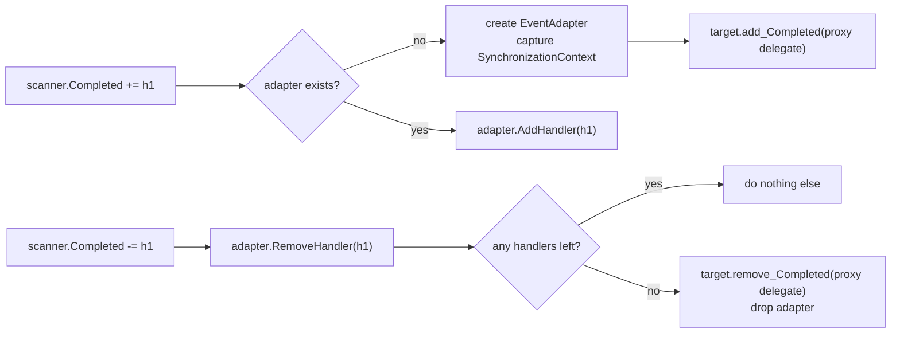
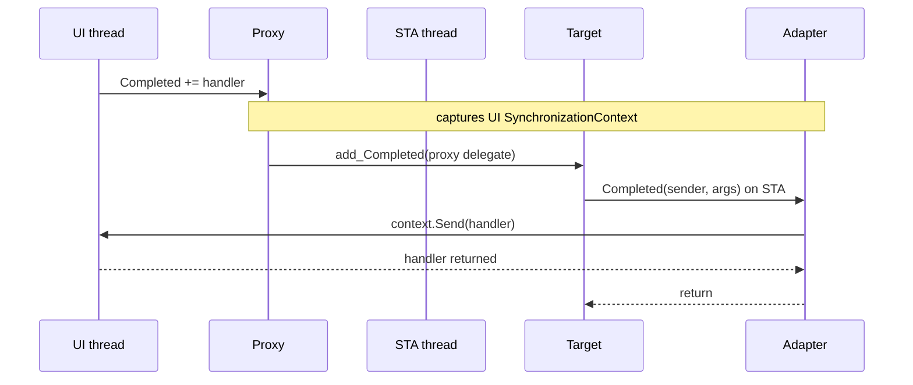

[All products](../) / [Saraff.ThreadingModel.NET](./index.md)
# Events

Events are the only part of the proxy that is not a plain call: `add_…` and `remove_…` are
intercepted, subscribers are stored in an adapter, and the target object gets a single proxy
delegate.

```csharp
using (var proxy = new SingleThreadedProxy(typeof(IScanner), typeof(Scanner))) {
    var scanner = proxy.GetTransparentProxy<IScanner>();

    scanner.Completed += (sender, args) =>
        Console.WriteLine($"pages: {args.Pages}, thread: {Thread.CurrentThread.ManagedThreadId}");

    scanner.Scan(3);
}
```

## Subscription pipeline



Consequences:

* The target always holds **one** proxy delegate, no matter how many subscribers you add.
* `CompletedSubscribers` on the target stays `1` while at least one subscriber exists.
* Removing one of several subscribers does not touch the target.
* Re-subscribing after the last removal creates a new adapter and attaches a fresh proxy delegate.

```csharp
EventHandler<ScanEventArgs> first = (s, e) => { };
EventHandler<ScanEventArgs> second = (s, e) => { };
scanner.Completed += first;
scanner.Completed += second;
Console.WriteLine(scanner.CompletedSubscribers);   // 1
scanner.Completed -= first;
Console.WriteLine(scanner.CompletedSubscribers);   // 1
scanner.Completed -= second;
Console.WriteLine(scanner.CompletedSubscribers);   // 0
```

## Delivery thread

The subscriber's `SynchronizationContext` is captured **at subscription time**. When the target
raises the event on the dispatcher thread, the adapter chooses:

| Captured context | Delivery |
|---|---|
| `null` | Direct call on the dispatcher thread |
| The dispatcher's own context | Direct call on the dispatcher thread |
| A foreign context (UI, custom) | `context.Send(...)` — blocks the dispatcher until the handler returns |
| `Send` not supported by the context | Falls back to a direct call on the dispatcher thread |



This is how a WinForms/WPF subscriber receives an event on the UI thread even though the object lives
on the STA dispatcher thread.

> **Avoid deadlocks on the UI thread:** if the UI thread is currently blocked waiting for a proxy
> call (`Send`/`Invoke`), it cannot process `context.Send` from the dispatcher. Prefer
> `InvokeAsync`/`PostAsync` on the UI thread.

## Multicast

Multicast delegates are supported: handlers are combined with `Delegate.Combine` and invoked in
subscription order. If a handler throws, the exception propagates and later handlers in the same
invocation list are not called (standard .NET multicast behavior).

## Arguments and return values

| Case | Behavior |
|---|---|
| `null` argument (for example `sender`) | accepted; no `NullReferenceException` |
| Non-`void` delegate (`Func<int,int>`) | return value is unboxed/cast and returned |
| Value-type arguments | boxed and unboxed correctly |
| `ref`/`out` parameters in the delegate | rejected with `NotSupportedException` on subscription |
| Event handler exception | unwrapped and rethrown to the code that raised the event |

```csharp
public interface IScanner {
    event Action<int>? Progress;
    event Func<int, int>? Transform;
    event EventHandler<ScanEventArgs>? Completed;
}

scanner.Transform += value => value * 2;   // return value is forwarded
var result = scanner.Scan(6);              // 12
```

## Reentrancy

A subscriber may call back into the proxy. Because events are raised on the dispatcher thread, the
nested call is executed inline:

```csharp
scanner.Completed += (sender, args) => {
    if(args.Pages == 1) {
        var nested = scanner.Scan(5);   // safe: inline on the dispatcher thread
    }
};
```

This works for queue handlers too: a handler runs on the dispatcher thread, so calling the proxied
object from the handler does not deadlock.

## Lifetime and leaks

* The adapter is removed from the proxy when the last subscriber is removed.
* The proxy clears all adapters on `Dispose`.
* If the target object keeps the proxy delegate after the proxy is disposed and someone raises the
  event, the adapter list is empty and the call is a no-op.
* Use `-=` to release long-lived subscribers; the adapter keeps strong references.

## Limitations

* `ref`/`out` event delegate parameters are not supported.
* Delivery through a foreign `SynchronizationContext` is synchronous (`Send`), not `Post`.
* Event handlers cannot be cancelled or timed out; a slow handler delays the dispatcher.
* Exceptions from handlers are visible to the caller of the method that raised the event.
