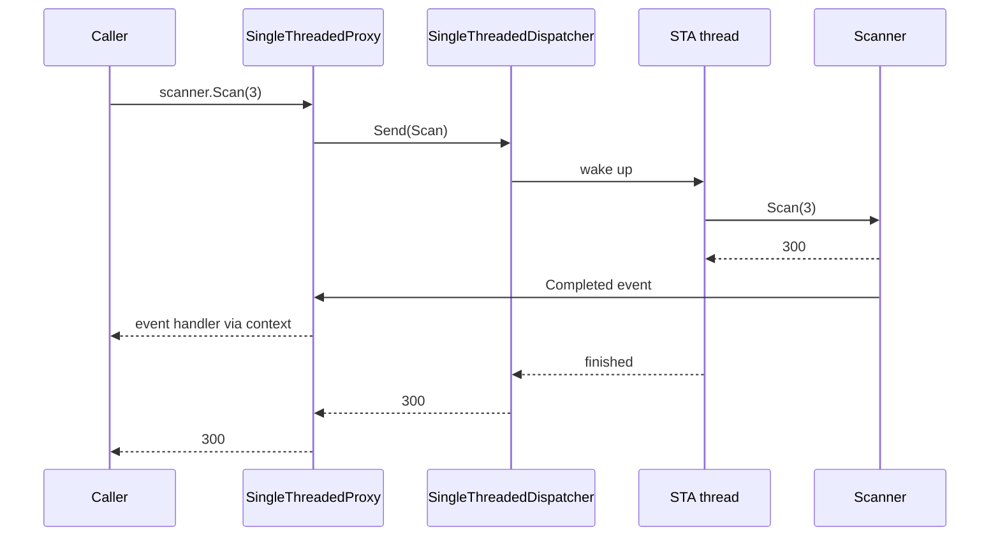
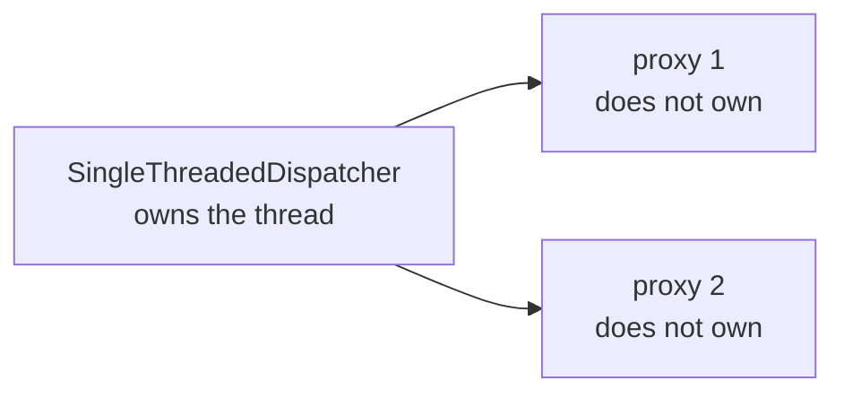
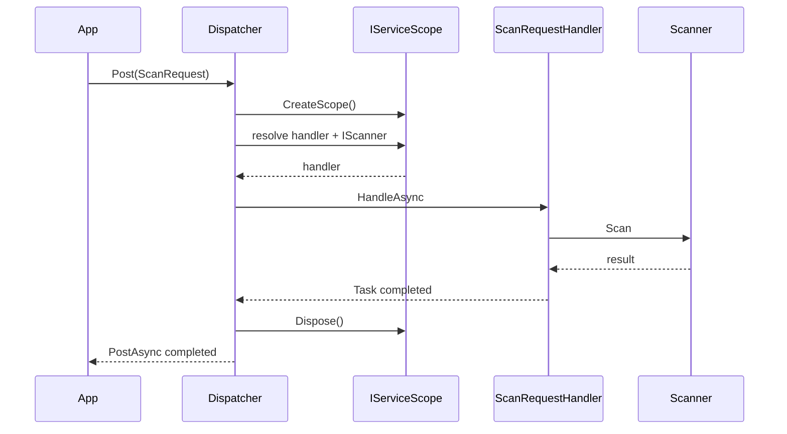

[All products](../) / [Saraff.ThreadingModel.NET](./index.md)
# Getting Started

This page takes you from an empty project to a working STA-bound object and a message queue with
dependency injection.

## 1. Install

```powershell
dotnet add package Saraff.ThreadingModel
```

The package targets `net462` and `net8.0-windows` and depends on `Saraff.IoC` 2.0.0.

```xml
<ItemGroup>
  <PackageReference Include="Saraff.ThreadingModel" Version="2.0.0" />
</ItemGroup>
```

> `net8.0-windows` uses `DispatchProxy`, so the proxied type must be an interface.
> `net462` uses `RealProxy` and supports interfaces plus `MarshalByRefObject` classes.

## 2. Define a service and an implementation

```csharp
using System;
using System.Threading;

public interface IScanner {
    string Name { get; }
    int ThreadId { get; }
    ApartmentState Apartment { get; }
    int Scan(int pages);
    event EventHandler<ScanCompletedEventArgs>? Completed;
}

public sealed class ScanCompletedEventArgs : EventArgs {
    public ScanCompletedEventArgs(int pages) => this.Pages = pages;
    public int Pages { get; }
}

public sealed class Scanner : IScanner {
    public event EventHandler<ScanCompletedEventArgs>? Completed;

    public string Name => "SARAFF Scanner";
    public int ThreadId => Thread.CurrentThread.ManagedThreadId;
    public ApartmentState Apartment => Thread.CurrentThread.GetApartmentState();

    public int Scan(int pages) {
        Thread.Sleep(100);                                  // pretend to talk to a device
        this.Completed?.Invoke(this, new ScanCompletedEventArgs(pages));
        return pages * 100;
    }
}
```

## 3. Create a proxy and call it

```csharp
using Saraff.ThreadingModel;

using (var proxy = new SingleThreadedProxy(typeof(IScanner), typeof(Scanner))) {
    var scanner = proxy.GetTransparentProxy<IScanner>();

    scanner.Completed += (sender, args) =>
        Console.WriteLine($"scanned {args.Pages} pages on thread {Thread.CurrentThread.ManagedThreadId}");

    Console.WriteLine($"caller: {Thread.CurrentThread.ManagedThreadId}");
    Console.WriteLine($"object: {scanner.ThreadId}, apartment: {scanner.Apartment}");
    Console.WriteLine($"result: {scanner.Scan(3)}");
}
```



Notes:

* The proxy owns a private dispatcher and stops it on `Dispose`.
* `GetTransparentProxy<T>()` is a typed helper over the platform proxy.
* Exceptions from the target are rethrown as original exceptions, not wrapped in
  `TargetInvocationException`.

## 4. Share a dispatcher between objects

A dispatcher can host several objects that must live on the same thread.

```csharp
using (var dispatcher = new SingleThreadedDispatcher(new SingleThreadedDispatcherOptions {
    ThreadName = "Device STA",
    InvokeTimeout = TimeSpan.FromSeconds(30)
}))
using (var proxy = new SingleThreadedProxy(typeof(IScanner), typeof(Scanner), dispatcher)) {
    var scanner = proxy.GetTransparentProxy<IScanner>();
    Console.WriteLine(scanner.ThreadId == dispatcher.ThreadId);   // true
}
// the proxy did not own the dispatcher, so you can keep using it
```

Sequence of ownership:



## 5. Register everything in Saraff.IoC

```csharp
using Saraff.IoC;
using Saraff.ThreadingModel;
using Saraff.ThreadingModel.DependencyInjection;

using (var container = new ServiceContainer()) {
    container.RegisterSingleThreadedDispatcher("scanner", options => {
        options.ThreadName = "SARAFF STA Scanner";
        options.HandlerTimeout = TimeSpan.FromSeconds(10);
        options.DisposeTimeout = TimeSpan.FromSeconds(5);
    });
    container.RegisterSingleThreadedProxy<IScanner, Scanner>("scanner");

    var scanner = container.Resolve<IScanner>();
    Console.WriteLine(scanner.ThreadId);
}
```

| Helper | Registers |
|---|---|
| `RegisterSingleThreadedDispatcher` | singleton dispatcher (named or default) |
| `RegisterSingleThreadedProxy` | proxy service bound to a dispatcher |
| `RegisterQueueMessageHandler` | `IQueueMessageHandler<T>` implementation |
| `RegisterQueueErrorHandler` | `IQueueMessageErrorHandler` implementation |

## 6. Add a message queue handler

```csharp
public sealed class ScanRequest {
    public ScanRequest(int pages, string name) {
        this.Pages = pages;
        this.Name = name;
    }

    public int Pages { get; }
    public string Name { get; }
}

public sealed class ScanSession : IDisposable {
    public void Log(string text) => Console.WriteLine($"[{text}]");
    public void Dispose() => Console.WriteLine("session disposed");
}

public sealed class ScanRequestHandler : IQueueMessageHandler<ScanRequest> {
    private readonly IScanner _scanner;
    private readonly ScanSession _session;

    [ServiceRequired]
    public ScanRequestHandler(IScanner scanner, ScanSession session) {
        this._scanner = scanner;
        this._session = session;
    }

    public Task HandleAsync(ScanRequest message, CancellationToken cancellationToken) {
        this._session.Log(message.Name);
        this._scanner.Scan(message.Pages);
        return Task.CompletedTask;
    }
}
```

Registration and posting:

```csharp
using (var container = new ServiceContainer()) {
    container.RegisterSingleThreadedDispatcher("scanner");
    container.RegisterSingleThreadedProxy<IScanner, Scanner>("scanner");
    container.Register<ScanSession, ScanSession>(ServiceLifetime.Scoped);
    container.RegisterQueueMessageHandler<ScanRequest, ScanRequestHandler>();

    var dispatcher = container.ResolveNamed<SingleThreadedDispatcher>("scanner");

    dispatcher.Post(new ScanRequest(3, "invoice"));                     // fire and forget
    await dispatcher.PostAsync(new ScanRequest(7, "passport"));         // wait for completion

    // a new scope was created and disposed for every message
}
```



## 7. Run the samples

```powershell
dotnet run --project samples/Saraff.ThreadingModel.Sample        # DI + queue + errors
dotnet run --project samples/Saraff.ThreadingModel.Sample.Plain  # dispatcher + proxy only
```

## 8. Where to go next

* [Architecture](./Architecture.md) — how the pieces fit together
* [Dispatcher](./Dispatcher.md) — timeouts, ordering, shutdown
* [Proxy](./Proxy.md) — constructors and platform differences
* [Events](./Events.md) — event delivery and reentrancy
* [Message Queue](./MessageQueue.md) — error policy and scopes
* [Dependency Injection](./DependencyInjection.md) — lifetimes and named dispatchers
* [Troubleshooting](./Troubleshooting.md) — when a call hangs
