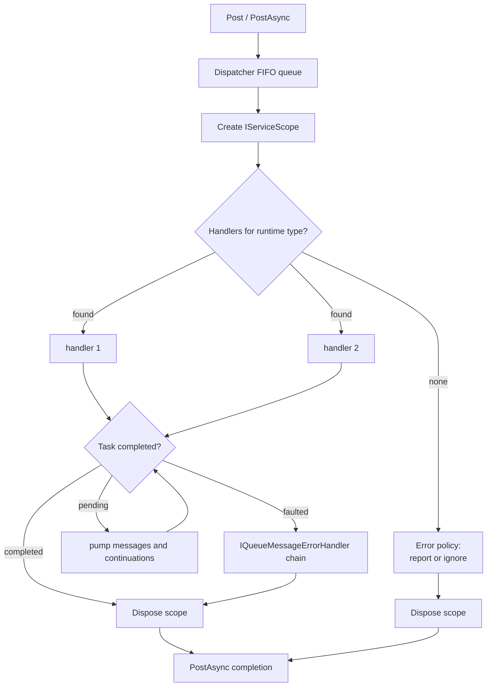
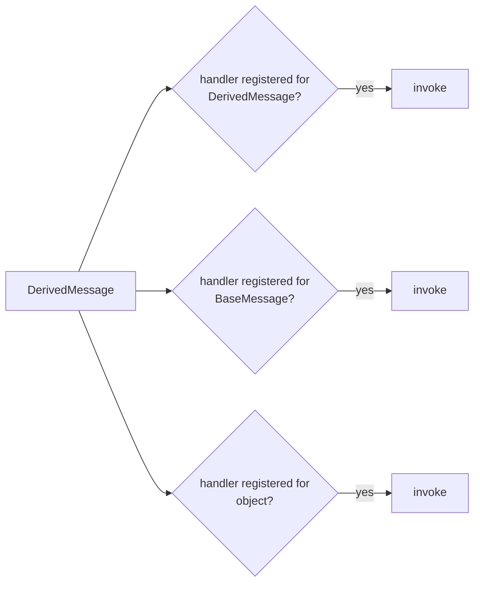
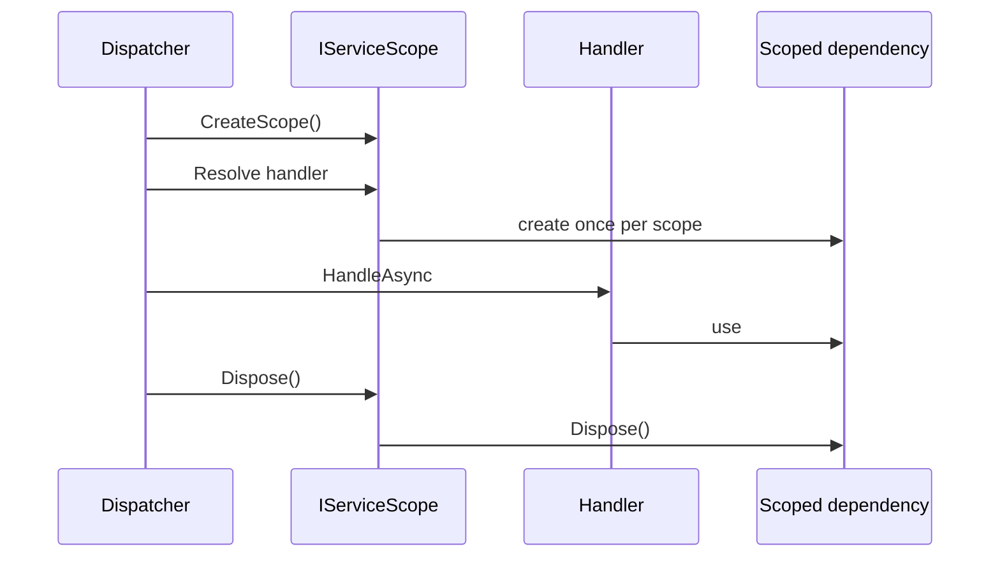
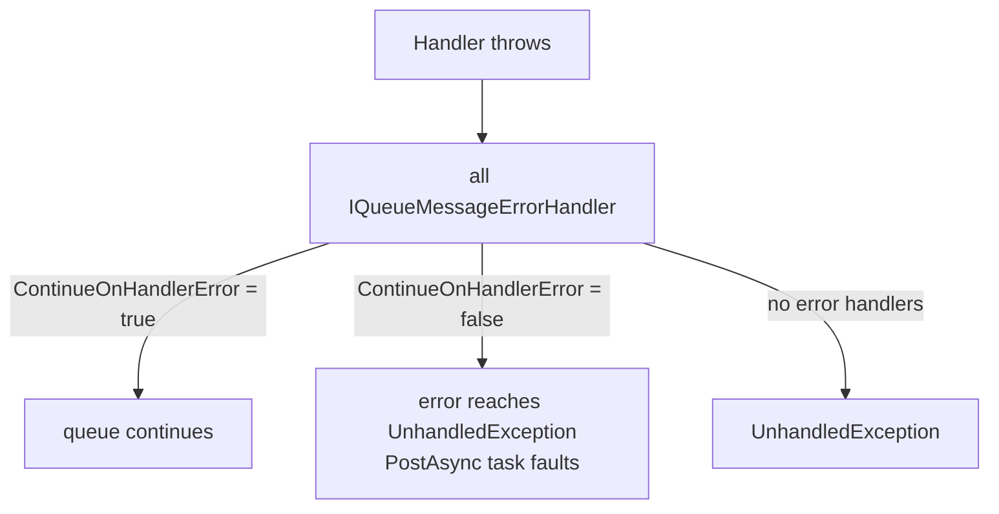

[All products](../) / [Saraff.ThreadingModel.NET](./index.md)
# Message Queue

The message queue turns posted POCO messages into handler invocations on the dispatcher thread, with
a dependency injection scope per message.

```csharp
public sealed class ScanRequest {
    public ScanRequest(int pages, string name) {
        this.Pages = pages;
        this.Name = name;
    }

    public int Pages { get; }
    public string Name { get; }
}

public sealed class ScanRequestHandler : IQueueMessageHandler<ScanRequest> {
    public Task HandleAsync(ScanRequest message, CancellationToken cancellationToken) {
        Console.WriteLine($"scanning {message.Name}: {message.Pages}");
        return Task.CompletedTask;
    }
}
```

```csharp
using (var container = new ServiceContainer()) {
    container.RegisterSingleThreadedDispatcher("scanner");
    container.RegisterQueueMessageHandler<ScanRequest, ScanRequestHandler>();

    var dispatcher = container.ResolveNamed<SingleThreadedDispatcher>("scanner");
    dispatcher.Post(new ScanRequest(3, "invoice"));
    await dispatcher.PostAsync(new ScanRequest(7, "passport"));
}
```

## Contracts

```csharp
public interface IQueueMessageHandler<in TMessage> {
    Task HandleAsync(TMessage message, CancellationToken cancellationToken);
}

public interface IQueueMessageErrorHandler {
    Task HandleAsync(object message, Exception error, CancellationToken cancellationToken);
}
```

Handlers are ordinary services: constructor injection, `[ServiceRequired]`, properties — everything
Saraff.IoC supports.

## Pipeline



## Registration

```csharp
container.RegisterQueueMessageHandler<ScanRequest, ScanRequestHandler>();                          // transient
container.RegisterQueueMessageHandler<ScanRequest, CachedScanHandler>(ServiceLifetime.Singleton);
container.RegisterQueueErrorHandler<ConsoleErrorHandler>(ServiceLifetime.Singleton);
```

Handlers are registered in the container under their **full type name**. The dispatcher resolves
them by name inside the message scope, so several handlers for the same message type do not collide
even with `Singleton` lifetime.

If you need the instance directly:

```csharp
var handler = container.ResolveNamed<IQueueMessageHandler<ScanRequest>>(
    typeof(ScanRequestHandler).FullName);
```

## Message type matching

A message is dispatched by its **runtime type**:



* Exact type, base class and implemented interfaces are all considered.
* `IQueueMessageHandler<object>` acts as a catch-all.
* All matching handlers are invoked, in registration order.
* A message with no handlers is reported unless `IgnoreUnhandledMessages = true`.

```csharp
public class BaseMessage { }
public sealed class DerivedMessage : BaseMessage { }

container.RegisterQueueMessageHandler<BaseMessage, BaseMessageHandler>();
container.RegisterQueueMessageHandler<DerivedMessage, DerivedMessageHandler>();

dispatcher.Post(new DerivedMessage());   // both handlers run
```

## Ordering and completion

* Messages are processed in the order they are posted.
* `Post` returns immediately; errors are routed to the error policy.
* `PostAsync` returns a task that completes after all handlers and the scope are finished.
* `MaxQueueLength` limits the number of queued work items; overflow throws `InvalidOperationException`.

```csharp
var first = dispatcher.PostAsync(new ScanRequest(1, "one"));
var second = dispatcher.PostAsync(new ScanRequest(2, "two"));
await Task.WhenAll(first, second);   // handlers ran in order 1, 2
```

## Scope per message

When the dispatcher was created with a Saraff.IoC provider, every message gets a fresh
`IServiceScope`:



This gives request-like isolation: a `Scoped` connection, buffer or session is created for one
message and disposed afterwards, even if the handler is `Singleton`.

## Errors



```csharp
public sealed class ConsoleErrorHandler : IQueueMessageErrorHandler {
    public Task HandleAsync(object message, Exception error, CancellationToken cancellationToken) {
        Console.WriteLine($"{message.GetType().Name}: {error.GetType().Name}: {error.Message}");
        return Task.CompletedTask;
    }
}

container.RegisterQueueErrorHandler<ConsoleErrorHandler>(ServiceLifetime.Singleton);
```

Error handlers run on the dispatcher thread too. If an error handler itself fails, that failure is
reported through `UnhandledException` (it does not recurse into the error chain).

## Handler timeout

```csharp
container.RegisterSingleThreadedDispatcher("scanner", options =>
    options.HandlerTimeout = TimeSpan.FromSeconds(5));
```

If a handler does not finish in time, `TimeoutException` is passed to the error handlers. The handler
task is not forcibly aborted; use the cancellation token for cooperative cancellation.

## Async handlers

`HandleAsync` may be asynchronous. While the returned task is pending, the dispatcher pumps messages
and runs continuations, so COM calls are not blocked by `await`:

```csharp
public sealed class AsyncScanHandler : IQueueMessageHandler<ScanRequest> {
    private readonly IDevice _device;

    [ServiceRequired]
    public AsyncScanHandler(IDevice device) => this._device = device;

    public async Task HandleAsync(ScanRequest message, CancellationToken cancellationToken) {
        await this._device.PrepareAsync(cancellationToken);
        await this._device.ScanAsync(message.Pages, cancellationToken);
    }
}
```

## Cancellation and shutdown

* `PostAsync(message, token)` checks the token before the message starts.
* Disposing the dispatcher cancels messages that have not started; a handler that is already running
  is not forcibly interrupted.
* After disposal, `Post`/`PostAsync` throw `ObjectDisposedException`.
* A message already in progress when `HandlerTimeout` fires is not aborted.

## Design recommendations

| Recommendation | Why |
|---|---|
| Use immutable POCO messages | They cross thread boundaries inside the queue |
| Keep handlers short and non-blocking | A handler occupies the dispatcher thread |
| Use `Scoped`/`Transient` dependencies for per-message state | The scope is disposed after the message |
| Do not call `Send` and wait for another thread that calls back | Classic deadlock, see [Threading and COM](./ThreadingAndCom.md) |
| Register an error handler in production | Otherwise errors only reach `UnhandledException` |
| Prefer `PostAsync` when the caller needs the result | It completes after scope disposal |
