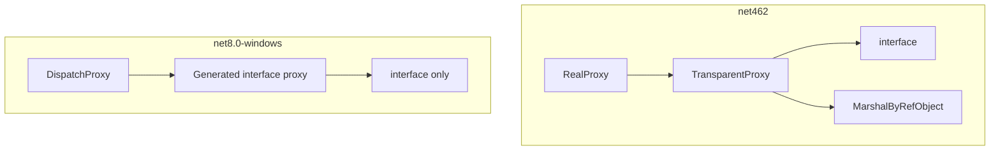
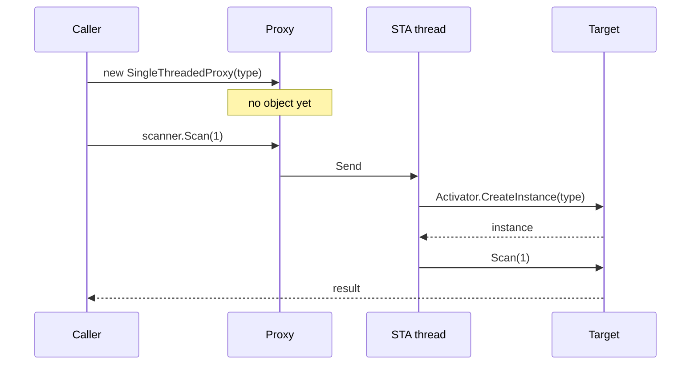
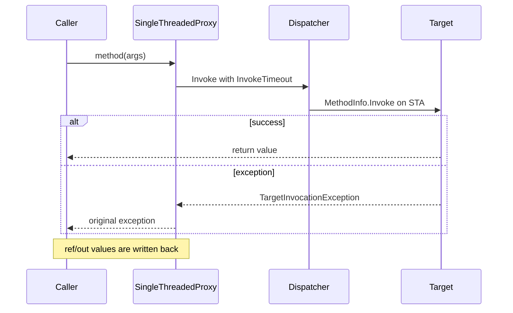

[All products](../) / [Saraff.ThreadingModel.NET](./index.md)
# Proxy

`SingleThreadedProxy` is the interception layer. It implements `RealProxy` on `net462` and wraps
`DispatchProxy` on `net8.0-windows`, and every interface call is executed on a dispatcher thread.

```csharp
using Saraff.ThreadingModel;

using (var proxy = new SingleThreadedProxy(typeof(IScanner), typeof(Scanner))) {
    var scanner = proxy.GetTransparentProxy<IScanner>();
    var pages = scanner.Scan(2);
}
```

## Platform implementations

| Target | Base mechanism | Supported targets | Notes |
|---|---|---|---|
| `net462` | `System.Runtime.Remoting.Proxies.RealProxy` | interfaces, `MarshalByRefObject` | `GetTransparentProxy()` comes from `RealProxy` |
| `net8.0-windows` | `System.Reflection.DispatchProxy` | **interfaces only** | the proxy returns an interface instance |



## Constructors

| Constructor | Service type | Implementation | Dispatcher | Ownership |
|---|---|---|---|---|
| `(object instance)` | single interface of `instance.GetType()`; on `net462` — the type itself | `instance` | private | proxy owns |
| `(Type type)` | `type` on `net462`; single interface on `net8` | `type` (activated lazily) | private | proxy owns |
| `(Type type, params object[] args)` | same as above | `type` with constructor arguments | private | proxy owns |
| `(object instance, SingleThreadedDispatcher dispatcher)` | single interface on `net8`; instance type on `net462` | `instance` | shared | caller owns |
| `(Type type, SingleThreadedDispatcher dispatcher)` | as `(Type)` | `type` | shared | caller owns |
| `(Type type, SingleThreadedDispatcher dispatcher, params object[] args)` | as `(Type)` | `type` + args | shared | caller owns |
| `(Type serviceType, Type implementationType, SingleThreadedDispatcher? dispatcher = null, params object[] args)` | explicit interface | explicit implementation | shared or private | depends on `dispatcher` |

The explicit `(serviceType, implementationType, ...)` form is the safest one and is what the
Saraff.IoC helpers use.

### Interface resolution on `net8.0-windows`

`(object instance)` and `(Type type)` look for **exactly one** interface on the implementation type.
If the type implements several interfaces, the proxy throws `NotSupportedException` and asks for an
explicit interface:

```csharp
// TwoInterfaces implements IFirst and ISecond
var proxy = new SingleThreadedProxy(
    typeof(IFirst),          // service type
    typeof(TwoInterfaces));  // implementation type

var first = proxy.GetTransparentProxy<IFirst>();
```

### Lazy activation

The target object is created on the dispatcher thread on the **first call**, not in the
constructor (an instance passed to the constructor is used as-is). If the constructor throws, the
exception is rethrown to the caller and the next call tries again.



## Calls



Supported member kinds:

| Member | Supported | Notes |
|---|---|---|
| Methods with `ref`/`out`/`params` | yes | values are copied back on both platforms |
| Generic methods | yes | `T Echo<T>(T value)` works |
| Property / indexer | yes | `get_`/`set_` are **not** treated as events |
| Events | yes | see [Events](./Events.md) |
| `object` members (`ToString`, `Equals`, …) | platform-dependent | `net462` routes them through `RealProxy`; `net8.0-windows` does not forward them |
| Static members | no | interfaces cannot declare them |

## Exceptions

The proxy never wraps target exceptions:

```csharp
try {
    scanner.Fail();       // throws InvalidOperationException in the target
} catch (InvalidOperationException error) {
    // caught here, with the original message and type
}
```

Constructor exceptions behave the same way:

```csharp
using (var proxy = new SingleThreadedProxy(typeof(IBroken), typeof(BrokenCtor))) {
    var broken = proxy.GetTransparentProxy<IBroken>();
    broken.Ping();   // InvalidOperationException from the constructor, no hang
}
```

## Timeouts

```csharp
using (var proxy = new SingleThreadedProxy(typeof(IScanner), typeof(Scanner))) {
    proxy.InvokeTimeout = TimeSpan.FromMilliseconds(250);
    var scanner = proxy.GetTransparentProxy<IScanner>();

    try {
        scanner.SlowOperation();
    } catch (TimeoutException) {
        // the caller gave up; the operation may still complete on the STA thread
    }
}
```

`InvokeTimeout` applies to every call. The call is not cancelled after the timeout: it may still run
to completion. Use `Task`-based work inside the target if you need cooperative cancellation.

## Disposal

```csharp
var proxy = new SingleThreadedProxy(typeof(IScanner), typeof(Scanner));
var scanner = proxy.GetTransparentProxy<IScanner>();

proxy.Dispose();                                   // stops the owned dispatcher
Assert.Throws<ObjectDisposedException>(() => scanner.Name);
```

* Owned dispatcher: disposed with the proxy.
* Shared dispatcher: the proxy only clears its event adapters; the dispatcher stays alive.
* A proxy resolved from Saraff.IoC stops working when the container disposes the dispatcher; the
  generated transparent proxy itself is not `IDisposable`.

## Events

Event members are intercepted separately: `add_…`/`remove_…` update an adapter, and the target
receives exactly one proxy delegate. Delivery, `SynchronizationContext`, multicast and reentrancy
are described in [Events](./Events.md).

## Limitations

* `net8.0-windows`: interfaces only; a class target requires an interface.
* Events with `ref`/`out` parameters are rejected when you subscribe
  (`NotSupportedException`).
* A blocking call cannot be cancelled once it has started.
* The proxy does not create a synchronization context for the caller; blocking calls keep the
  caller blocked for the whole call.
