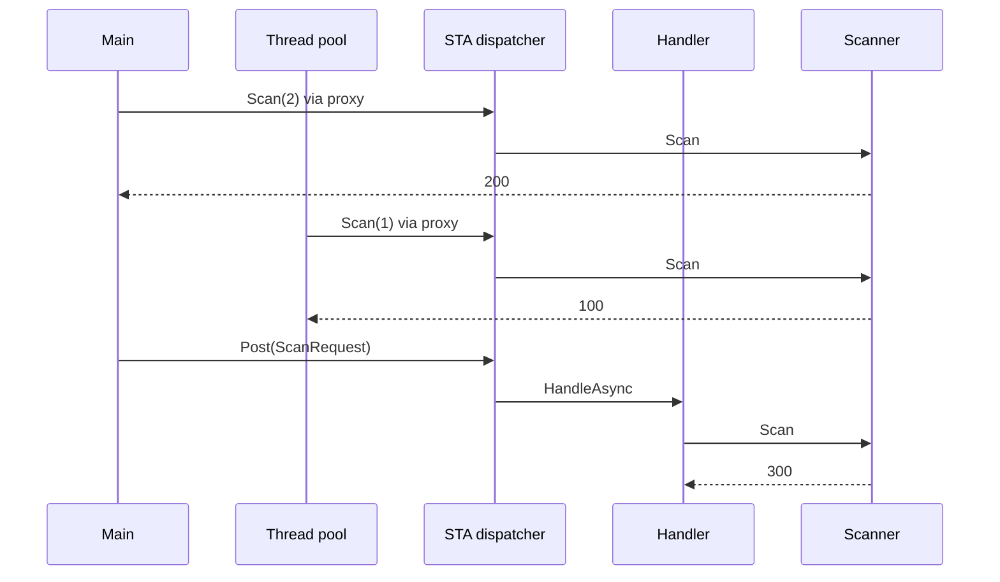

[All products](../) / [Saraff.ThreadingModel.NET](./index.md)
# Samples

Two runnable console samples live in the repository
([source](https://github.com/saraff-9EB1047A4BEB4cef8506B29BA325BD5A/Saraff.ThreadingModel.NET/tree/master/samples)).
Both target `net8.0-windows` and can be started with `dotnet run`.

| Sample | Path | Focus |
|---|---|---|
| DI + queue | `samples/Saraff.ThreadingModel.Sample` | Saraff.IoC, named dispatcher, proxy, message queue, scopes, errors, events |
| Plain | `samples/Saraff.ThreadingModel.Sample.Plain` | Dispatcher and proxy without a container, shared dispatcher |

```powershell
dotnet run --project samples/Saraff.ThreadingModel.Sample
dotnet run --project samples/Saraff.ThreadingModel.Sample.Plain
```

## DI + queue sample

What it demonstrates:

1. A named dispatcher with a custom thread name, handler timeout and shutdown timeout.
2. A proxy registered in Saraff.IoC and resolved as `IScanner`.
3. An event subscriber that sees the dispatcher thread id.
4. A direct call from a thread-pool thread.
5. Messages posted with `Post` and awaited with `PostAsync`.
6. A `Scoped` session object created and disposed for every message.
7. A faulty message that goes through `IQueueMessageErrorHandler` while the queue keeps running.

Key excerpt:

```csharp
using(var container = new ServiceContainer()) {
    container.RegisterSingleThreadedDispatcher("scanner", options => {
        options.ThreadName = "SARAFF STA Scanner";
        options.HandlerTimeout = TimeSpan.FromSeconds(10);
        options.DisposeTimeout = TimeSpan.FromSeconds(5);
    });
    container.RegisterSingleThreadedProxy<IScanner, Scanner>("scanner");
    container.Register<ScanSession, ScanSession>(ServiceLifetime.Scoped);
    container.RegisterQueueMessageHandler<ScanRequest, ScanRequestHandler>();
    container.RegisterQueueErrorHandler<ConsoleErrorHandler>(ServiceLifetime.Singleton);

    var dispatcher = container.ResolveNamed<SingleThreadedDispatcher>("scanner");
    var scanner = container.Resolve<IScanner>();

    scanner.Completed += (sender, args) =>
        Console.WriteLine($"  [event]   pages: {args.Pages}, thread: {Thread.CurrentThread.ManagedThreadId}");

    Console.WriteLine($"Main thread: {Thread.CurrentThread.ManagedThreadId}");
    Console.WriteLine($"STA object thread: {scanner.ThreadId}, apartment: {scanner.Apartment}");
    Console.WriteLine($"Scan(2) => {scanner.Scan(2)}");

    var fromPool = await Task.Run(() => scanner.Scan(1));
    Console.WriteLine($"  [pool]    thread: {Thread.CurrentThread.ManagedThreadId}, result: {fromPool}");

    dispatcher.Post(new ScanRequest(3, "invoice"));
    dispatcher.Post(new ScanRequest(5, "contract"));
    await dispatcher.PostAsync(new ScanRequest(7, "passport"));
    dispatcher.Post(new ScanRequest(-1, "broken"));
}
```

Expected shape of the output (ids vary):

```text
Main thread: 2
STA object thread: 4, apartment: STA
  [event]   pages: 2, thread: 4
Scan(2) => 200
  [event]   pages: 1, thread: 4
  [pool]    thread: 5, result: 100
  [session] 'invoice': scanning 3 pages, thread 4
  [handler] 'invoice': result 300
  [session] disposed (thread 4)
  ...
  [error]   ScanRequest: InvalidOperationException: Invalid page count: -1.
  [session] disposed (thread 4)
Shutdown: the container disposes the dispatcher and scoped sessions.
```

What to notice:

* Every proxy call and every handler runs on thread `4` (the dispatcher thread).
* The thread-pool caller keeps its own thread `5`.
* The scoped session is disposed after each message, including the failing one.
* The error does not stop the queue.



## Plain sample

Shows the core without any container:

```csharp
using(var dispatcher = new SingleThreadedDispatcher(new SingleThreadedDispatcherOptions {
    ThreadName = "plain STA"
}))
using(var proxy = new SingleThreadedProxy(
    typeof(IClock), typeof(SingleThreadedClock), dispatcher)) {
    var clock = proxy.GetTransparentProxy<IClock>();

    clock.Ticked += (sender, args) =>
        Console.WriteLine($"  [event]   {args.Ticks} ticks, thread {Thread.CurrentThread.ManagedThreadId}");

    Console.WriteLine($"Main thread: {Thread.CurrentThread.ManagedThreadId}");
    Console.WriteLine($"Object thread: {clock.ThreadId}, apartment: {clock.Apartment}");
    Console.WriteLine($"Tick() => {clock.Tick()}");
}
```

Expected output:

```text
Main thread: 2
Object thread: 4, apartment: STA
  [event]   1 ticks, thread 4
Tick() => 1
  [event]   2 ticks, thread 4
Tick() => 2
Proxy disposed; the shared dispatcher keeps running.
```

What to notice:

* The proxy uses an **external** dispatcher and does not dispose it.
* The event handler runs on the dispatcher thread because the subscription happened on a thread
  without a synchronization context.
* `Apartment` is `STA` even though the caller is not.

## Mapping samples to documentation

| Sample part | Documentation |
|---|---|
| Dispatcher registration and options | [Dispatcher](./Dispatcher.md) |
| Proxy construction and calls | [Proxy](./Proxy.md) |
| Event subscription and delivery | [Events](./Events.md) |
| Queue handlers, scopes, errors | [Message Queue](./MessageQueue.md) |
| Container registration and lifetimes | [Dependency Injection](./DependencyInjection.md) |
