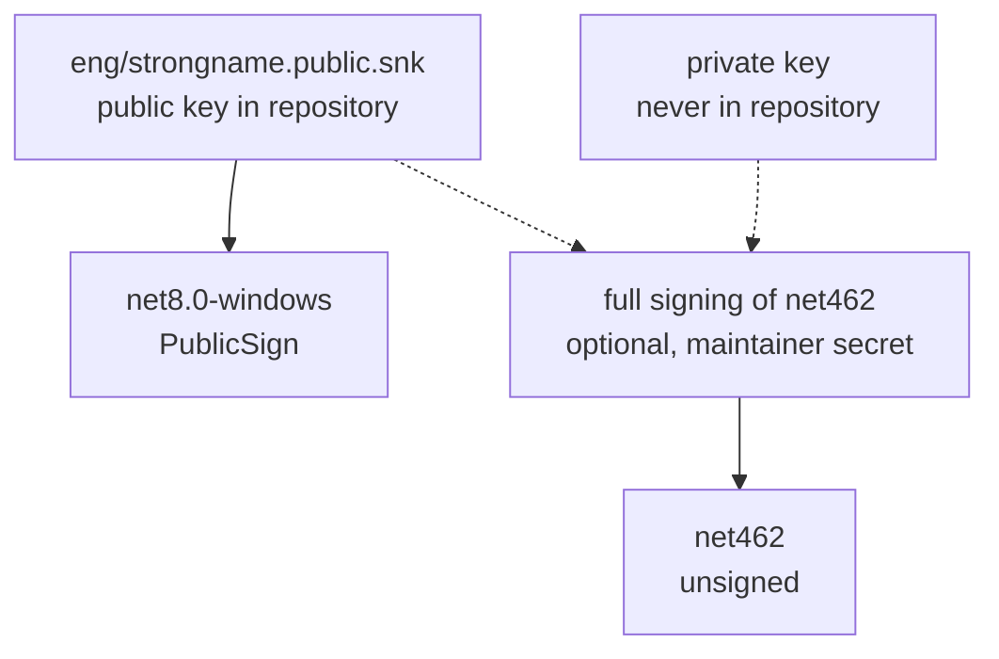

[All products](../) / [Saraff.ThreadingModel.NET](./index.md)
# Strong Name

The 2.0 package has a **public-signed** `net8.0-windows` assembly and an **unsigned** `net462`
assembly. This is a deliberate split caused by platform behavior, not an omission.

| Target | Signing | Public key token |
|---|---|---|
| `net8.0-windows` | `PublicSign` | `54f373c993f693dc` |
| `net462` | none | — |

## Why the old key was removed

Version 1.x shipped `sign.snk` **inside the repository**. That file contained the private key, so
the strong name provided no authenticity: anyone could produce an assembly with the same identity.
The key was removed and never reused. The new identity uses a public key only.



## Configuration

`src/Saraff.ThreadingModel/Saraff.ThreadingModel.csproj`:

```xml
<PropertyGroup Condition="'$(TargetFramework)' == 'net8.0-windows'">
  <SignAssembly>true</SignAssembly>
  <PublicSign>true</PublicSign>
  <AssemblyOriginatorKeyFile>..\..\eng\strongname.public.snk</AssemblyOriginatorKeyFile>
</PropertyGroup>
```

`PublicSign` tells the compiler to set the strong-name identity from the public key without
producing a cryptographic signature. The CLR on .NET Core/.NET 5+ does not verify strong-name
signatures, so the assembly has a stable identity without a private key.

The `.NET Framework` CLR **does** verify signatures and rejects public-signed/delay-signed
assemblies with `HRESULT 0x80131045`. That is why `net462` is left unsigned instead of shipping an
assembly that may fail to load.

## CI verification

The workflow fails if the modern assembly loses its identity or the token changes:

```yaml
- name: Verify strong name
  shell: pwsh
  run: |
    $assemblyPath = Resolve-Path 'src/Saraff.ThreadingModel/bin/Release/net8.0-windows/Saraff.ThreadingModel.dll'
    $token = [System.Reflection.AssemblyName]::GetAssemblyName($assemblyPath).GetPublicKeyToken()
    if (-not $token) { throw 'The net8.0-windows assembly is not public-signed.' }
    $hex = ($token | ForEach-Object { $_.ToString('x2') }) -join ''
    if ($hex -ne '54f373c993f693dc') { throw "Unexpected public key token: $hex" }
```

Local verification:

```powershell
sn -T src\Saraff.ThreadingModel\bin\Release\net8.0-windows\Saraff.ThreadingModel.dll
```

```powershell
$path = 'src\Saraff.ThreadingModel\bin\Release\net8.0-windows\Saraff.ThreadingModel.dll'
$token = [System.Reflection.AssemblyName]::GetAssemblyName((Resolve-Path $path).Path).GetPublicKeyToken()
($token | ForEach-Object { $_.ToString('x2') }) -join ''
```

## Consuming the assembly

Update binding redirects and `assemblyIdentity` entries:

```xml
<!-- net8.0-windows: public-signed -->
<assemblyIdentity name="Saraff.ThreadingModel"
                  publicKeyToken="54f373c993f693dc" culture="neutral" />

<!-- net462: unsigned, no publicKeyToken attribute -->
<assemblyIdentity name="Saraff.ThreadingModel" culture="neutral" />
```

Version is `2.0.0.0`; the public key token differs from 1.x in all cases.

## If `net462` needs a strong name

A real strong name on .NET Framework requires full signing with a private key. Keep the private key
outside the repository (build machine or CI secret) and configure public signing only where it is
supported:

1. Generate a new key pair: `sn -k release.snk`.
2. Replace `eng/strongname.public.snk` with `sn -p release.snk eng/strongname.public.snk`.
3. Update the expected token in `.github/workflows/ci.yml` and this page.
4. In the build, set `SignAssembly=true`, remove `PublicSign` and point
   `AssemblyOriginatorKeyFile` to the private key file:

```xml
<PropertyGroup Condition="'$(TargetFramework)' == 'net462'">
  <SignAssembly>true</SignAssembly>
  <PublicSign>false</PublicSign>
  <AssemblyOriginatorKeyFile>$(SaraffStrongNameKey)</AssemblyOriginatorKeyFile>
</PropertyGroup>
```

5. Pass `SaraffStrongNameKey` from a CI secret (environment variable or MSBuild property).

Never commit the private key. Replacing the key changes the public key token for all targets; treat
it as a breaking identity change and update the migration notes.

## Notes

* Strong naming is **identity and binding**, not trust or tamper protection. Use NuGet package
  signing and reproducible builds for supply-chain guarantees.
* NuGet does not require assemblies to be strong-named.
* The package has no `InternalsVisibleTo`; if you add one to a public-signed assembly, the friend
  assembly must have a matching strong-name identity, which public signing cannot provide
  cryptographically.
* See [Migration](./Migration.md) for the 1.x → 2.0 identity change.
