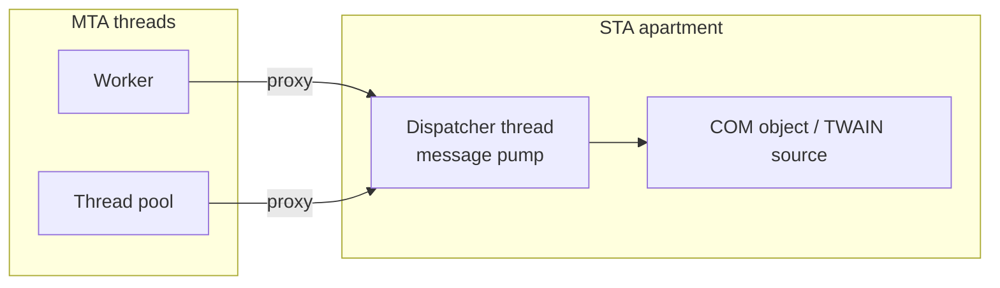
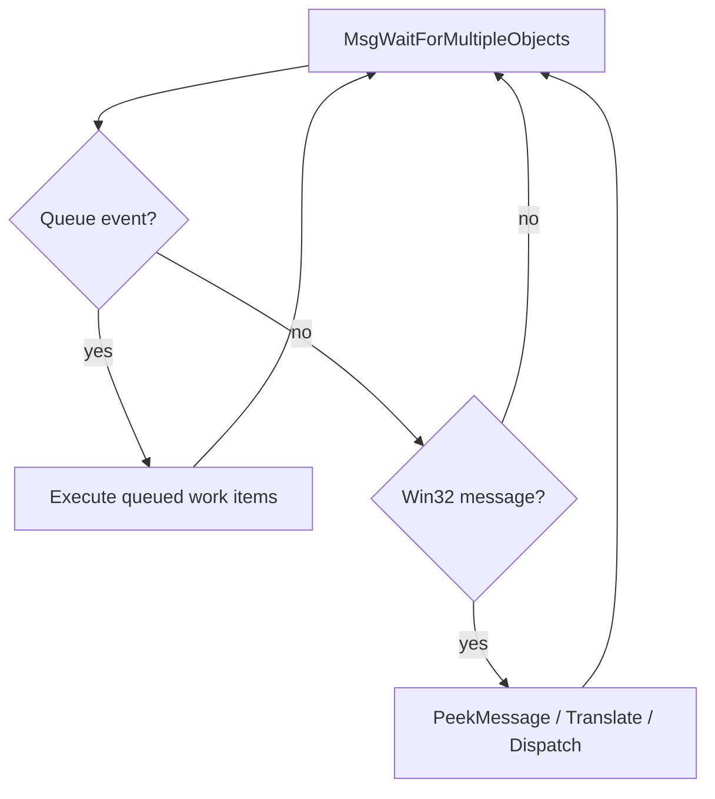
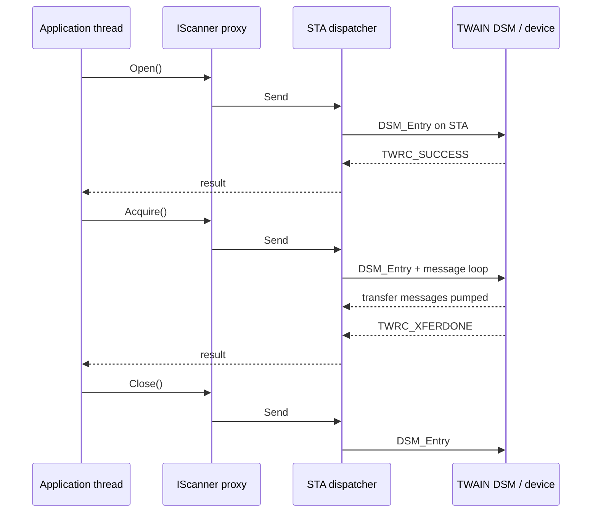
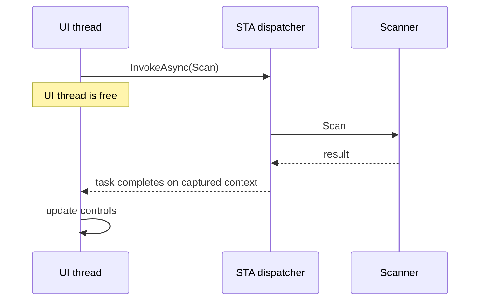
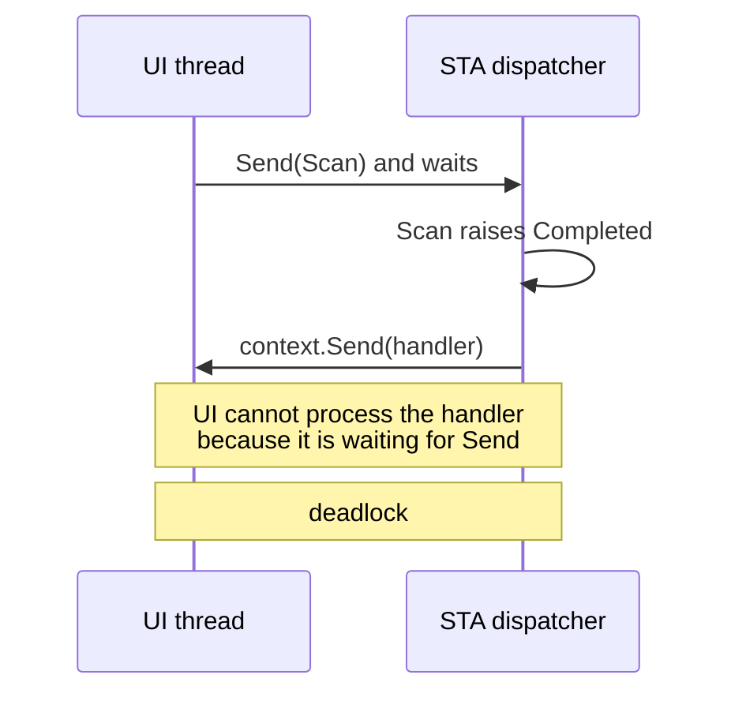
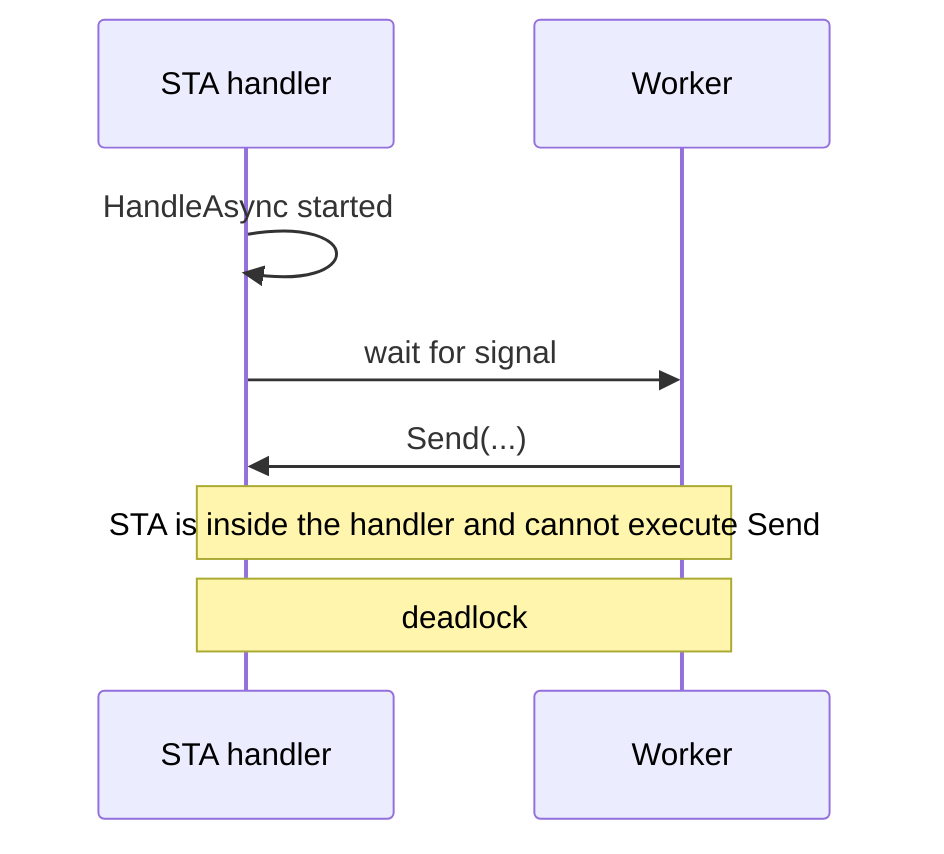

[All products](../) / [Saraff.ThreadingModel.NET](./index.md)
# Threading and COM

The library exists because some objects must live on a specific thread. COM components, TWAIN data
sources, UI controls and many vendor SDKs expect their calls to arrive on an STA thread that also
processes Windows messages. Everything else in the application can stay multi-threaded.

## Apartments in one picture



* An **STA** apartment is single-threaded: objects created in it must be used from that thread.
* A **message pump** is required for cross-apartment COM calls: the caller's RPC requests are
  delivered as Windows messages, and the STA thread must dispatch them.
* Without a pump, an incoming call can wait forever even though the STA thread is "alive".

Saraff.ThreadingModel starts the thread with `ApartmentState.STA` and pumps messages with
`MsgWaitForMultipleObjects` (`UseMessagePump = true` by default).

## What the pump does



* The thread waits efficiently for either internal work or incoming Win32 messages.
* COM calls are dispatched while the thread is idle.
* Messages are also pumped while a queue handler awaits (`HandlerTimeout` loop), so an `await` in a
  handler does not freeze COM.

## Verification

```csharp
using (var proxy = new SingleThreadedProxy(typeof(IScanner), typeof(Scanner))) {
    var scanner = proxy.GetTransparentProxy<IScanner>();
    Console.WriteLine(scanner.Apartment);            // STA
    Console.WriteLine(scanner.ThreadId);             // stable across calls
}
```

```csharp
var dispatcher = new SingleThreadedDispatcher();
dispatcher.Send(() => {
    Console.WriteLine(Thread.CurrentThread.GetApartmentState());   // STA
    Console.WriteLine(SingleThreadedDispatcher.Current == dispatcher);   // True
});
```

## A TWAIN-like scenario



The caller is blocked for the duration of `Acquire`; the STA thread pumps messages while the device
transfers data, so the COM/TWAIN protocol can complete.

## UI threads

A UI thread is usually STA with its own `SynchronizationContext`. Two rules keep the application
responsive:

1. Do not block the UI thread with `Send`/`Invoke` for long operations.
2. Let events and completions flow back through the UI context.

```csharp
// UI event handler
private async void OnScanClick(object sender, EventArgs e) {
    var result = await dispatcher.InvokeAsync(() => scanner.Scan(10));
    label.Text = $"scanned {result}";
}
```



## Common deadlock patterns

### 1. UI thread blocks on the dispatcher

```csharp
var value = scanner.SlowOperation();   // called from a UI event handler
```

Not a deadlock by itself, but the UI freezes until the STA finishes. Use `InvokeAsync`/`PostAsync`.

### 2. Dispatcher sends an event to the blocked UI thread



The event adapter captures the UI `SynchronizationContext` at subscription time and calls
`context.Send`, which requires the UI thread. The UI thread is blocked in `Send` to the dispatcher.

**Fix:** use `InvokeAsync`/`PostAsync` on the UI thread, or unsubscribe/raise events without a UI
context on the dispatcher thread.

### 3. Handler waits for a thread that calls the same dispatcher



**Fix:** handlers must not synchronously wait for callbacks into the same dispatcher. Use `Post`
(fire and forget) or redesign the flow.

### 4. `Task.Result` or `.Wait()` on the UI thread

```csharp
var task = dispatcher.InvokeAsync(() => scanner.Scan(1));
var result = task.Result;     // blocks the UI context; continuations cannot run
```

**Fix:** `await` instead of blocking.

## Guidelines

| Situation | Do | Avoid |
|---|---|---|
| UI event | `await dispatcher.InvokeAsync(...)` | `Send`/`Invoke` on the UI thread |
| Queue handler | call the proxy directly | waiting for another thread that calls back |
| Event subscriber | quick handler; marshal long work out | blocking the dispatcher in a handler |
| Background worker | `Send` if the result is needed, `Post` otherwise | taking locks that the STA also takes |
| Shutdown | `Dispose` the owner (container/proxy/dispatcher) | leaving the dispatcher running in a loop |

## Notes

* .NET initializes COM on the thread automatically; the library does not call `CoInitializeEx` for
  you because the thread is managed by the CLR.
* `ApartmentState.MTA` is allowed but disables the COM affinity guarantees described here.
* `UseMessagePump = false` is useful for tests and pure CPU work; do not use it for COM objects.
* A dispatcher thread is a background thread: it never prevents process exit.
