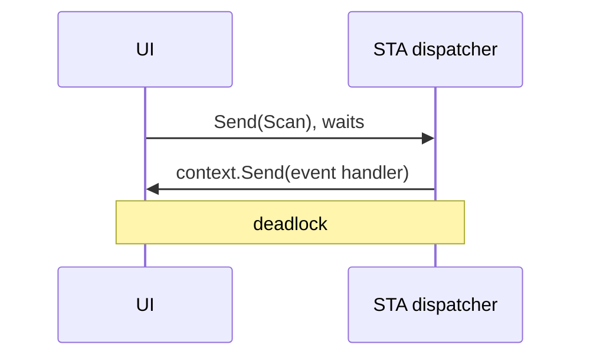

[All products](../) / [Saraff.ThreadingModel.NET](./index.md)
# Troubleshooting

## Quick symptoms

| Symptom | Likely cause | Fix |
|---|---|---|
| Call never returns | deadlock between UI thread, dispatcher and event `Send` | use `InvokeAsync`/`PostAsync`, see [Threading and COM](./ThreadingAndCom.md) |
| `TimeoutException` | `InvokeTimeout`/`HandlerTimeout` too small or the target is stuck | raise the timeout, find the blocking call inside the target |
| `ObjectDisposedException` | dispatcher/proxy/container already disposed | check disposal order; do not cache proxies across container shutdown |
| `InvalidOperationException` "dispatcher created without IServiceProvider" | `Post(message)` on a dispatcher created with `services: null` | pass an `IServiceProvider` or use `Post(Action)` |
| `InvalidOperationException` "Dispatcher 'x' is not registered" | proxy bound to a name that was never registered | call `RegisterSingleThreadedDispatcher("x")` first |
| `InvalidOperationException` "no handler registered" | message type has no handler | register one or set `IgnoreUnhandledMessages` |
| `NotSupportedException` on a proxy | `net8.0-windows` class target or multiple interfaces | use `(serviceType, implementationType, ...)` with an interface |
| `NotSupportedException` on `+= event` | delegate has `ref`/`out` parameters | use an event delegate without by-ref parameters |
| UI freezes during a call | blocking `Send`/`Invoke` on the UI thread | `await dispatcher.InvokeAsync(...)` |
| COM call hangs | pump disabled or wrong apartment | keep `UseMessagePump = true` and `ApartmentState.STA` |
| Event handler never runs | subscription was disposed, or handler context cannot `Send` | keep the proxy alive; check the captured `SynchronizationContext` |

## A call does not return

### Deadlock with an event subscriber

The adapter captures the subscriber `SynchronizationContext` and calls `Send` when the target raises
an event. If the UI thread is blocked waiting for the same proxy call, it cannot process `Send`.



**Fix:** do not block the UI thread on the dispatcher. Use `InvokeAsync`/`PostAsync`:

```csharp
private async void OnScan(object sender, EventArgs e) {
    var result = await dispatcher.InvokeAsync(() => scanner.Scan(1));
    label.Text = result.ToString();
}
```

### Handler waits for a callback into the same dispatcher

A queue handler runs on the dispatcher thread. If it blocks until another thread calls `Send` on the
same dispatcher, the nested call can never start.

```csharp
public Task HandleAsync(ScanRequest message, CancellationToken ct) {
    this._worker.DoWork();
    this._worker.Done.WaitOne();     // the worker's dispatcher.Send never runs
    return Task.CompletedTask;
}
```

**Fix:** use `Post` for the notification, make the handler asynchronous, or use a separate
dispatcher for the other component.

### The target itself blocks

A synchronous call cannot be cancelled. If the vendor API never returns, the caller eventually gets
`TimeoutException` (if configured) but the dispatcher thread stays busy.

```csharp
proxy.InvokeTimeout = TimeSpan.FromSeconds(30);
```

Check the target with the vendor's own diagnostics; the library cannot interrupt a native call.

## `TimeoutException`

| Where | Option | Meaning |
|---|---|---|
| `Send`/`Invoke`/proxy call | `InvokeTimeout` | the caller stopped waiting; the call may still complete later |
| Queue handler | `HandlerTimeout` | the handler (including awaits) exceeded the limit; `TimeoutException` goes to error handlers |

Timeouts do not abort the target operation. Keep the timeout long enough for legitimate work, and
make handler work cooperatively cancellable through the provided token.

## `ObjectDisposedException`

* Calls after `Dispose` are rejected by design.
* Resolving a proxy from a disposed container, or reusing a proxy after the container is disposed,
  produces this exception.
* Disposal order: stop producers (UI/worker), then dispose the container/proxy, then dispose the
  dispatcher if you own it.
* `Dispose` called from the dispatcher thread itself does not wait; calls made afterwards still throw.

## Queue configuration errors

### "Dispatcher was created without IServiceProvider"

`Post<TMessage>` needs the service provider passed to the dispatcher constructor:

```csharp
var dispatcher = new SingleThreadedDispatcher(services: container);
```

When using Saraff.IoC, `RegisterSingleThreadedDispatcher` does this for you.

### "Service IQueueMessageHandler<T> is not registered"

The handler type was registered but the dispatcher could not resolve it in the message scope:

* check that the handler implements `IQueueMessageHandler<T>` for the **runtime** message type or a
  base type;
* check the handler constructor: Saraff.IoC needs `[ServiceRequired]` when the constructor is not
  parameterless;
* check that scoped dependencies have a registration.

### No handler for a message

```text
InvalidOperationException: no handler registered for message MyApp.UnknownMessage
```

Register a handler for that type, for a base type, or for `object`. To silently ignore unknown
messages:

```csharp
options.IgnoreUnhandledMessages = true;
```

### Queue overflow

`MaxQueueLength` limits queued items (not including the currently running one). Overflow throws
`InvalidOperationException` at `Post` time. Increase the limit or apply backpressure.

## Proxy creation errors (`net8.0-windows`)

### "SingleThreadedProxy supports interfaces only"

`DispatchProxy` cannot proxy classes. Use an interface as the service type:

```csharp
new SingleThreadedProxy(typeof(IScanner), typeof(Scanner));
```

### "Type implements N interfaces"

The implicit constructors require exactly one interface. Specify it explicitly:

```csharp
new SingleThreadedProxy(typeof(IFirst), typeof(TwoInterfaces));
```

## Event problems

### Event with `ref`/`out`

```text
NotSupportedException: events with ref/out parameters are not supported
```

Redesign the event delegate to return values or use a separate method. Expression trees cannot
represent by-ref event parameters safely.

### Handler runs on an unexpected thread

| Subscription thread | Delivery thread |
|---|---|
| No `SynchronizationContext` | dispatcher thread |
| UI thread | UI thread (`Send`) |
| Another dispatcher thread | that dispatcher |

If you need to move work to a specific thread, capture the context yourself and marshal inside the
handler.

### Slow or blocking event handler

Event delivery is synchronous. A handler that waits for the UI, performs I/O, or calls back into the
dispatcher delays everything behind it. Keep handlers short; use `Post`/`PostAsync` for long work.

## UI and COM

* **UI freeze:** see the deadlock section above.
* **COM call hangs:** verify `scanner.Apartment == ApartmentState.STA` and that `UseMessagePump` is
  `true` (default). Do not disable the pump for COM objects.
* **"The application called an interface that was marshalled for a different thread":** the object
  was created outside the dispatcher (for example, resolved from the container directly instead of
  through the proxy).
* **Message filter / reentrancy issues:** the pump dispatches all pending messages; if the vendor SDK
  installs a message filter, make sure it is compatible with an STA thread.

## Diagnostics

```csharp
var dispatcher = new SingleThreadedDispatcher(options => ...);

dispatcher.UnhandledException += error =>
    Console.Error.WriteLine($"dispatcher error: {error}");

dispatcher.Send(() => {
    Console.WriteLine($"thread: {Thread.CurrentThread.ManagedThreadId}");
    Console.WriteLine($"is dispatcher thread: {dispatcher.IsDispatcherThread}");
    Console.WriteLine($"apartment: {Thread.CurrentThread.GetApartmentState()}");
});
```

* `ThreadId` — stable identity of the worker.
* `IsDispatcherThread` — cheap reentrancy check.
* `SingleThreadedDispatcher.Current` — useful inside handlers and event subscribers.
* Queue errors are also visible through `PostAsync` completion tasks.

## Tests and CI

* STA is a Windows concept; `Thread.GetApartmentState()` on non-Windows targets returns `Unknown`.
  Tests in this repository run on Windows.
* `net8.0-windows` tests use `RollForward=Major` so they can run on a newer installed runtime.
* `net462` tests run on .NET Framework 4.8 through VSTest.
* If a test appears to hang, check for a blocking `Send` on a thread whose context is required by an
  event `Send`, or a handler that waits for a callback into the same dispatcher.
