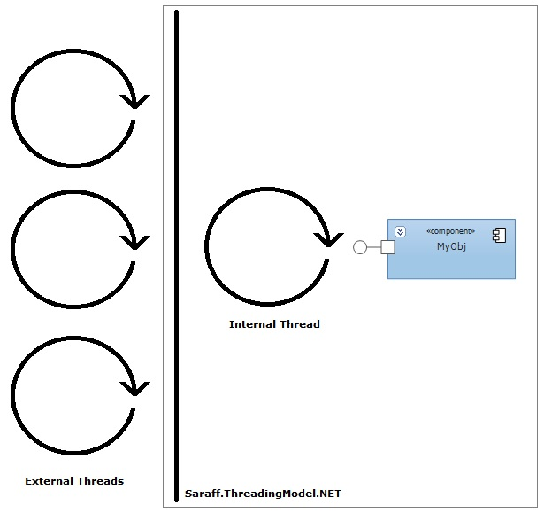
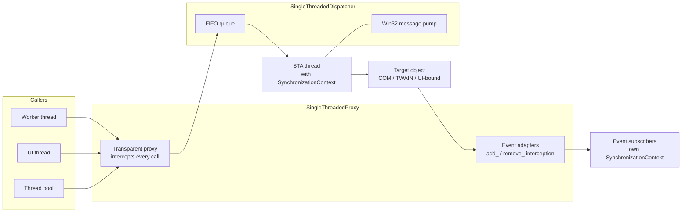

[All products](../)
# Saraff.ThreadingModel.NET

**Saraff.ThreadingModel.NET** is a single-threaded execution model for .NET. It gives you:

* a dedicated worker thread with a **Win32 message pump** (STA by default);
* an **interface proxy** that marshals every call to that thread;
* a **message queue** whose handlers are resolved from a DI container;
* **event forwarding** back to subscribers, honoring their `SynchronizationContext`.

This is the model COM and TWAIN objects expect: the object is created, used and destroyed on one
STA thread, while the rest of the application stays multi-threaded.

| | |
|---|---|
| **Package** | [`Saraff.ThreadingModel`](https://www.nuget.org/packages/Saraff.ThreadingModel/) |
| **Version** | 2.0 |
| **Target frameworks** | `net462`, `net8.0-windows` |
| **Namespaces** | `Saraff.ThreadingModel`, `Saraff.ThreadingModel.Messaging`, `Saraff.ThreadingModel.DependencyInjection` |
| **Container** | [Saraff.IoC](https://www.nuget.org/packages/Saraff.IoC/) 2.0.0 |
| **License** | LGPL-3.0-or-later |

> **Upgrading from 1.x?** The public `SingleThreadedProxy` constructors and `GetTransparentProxy`
> are preserved, but the internals, target frameworks and serialization semantics changed.
> See [Migration](./Migration.md).
>
> Version 2.0 is the current source version of the repository. The 1.x package remains on NuGet for
> projects that must stay on .NET Framework 2.0.



## The model in one picture



Everything the target object sees happens on one thread. Callers keep their own threads and block
only for the duration of a call — or switch to `InvokeAsync`/`PostAsync` and stay non-blocking.

## Quick start: proxy

```csharp
using System.Threading;
using Saraff.ThreadingModel;

public interface IScanner {
    int ThreadId { get; }
    ApartmentState Apartment { get; }
    int Scan(int pages);
    event EventHandler<ScanCompletedEventArgs>? Completed;
}

using (var proxy = new SingleThreadedProxy(typeof(IScanner), typeof(Scanner))) {
    var scanner = proxy.GetTransparentProxy<IScanner>();

    Console.WriteLine(scanner.ThreadId);    // dispatcher thread, not the caller
    Console.WriteLine(scanner.Apartment);   // STA
    Console.WriteLine(scanner.Scan(2));
}
```

## Quick start: dispatcher and message queue

```csharp
using Saraff.IoC;
using Saraff.ThreadingModel;
using Saraff.ThreadingModel.DependencyInjection;

using (var container = new ServiceContainer()) {
    container.RegisterSingleThreadedDispatcher("scanner", options => {
        options.ThreadName = "STA Scanner";
        options.HandlerTimeout = TimeSpan.FromSeconds(10);
    });
    container.RegisterSingleThreadedProxy<IScanner, Scanner>("scanner");
    container.Register<ScanSession, ScanSession>(ServiceLifetime.Scoped);
    container.RegisterQueueMessageHandler<ScanRequest, ScanRequestHandler>();

    var dispatcher = container.ResolveNamed<SingleThreadedDispatcher>("scanner");
    var scanner = container.Resolve<IScanner>();

    dispatcher.Post(new ScanRequest(3, "invoice"));
    await dispatcher.PostAsync(new ScanRequest(7, "passport"));
}
```

Handlers are ordinary container services:

```csharp
public sealed class ScanRequestHandler : IQueueMessageHandler<ScanRequest> {
    private readonly IScanner _scanner;
    private readonly ScanSession _session;

    [ServiceRequired]
    public ScanRequestHandler(IScanner scanner, ScanSession session) {
        this._scanner = scanner;
        this._session = session;
    }

    public Task HandleAsync(ScanRequest message, CancellationToken cancellationToken) {
        this._session.Log(message.Name);
        this._scanner.Scan(message.Pages);   // already on the dispatcher thread
        return Task.CompletedTask;
    }
}
```

## What is inside

| Area | What you get |
|---|---|
| **Dispatcher** | Dedicated thread, STA by default, Win32 message pump, FIFO queue, `Send`/`Invoke`/`InvokeAsync`/`Post`/`PostAsync`, timeouts, `IDisposable`/`IAsyncDisposable` |
| **Proxy** | Interface proxy on `net8.0-windows` (`DispatchProxy`) and `net462` (`RealProxy`); `ref/out`, generics, properties, events |
| **Events** | `add_`/`remove_` interception, multicast, `null` arguments, non-`void` delegates, delivery through the subscriber's `SynchronizationContext` |
| **Message queue** | `IQueueMessageHandler<T>`, scope per message, ordering, `HandlerTimeout`, `MaxQueueLength`, error handlers |
| **DI** | First-class [Saraff.IoC](https://www.nuget.org/packages/Saraff.IoC/) integration: named dispatchers, lifetimes, proxies, handlers, automatic disposal |
| **Diagnostics** | `UnhandledException`, `ThreadId`, `IsDispatcherThread`, `SingleThreadedDispatcher.Current` |
| **Samples** | A DI/queue sample and a plain dispatcher/proxy sample in the repository |

## Platform matrix

| Target | Proxy implementation | Class targets | Async dispatcher APIs | Saraff.IoC assembly |
|---|---|---|---|---|
| `net462` | `RealProxy` / `TransparentProxy` | interfaces and `MarshalByRefObject` | `DisposeAsync` not available | `net40` (synchronous) |
| `net8.0-windows` | `DispatchProxy` | **interfaces only** | `IAsyncDisposable` | `netstandard2.0` |

## Documentation map

### Start here

* [Getting Started](./GettingStarted.md) — install, first proxy, first queue message
* [Architecture](./Architecture.md) — threads, queues, message pump, event adapters
* [Threading and COM](./ThreadingAndCom.md) — why STA, pumping, UI threads and deadlock patterns

### Using the library

* [Dispatcher](./Dispatcher.md) — `SingleThreadedDispatcher`, options, timeouts, lifecycle
* [Proxy](./Proxy.md) — constructors, transparent proxy, exceptions, `ref/out`
* [Events](./Events.md) — forwarding, `SynchronizationContext`, reentrancy, limitations
* [Message Queue](./MessageQueue.md) — handlers, scopes, ordering, errors, timeouts
* [Dependency Injection](./DependencyInjection.md) — Saraff.IoC registration and lifetimes

### Reference

* [API Reference](./ApiReference.md) — public types and members
* [Strong Name](./StrongName.md) — public signing, token and net462 caveat
* [Samples](./Samples.md) — what the sample projects demonstrate
* [Migration from 1.x](./Migration.md) — breaking changes and code before/after
* [Troubleshooting](./Troubleshooting.md) — symptoms, causes and fixes

## Design principles

* **One thread owns the object.** The target is never touched from two threads at once; callers are
  serialized by the dispatcher queue.
* **Explicit concurrency.** `Send` and `Invoke` block by design; `InvokeAsync` and `Post` do not.
  Timeouts are opt-in.
* **No hidden IL.** Event adapters are built with expression trees; there are no generated
  assemblies, no `RunAndSave`, and no unloadable dynamic types.
* **Deterministic shutdown.** `Dispose` stops the thread, rejects new work with
  `ObjectDisposedException`, and never leaves a background thread spinning.
* **Container-agnostic core, first-class Saraff.IoC.** The dispatcher accepts any
  `IServiceProvider`; registration helpers live in `Saraff.ThreadingModel.DependencyInjection`.

## Known limitations

* On `net8.0-windows`, `SingleThreadedProxy` supports **interfaces only** (`DispatchProxy`).
* Events whose delegate has `ref`/`out` parameters are rejected with `NotSupportedException`.
* A synchronous call that is already running cannot be cancelled; `CancellationToken` applies
  to queued work and handlers.
* Event handlers run synchronously; an exception in a handler propagates to the caller that
  triggered the event.
* `net8.0-windows` is public-signed (`54f373c993f693dc`); `net462` is unsigned — see
  [Strong Name](./StrongName.md).
