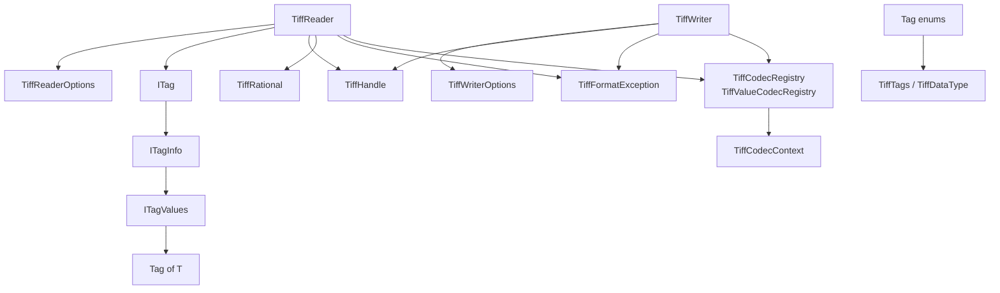

[All products](../) / [Saraff.Tiff.NET](./index.md)
# API reference

This page is a compact map of the public API. Full behavior is described in
[Reader](./reader.md), [Writer](./writer.md) and [Safety and limits](./safety.md).

## Namespaces

| Namespace | Contents |
|---|---|
| `Saraff.Tiff` | `TiffReader`, `TiffWriter`, `Tag<T>`, `ITag`, `ITagInfo`, `ITagValues`, `TiffHandle`, `TiffRational`, options, exceptions |
| `Saraff.Tiff.Core` | `TiffTags`, `TiffDataType`, tag enums, codec interfaces/registries, `TiffCodecContext`, `TiffCompressionCodecNone`, `TiffTagAttribute`, `TiffTagRegistry` |
| `Saraff.Tiff.Compression` | Built-in `PackBitsCodec`, `LzwCodec` and `DeflateCodec` |

## Type map

## TiffReader

| Member | Description |
|---|---|
| `static Create(Stream)` | Create a reader with default options |
| `static Create(Stream, TiffReaderOptions)` | Create a reader with explicit options |
| `ReadHeader()` | Read and validate the header |
| `ReadImageFileDirectory()` | Read the next IFD; returns its tag count |
| `ReadTag()` | Read the next tag or `null` at the end of the IFD |
| `ReadValue()` | Read the next typed value or `null` at the end of the tag |
| `ReadHandle()` | Read the next value as a `TiffHandle` |
| `ReadData(TiffHandle, long)` | Read a raw block by offset |
| `ReadData(TiffHandle, long, TiffCompression)` | Read and decompress a block with the instance registry |
| `ReadData(TiffHandle, long, TiffCompression, TiffCodecContext)` | Read and decompress with explicit codec context |
| `BaseStream` | The source stream |
| `LeaveOpen` | Whether the source stream is left open |
| `TiffVersion` | Version from the header (42) |
| `ByteOrder` | Byte order read from the header |
| `Codecs` | Compression codec registry used by the reader |
| `ValueCodecs` | Value codec registry for custom data types |
| `MaxDecodedBytes` | Decoded block limit captured from options |
| `Dispose()` | Release the reader (and the stream if `LeaveOpen` is false) |

## TiffWriter

| Member | Description |
|---|---|
| `static Create(Stream)` | Create a writer with default options |
| `static Create(Stream, TiffWriterOptions)` | Create a writer with explicit options |
| `WriteHeader()` | Write the header and return a handle to the first IFD offset |
| `WriteData(byte[])` | Write raw bytes and return a handle |
| `WriteData(byte[], TiffCompression)` | Compress and write a block with the instance registry |
| `WriteData(byte[], TiffCompression, TiffCodecContext)` | Compress and write with explicit codec context |
| `WriteImageFileDirectory(TiffHandle, Collection<ITag>)` | Write an IFD and return a handle to its next-IFD field |
| `WriteImageFileDirectory(TiffHandle, IEnumerable<ITag>)` | Convenience overload |
| `Flush()` | Flush the underlying stream |
| `BaseStream` | The target stream |
| `LeaveOpen` | Whether the target stream is left open |
| `ByteOrder` | Byte order used for the written file |
| `Codecs` | Compression codec registry used by the writer |
| `ValueCodecs` | Value codec registry for custom data types |
| `Dispose()` | Flush and optionally dispose the stream |

## Options

### TiffReaderOptions

| Property | Default | Description |
|---|---:|---|
| `LeaveOpen` | `true` | Do not dispose the source stream |
| `MaxValueBytes` | 64 MiB | Maximum size of one buffered tag value |
| `MaxDecodedBytes` | 256 MiB | Maximum decoded block size; `0` disables the limit |
| `MaxPages` | 1,000,000 | Maximum number of IFDs |
| `BaseOffset` | 0 | Absolute position of the TIFF header |
| `Codecs` | `TiffCodecRegistry.Default` | Compression codec registry |
| `ValueCodecs` | `TiffValueCodecRegistry.Default` | Value codec registry for custom data types |

### TiffWriterOptions

| Property | Default | Description |
|---|---:|---|
| `LeaveOpen` | `true` | Do not dispose the target stream |
| `ByteOrder` | `LittleEndian` | `LittleEndian` or `BigEndian` |
| `MaxValueBytes` | 64 MiB | Maximum size of one buffered tag value |
| `BaseOffset` | 0 | Absolute position of the TIFF header |
| `Codecs` | `TiffCodecRegistry.Default` | Compression codec registry |
| `ValueCodecs` | `TiffValueCodecRegistry.Default` | Value codec registry for custom data types |

## Codecs

### ITiffCompressionCodec

| Member | Description |
|---|---|
| `Compression` | The `TiffCompression` scheme handled by the codec |
| `Compress(byte[], TiffCodecContext)` | Encode a data block |
| `Decompress(byte[], TiffCodecContext)` | Decode a data block |

### TiffCodecRegistry

| Member | Description |
|---|---|
| `static Default` | Process-wide registry with all built-in codecs |
| `new TiffCodecRegistry()` | New registry with all built-in codecs |
| `static CreateEmpty()` | Registry without codecs |
| `Register(codec)` | Add a codec; throws if the scheme is already registered |
| `RegisterOrReplace(codec)` | Add or replace a codec |
| `TryGet(compression, out codec)` | Look up a codec |
| `Get(compression)` | Look up a codec or throw `NotSupportedException` |
| `Contains(compression)` | Check whether a scheme is registered |

### TiffCodecContext

| Member | Description |
|---|---|
| `TiffCodecContext()` / `(TiffByteOrder)` | Empty context |
| `TiffCodecContext(TiffByteOrder, IReadOnlyDictionary<TiffTags, object>)` | Context with tag values |
| `TiffCodecContext(..., int maxDecodedBytes)` | Context with a decoded-size limit |
| `ByteOrder` | Byte order of the TIFF stream |
| `Tags` | Tag values available to the codec |
| `MaxDecodedBytes` | Output limit; `0` means no limit |
| `TryGetValue` / `GetValue` / `GetInt32` / `GetInt32Array` | Tag accessors |

Built-in codecs: `NONE` (`TiffCompressionCodecNone` in `Saraff.Tiff.Core`), `PACKBITS`
(`PackBitsCodec`), `LZW` (`LzwCodec`), `ADOBE_DEFLATE`/`DEFLATE` (`DeflateCodec`). See
[Codecs](./codecs.md).

### ITiffValueCodec

| Member | Description |
|---|---|
| `DataType` | Custom `TiffDataType` handled by the codec |
| `Size` | Encoded size of one value, in bytes |
| `ClrType` | CLR type of a decoded value |
| `Read(byte[], int, TiffByteOrder)` | Decode one value |
| `Write(byte[], int, object, TiffByteOrder)` | Encode one value |

`TiffValueCodecRegistry` mirrors `TiffCodecRegistry`: `Default`, `Register`,
`RegisterOrReplace`, `TryGet`, `Get` and `Contains`. Built-in TIFF data types cannot be
overridden.

### TiffTagAttribute and TiffTagRegistry

| Member | Description |
|---|---|
| `TiffTagAttribute(TiffTags)` | Map an enum type to a TIFF tag |
| `TiffTagRegistry.Register(TiffTags, Type)` | Register a single mapping |
| `TiffTagRegistry.Register(Type)` | Register all annotated mappings on an enum |
| `TryGetEnumType` / `GetEnumType` | Inspect the current mappings |

## Tags

### ITag

| Member | Description |
|---|---|
| `TagId` | `TiffTags` identifier |

### ITagInfo : ITag

| Member | Description |
|---|---|
| `DataType` | TIFF data type |
| `ItemType` | CLR type of one value |
| `Count` | TIFF count; for ASCII this is the byte count |

### ITagValues : ITagInfo

| Member | Description |
|---|---|
| `GetValue(int index)` | One CLR value |
| `GetValues()` | All CLR values for writing |

### Tag&lt;T&gt;

| Member | Description |
|---|---|
| `static Create(TiffTags, params T[])` | Create a tag; rejects empty values and unsupported types |
| `TagId` | Tag identifier |
| `Values` | The CLR value array |
| `DataType` | TIFF data type inferred from `T` |
| `ItemType` | `typeof(T)` |
| `Count` | TIFF count; for `string` this is the encoded byte count |
| `GetValue(int)` / `GetValues()` | Value accessors |

## TiffHandle

| Member | Description |
|---|---|
| `ToString()` | Hexadecimal representation of the relative offset |
| `Dispose()` | Marks the handle closed; does not release data |

`TiffHandle` values are produced by `WriteData`, `WriteImageFileDirectory` and `ReadHandle`.
The offset itself is intentionally internal: pass the handle back to the library.

## TiffRational

| Member | Description |
|---|---|
| `Numerator` | Numerator |
| `Denominator` | Denominator |
| `ToDouble()` | Numeric value, `NaN` when the denominator is zero |
| `FromRaw(ulong)` / `ToRaw()` | Raw 64-bit helpers |
| `ToString()` | `numerator/denominator` |

## Exceptions

| Exception | Meaning |
|---|---|
| `TiffFormatException` | Invalid, truncated, cyclic or out-of-range TIFF data, invalid compressed data, limit exceeded |
| `NotSupportedException` | BigTIFF, data beyond 4 GiB when writing, missing codec, floating-point predictor |
| `InvalidOperationException` | Wrong call order for the reader/writer state, or a codec returned `null` |
| `ArgumentException` | Invalid handle, tag set, data type or missing predictor tags |
| `ArgumentNullException` | Null stream/options/tags/data |
| `ArgumentOutOfRangeException` | Invalid option or count |
| `ObjectDisposedException` | Reader/writer used after disposal |
| `IOException` | Underlying stream failure |

## Related pages

* [Reader](./reader.md)
* [Writer](./writer.md)
* [Codecs](./codecs.md)
* [TIFF data model](./data-model.md)
* [Safety and limits](./safety.md)
* [Migration](./migration.md)
