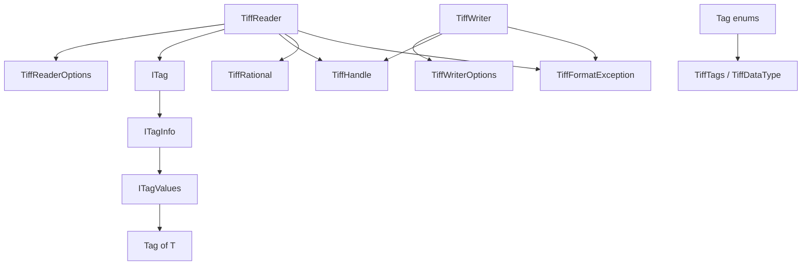

[All products](../) / [Saraff.Tiff.NET](./index.md)
# API reference

This page is a compact map of the public API. Full behavior is described in
[Reader](./reader.md), [Writer](./writer.md) and [Safety and limits](./safety.md).

## Namespaces

| Namespace | Contents |
|---|---|
| `Saraff.Tiff` | `TiffReader`, `TiffWriter`, `Tag<T>`, `ITag`, `ITagInfo`, `ITagValues`, `TiffHandle`, `TiffRational`, options, exceptions |
| `Saraff.Tiff.Core` | `TiffTags`, `TiffDataType` and the tag enums (`TiffCompression`, `TiffPhotoMetric`, ...) |

## Type map

## TiffReader

| Member | Description |
|---|---|
| `static Create(Stream)` | Create a reader with default options |
| `static Create(Stream, TiffReaderOptions)` | Create a reader with explicit options |
| `ReadHeader()` | Read and validate the header |
| `ReadImageFileDirectory()` | Read the next IFD; returns its tag count |
| `ReadTag()` | Read the next tag or `null` at the end of the IFD |
| `ReadValue()` | Read the next typed value or `null` at the end of the tag |
| `ReadHandle()` | Read the next value as a `TiffHandle` |
| `ReadData(TiffHandle, long)` | Read an arbitrary block by offset |
| `BaseStream` | The source stream |
| `LeaveOpen` | Whether the source stream is left open |
| `TiffVersion` | Version from the header (42) |
| `Dispose()` | Release the reader (and the stream if `LeaveOpen` is false) |

## TiffWriter

| Member | Description |
|---|---|
| `static Create(Stream)` | Create a writer with default options |
| `static Create(Stream, TiffWriterOptions)` | Create a writer with explicit options |
| `WriteHeader()` | Write the header and return a handle to the first IFD offset |
| `WriteData(byte[])` | Write raw bytes and return a handle |
| `WriteImageFileDirectory(TiffHandle, Collection<ITag>)` | Write an IFD and return a handle to its next-IFD field |
| `WriteImageFileDirectory(TiffHandle, IEnumerable<ITag>)` | Convenience overload |
| `Flush()` | Flush the underlying stream |
| `BaseStream` | The target stream |
| `LeaveOpen` | Whether the target stream is left open |
| `Dispose()` | Flush and optionally dispose the stream |

## Options

### TiffReaderOptions

| Property | Default | Description |
|---|---:|---|
| `LeaveOpen` | `true` | Do not dispose the source stream |
| `MaxValueBytes` | 64 MiB | Maximum size of one buffered tag value |
| `MaxPages` | 1,000,000 | Maximum number of IFDs |
| `BaseOffset` | 0 | Absolute position of the TIFF header |

### TiffWriterOptions

| Property | Default | Description |
|---|---:|---|
| `LeaveOpen` | `true` | Do not dispose the target stream |
| `ByteOrder` | `LittleEndian` | `LittleEndian` or `BigEndian` |
| `MaxValueBytes` | 64 MiB | Maximum size of one buffered tag value |
| `BaseOffset` | 0 | Absolute position of the TIFF header |

## Tags

### ITag

| Member | Description |
|---|---|
| `TagId` | `TiffTags` identifier |

### ITagInfo : ITag

| Member | Description |
|---|---|
| `DataType` | TIFF data type |
| `ItemType` | CLR type of one value |
| `Count` | TIFF count; for ASCII this is the byte count |

### ITagValues : ITagInfo

| Member | Description |
|---|---|
| `GetValue(int index)` | One CLR value |
| `GetValues()` | All CLR values for writing |

### Tag&lt;T&gt;

| Member | Description |
|---|---|
| `static Create(TiffTags, params T[])` | Create a tag; rejects empty values and unsupported types |
| `TagId` | Tag identifier |
| `Values` | The CLR value array |
| `DataType` | TIFF data type inferred from `T` |
| `ItemType` | `typeof(T)` |
| `Count` | TIFF count; for `string` this is the encoded byte count |
| `GetValue(int)` / `GetValues()` | Value accessors |

## TiffHandle

| Member | Description |
|---|---|
| `ToString()` | Hexadecimal representation of the relative offset |
| `Dispose()` | Marks the handle closed; does not release data |

`TiffHandle` values are produced by `WriteData`, `WriteImageFileDirectory` and `ReadHandle`.
The offset itself is intentionally internal: pass the handle back to the library.

## TiffRational

| Member | Description |
|---|---|
| `Numerator` | Numerator |
| `Denominator` | Denominator |
| `ToDouble()` | Numeric value, `NaN` when the denominator is zero |
| `FromRaw(ulong)` / `ToRaw()` | Raw 64-bit helpers |
| `ToString()` | `numerator/denominator` |

## Exceptions

| Exception | Meaning |
|---|---|
| `TiffFormatException` | Invalid, truncated, cyclic or out-of-range TIFF data |
| `NotSupportedException` | BigTIFF or data beyond 4 GiB when writing |
| `InvalidOperationException` | Wrong call order for the reader/writer state |
| `ArgumentException` | Invalid handle, tag set or data type |
| `ArgumentNullException` | Null stream/options/tags/data |
| `ArgumentOutOfRangeException` | Invalid option or count |
| `ObjectDisposedException` | Reader/writer used after disposal |
| `IOException` | Underlying stream failure |

## Related pages

* [Reader](./reader.md)
* [Writer](./writer.md)
* [TIFF data model](./data-model.md)
* [Safety and limits](./safety.md)
* [Migration](./migration.md)
