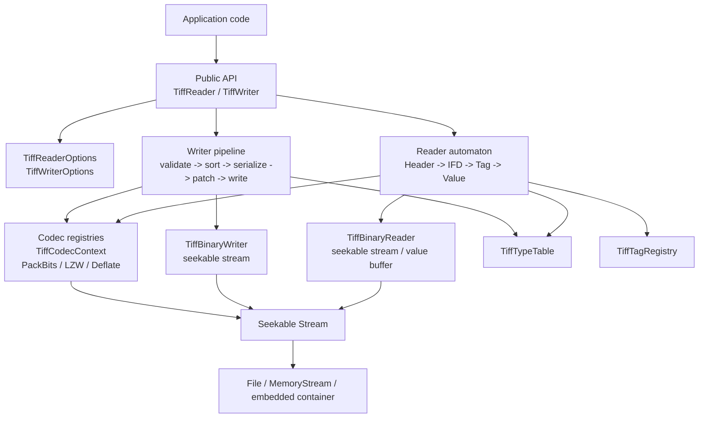
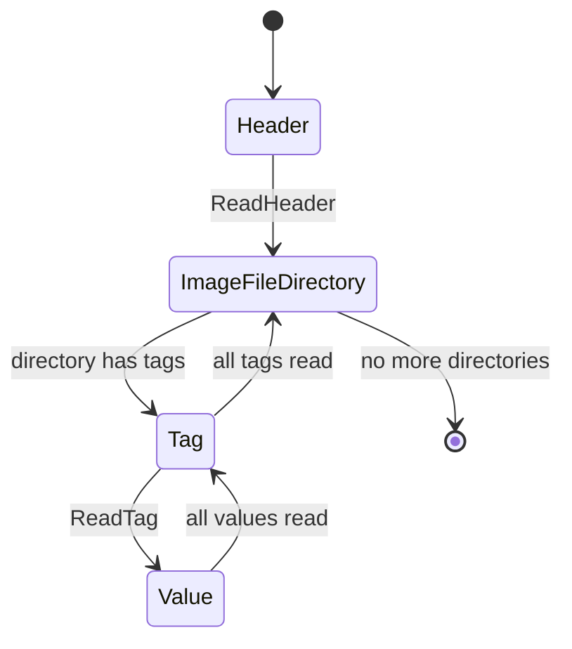
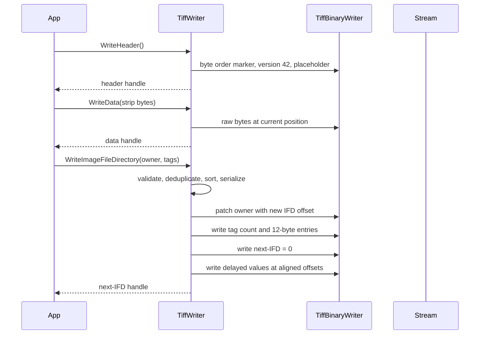
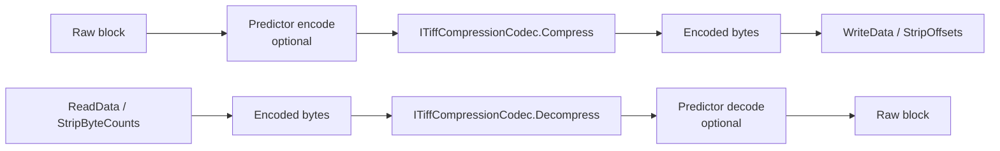
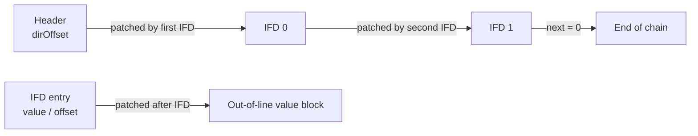
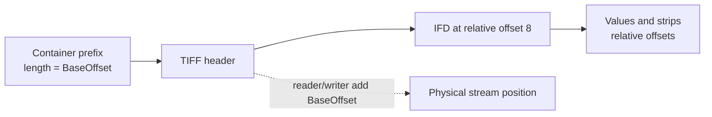
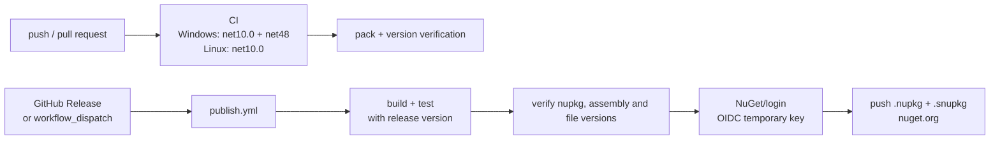

[All products](../) / [Saraff.Tiff.NET](./index.md)
# Architecture

Saraff.Tiff.NET is deliberately small. It has a **public facade**, a **reader state machine**,
a **writer pipeline** and a **binary I/O layer**. Everything is built around classic TIFF
structures: an 8-byte header, a chain of IFDs, 12-byte directory entries and typed value blocks.

## Layers

The public API never exposes the automaton or the binary primitives. It exposes TIFF concepts:
`ITag`, `TiffHandle`, `TiffTags`, `TiffDataType` and raw `byte[]` blocks.

## Public surface

| Type | Responsibility |
|---|---|
| `TiffReader` | Header, IFD chain, tag iteration, typed values, raw or decompressed data blocks |
| `TiffWriter` | Header, raw or compressed data, IFD writing, multi-page chaining |
| `TiffReaderOptions` | `LeaveOpen`, `MaxValueBytes`, `MaxDecodedBytes`, `MaxPages`, `BaseOffset`, `Codecs`, `ValueCodecs` |
| `TiffWriterOptions` | `LeaveOpen`, `ByteOrder`, `MaxValueBytes`, `BaseOffset`, `Codecs`, `ValueCodecs` |
| `Tag<T>` / `ITagValues` | Typed tag values for writing |
| `ITagInfo` | Tag id, TIFF data type, CLR item type and count for reading |
| `TiffHandle` | A relative offset to a TIFF location, used for strips/tiles/IFDs |
| `TiffRational` | RATIONAL and SRATIONAL value |
| `ITiffCompressionCodec` / `TiffCodecRegistry` | Pluggable compression and decompression |
| `ITiffValueCodec` / `TiffValueCodecRegistry` | Pluggable custom TIFF data types |
| `TiffCodecContext` | Byte order, tag values and decoded-size limit passed to a codec |
| `TiffTagRegistry` | Extensible tag-to-enum mapping |
| `TiffFormatException` | Malformed or unsafe TIFF data |

## Reader state machine

The reader is a strict automaton. `ReadValue()` must consume every value of the current tag
before the next `ReadTag()`, and the next `ReadTag()` must not be called until the current
directory is exhausted. This is what makes the reader forward-only and non-cached.

* `ReadHeader()` validates the byte-order marker, version 42 and reads the first IFD offset.
* `ReadImageFileDirectory()` validates the IFD offset, tag count, cycle detection and `MaxPages`.
* `ReadTag()` reads one 12-byte entry and buffers its value block in one bounded read.
* `ReadValue()` parses the buffer. ASCII returns `string`; RATIONAL/SRATIONAL return
  `TiffRational`; known tags are converted to CLR enums.
* `ReadHandle()` is `ReadValue()` followed by offset conversion to `TiffHandle`.
* `ReadData(handle, count)` returns raw bytes. The compression-aware overload resolves a codec,
  decompresses the block, reverses the predictor if present and enforces `MaxDecodedBytes`.

> **Important:** the automaton does not recover after an exception. A malformed file produces
> `TiffFormatException` (or `NotSupportedException` for BigTIFF) and the reader should be
> disposed.

## Writer pipeline

The writer is also forward-only. It validates and serializes all tags before touching the
owner handle, so most argument errors do not leave a half-written directory.

Key rules:

* Tags are sorted by tag id; duplicate tag ids are rejected.
* Values of 4 bytes or less are stored inline in the entry value field.
* Larger values are written after the IFD and their offsets are patched afterwards.
* Delayed values are aligned to an even offset.
* `WriteImageFileDirectory()` returns a handle to the **next-IFD field**. Pass it as the
  `owner` of the next page to build a chain.
* `WriteData(byte[], compression, context)` compresses the block before writing it; the caller
  must write matching `Compression` and predictor tags.

## Codec layer

Compression is a separate, optional layer around raw data blocks:

`TiffCodecRegistry` resolves the codec by `TiffCompression`. `TiffCodecContext` supplies the
byte order and the tag values a codec may need (`Predictor`, `ImageWidth`, `BitsPerSample`,
`SamplesPerPixel`, `PlanarConfiguration`, `TileWidth`). Registries are thread-safe; codec
instances should be stateless or keep state per call. See [Codecs](./codecs.md).

## Offset patching

TIFF is a graph of offsets. The writer creates placeholder fields and patches them later:

The same mechanism is used for strips/tiles: `WriteData()` returns a `TiffHandle`, and
`Tag<TiffHandle>` writes that relative offset into the `StripOffsets` or `TileOffsets` tag.
The writer never disposes caller handles.

## Embedded TIFF and `BaseOffset`

Every offset inside a TIFF file is relative to the TIFF header, not to the physical start of the
stream. `BaseOffset` tells the reader/writer where the header lives:

With `BaseOffset = 0` the behavior is the classic "TIFF starts at byte 0" case.

## Data and tag caches

| Component | Purpose |
|---|---|
| `TiffTypeTable` | Maps `TiffDataType` to size and CLR type, and CLR type to TIFF data type; consults value codecs for custom types |
| `TiffTagRegistry` | Maps known tag ids to their CLR enums; built once, cached and extensible at runtime |
| `TiffCodecRegistry` | Maps `TiffCompression` to `ITiffCompressionCodec`; built-in and custom codecs |
| `TiffValueCodecRegistry` | Maps custom `TiffDataType` values to `ITiffValueCodec` |
| `TiffBinaryReader` | Explicit little/big-endian primitives, bounds checks, value buffer mode |
| `TiffBinaryWriter` | Explicit little/big-endian primitives, relative offsets, patching |

The tag registry is built from the assembly's tag attributes on first use and can be extended
with `TiffTagRegistry.Register`. Codec registries use copy-on-write snapshots, so lookups do not
lock and custom registrations do not affect registries already captured by a reader or writer.

## Release pipeline

The package and assembly versions are verified before any push. See
[Safety and limits](./safety.md) and [Migration](./migration.md) for the behavioral details.

## Continue reading

* [TIFF data model](./data-model.md) - header, IFD and entry layout.
* [Reader](./reader.md) - practical reading recipes.
* [Writer](./writer.md) - practical writing recipes.
* [Codecs](./codecs.md) - compression, predictors and extension points.
