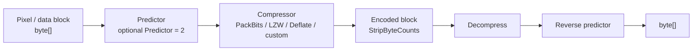

[All products](../) / [Saraff.Tiff.NET](./index.md)
# Codecs

Version 2.1 adds optional compression and decompression while keeping the core low-level.
The raw `ReadData(handle, count)` and `WriteData(bytes)` overloads never compress or decompress;
the codec-aware overloads select a codec from a registry.

## Pipeline



The predictor is part of the codec pipeline, not a separate TIFF data type. LZW and Deflate
apply it before compression and reverse it after decompression when the context contains the
required image tags.

## Built-in codecs

| `TiffCompression` | Implementation | Namespace | Notes |
|---|---|---|---|
| `NONE` | `TiffCompressionCodecNone` | `Saraff.Tiff.Core` | Pass-through |
| `PACKBITS` | `PackBitsCodec` | `Saraff.Tiff.Compression` | PackBits run-length encoding |
| `LZW` | `LzwCodec` | `Saraff.Tiff.Compression` | TIFF LZW, including code-width transitions |
| `ADOBE_DEFLATE` | `DeflateCodec` | `Saraff.Tiff.Compression` | zlib-wrapped Deflate (RFC 1950/1951) |
| `DEFLATE` | `DeflateCodec` | `Saraff.Tiff.Compression` | Same wire format as Adobe Deflate |

Every registry created with `new TiffCodecRegistry()` contains all built-in codecs. Use
`TiffCodecRegistry.CreateEmpty()` when you want a registry without defaults, and
`RegisterOrReplace` to substitute an implementation.

Not built in: JPEG/OJPEG, JPEG2000, JBIG, CCITT RLE/Group 3/Group 4, NeXT, ThunderScan,
Pixar, SGILog, IT8 and other vendor schemes. Register them through `ITiffCompressionCodec`.

## Reading compressed data

The compression tag tells you which codec to use. `StripByteCounts` or `TileByteCounts` gives
the **compressed** byte count:

```csharp
using System.Collections.Generic;
using Saraff.Tiff;
using Saraff.Tiff.Core;

var tagValues = new Dictionary<TiffTags, object> {
    [TiffTags.ImageWidth] = width,
    [TiffTags.ImageLength] = height,
    [TiffTags.BitsPerSample] = new[] { 8, 8, 8 },
    [TiffTags.SamplesPerPixel] = 3,
    [TiffTags.PlanarConfiguration] = 1,
    [TiffTags.Predictor] = 2
};

var context = new TiffCodecContext(reader.ByteOrder, tagValues);
var compression = TiffCompression.LZW;

var pixels = reader.ReadData(handle, compressedByteCount, compression, context);
```

`TiffReaderOptions.Codecs` selects the registry used by the convenience overloads. To decode
with a custom registry, pass it in the options:

```csharp
var registry = new TiffCodecRegistry();
registry.RegisterOrReplace(new MyVendorCodec());

using var reader = TiffReader.Create(stream, new TiffReaderOptions {
    Codecs = registry,
    MaxDecodedBytes = 64 * 1024 * 1024
});
```

The reader verifies the result against `MaxDecodedBytes` even if the context does not carry a
limit. A missing codec produces `NotSupportedException`; malformed compressed data produces
`TiffFormatException`.

## Writing compressed data

Compress the block first and use the compressed length in `StripByteCounts` or
`TileByteCounts`. The directory must declare the matching `Compression` tag:

```csharp
using System.Collections.Generic;
using System.Collections.ObjectModel;
using Saraff.Tiff;
using Saraff.Tiff.Compression;
using Saraff.Tiff.Core;

var context = new TiffCodecContext(TiffByteOrder.LittleEndian,
    new Dictionary<TiffTags, object> {
        [TiffTags.ImageWidth] = width,
        [TiffTags.BitsPerSample] = new[] { 8, 8, 8 },
        [TiffTags.SamplesPerPixel] = 3,
        [TiffTags.PlanarConfiguration] = 1,
        [TiffTags.Predictor] = 2
    });

var header = writer.WriteHeader();
var dataOffset = stream.Position;
var data = writer.WriteData(pixels, TiffCompression.LZW, context);
var compressedLength = (int)(stream.Position - dataOffset);

writer.WriteImageFileDirectory(header, new Collection<ITag> {
    Tag<ushort>.Create(TiffTags.ImageWidth, (ushort)width),
    Tag<ushort>.Create(TiffTags.ImageLength, (ushort)height),
    Tag<ushort>.Create(TiffTags.BitsPerSample, 8, 8, 8),
    Tag<TiffCompression>.Create(TiffTags.Compression, TiffCompression.LZW),
    Tag<TiffHandle>.Create(TiffTags.StripOffsets, data),
    Tag<ushort>.Create(TiffTags.SamplesPerPixel, 3),
    Tag<ushort>.Create(TiffTags.RowsPerStrip, (ushort)height),
    Tag<uint>.Create(TiffTags.StripByteCounts, (uint)compressedLength),
    Tag<ushort>.Create(TiffTags.Predictor, 2)
});
```

`WriteData(byte[])` remains available for pre-compressed or uncompressed blocks. The writer
does not change the `Compression` tag automatically; the caller writes a consistent tag set.

## Predictor

The integer horizontal predictor (`Predictor = 2`) is supported for 8, 16 and 32-bit samples,
with `PlanarConfiguration = 1` (contiguous) and `2` (separate). Strips and tiles are handled per
row; for tiles, `TileWidth` is used when present, otherwise `ImageWidth`.

The context must contain `Predictor`, `ImageWidth` (or `TileWidth`), `BitsPerSample` and
`SamplesPerPixel`. `PlanarConfiguration` defaults to contiguous. Missing required tags throw
`ArgumentException`; mismatched sample sizes throw `NotSupportedException`.

The floating-point predictor (`Predictor = 3`) is not implemented and throws
`NotSupportedException`.

## Custom compression codecs

Implement `ITiffCompressionCodec` from `Saraff.Tiff.Core`:

```csharp
using Saraff.Tiff.Core;

sealed class XorCodec : ITiffCompressionCodec {
    public TiffCompression Compression => TiffCompression.PACKBITS;

    public byte[] Compress(byte[] data, TiffCodecContext context) {
        var result = new byte[data.Length];
        for (var i = 0; i < data.Length; i++) result[i] = (byte)(data[i] ^ 0x5A);
        return result;
    }

    public byte[] Decompress(byte[] data, TiffCodecContext context) {
        var result = new byte[data.Length];
        for (var i = 0; i < data.Length; i++) result[i] = (byte)(data[i] ^ 0x5A);
        return result;
    }
}

var registry = TiffCodecRegistry.CreateEmpty();
registry.Register(new XorCodec());

var writer = TiffWriter.Create(stream, new TiffWriterOptions { Codecs = registry });
```

Codec instances should be stateless or create per-call state; one instance may be used
concurrently. Registry lookup is thread-safe. `TiffCodecRegistry.Default` is process-wide and
mutable; use per-reader/per-writer registries when isolation is required.

## Custom TIFF data types

`ITiffValueCodec` extends `TiffValueCodecRegistry` for TIFF data types that are not built in:

```csharp
using System;
using Saraff.Tiff.Core;

sealed class UInt24Codec : ITiffValueCodec {
    public TiffDataType DataType => (TiffDataType)16;
    public int Size => 3;
    public Type ClrType => typeof(uint);

    public object Read(byte[] data, int offset, TiffByteOrder byteOrder) {
        // decode three bytes using the TIFF byte order
    }

    public void Write(byte[] data, int offset, object value, TiffByteOrder byteOrder) {
        // encode three bytes using the TIFF byte order
    }
}
```

Register the codec through `TiffReaderOptions.ValueCodecs` and
`TiffWriterOptions.ValueCodecs`. Built-in TIFF data types cannot be overridden. A custom data
type can also be used with a custom `ITagValues` implementation; `Tag<T>` remains limited to the
built-in CLR types.

## Custom tag enums

`TiffTagAttribute` and `TiffTagRegistry` are public in 2.1:

```csharp
using Saraff.Tiff.Core;

[TiffTag(TiffTags.PIXAR_FOVCOT)]
enum MyTagValue : ushort { First = 1, Second = 2 }

TiffTagRegistry.Register(typeof(MyTagValue));
```

The registry is process-wide and thread-safe. Registering a tag that is already mapped to a
different enum type throws `ArgumentException`.

## Limits and errors

| Situation | Result |
|---|---|
| Decoded block exceeds `MaxDecodedBytes` | `TiffFormatException` |
| No codec registered for the compression | `NotSupportedException` |
| Codec returns `null` | `InvalidOperationException` |
| Truncated or invalid compressed stream | `TiffFormatException` |
| Predictor tags are missing or inconsistent | `ArgumentException` / `NotSupportedException` |
| Floating-point predictor is requested | `NotSupportedException` |

See [Safety and limits](./safety.md) for the overall threat model.

## Related pages

* [Reader](./reader.md)
* [Writer](./writer.md)
* [API reference](./api.md)
* [Safety and limits](./safety.md)
