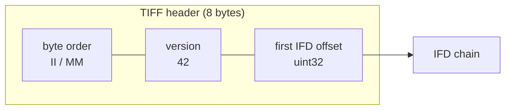
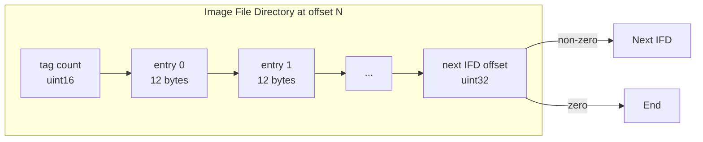
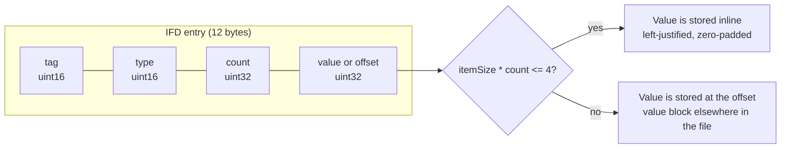
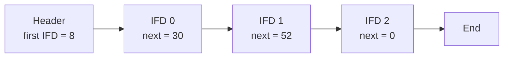
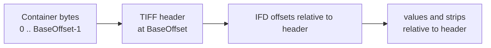

[All products](../) / [Saraff.Tiff.NET](./index.md)
# TIFF data model

A classic TIFF file is a header followed by a chain of image file directories (IFDs). Each IFD
contains 12-byte entries. An entry either stores its value inside those 12 bytes or stores an
offset to a value block elsewhere in the file.

## Header

| Offset | Size | Field | Notes |
|---:|---:|---|---|
| 0 | 2 | Byte-order marker | `II` = little-endian, `MM` = big-endian |
| 2 | 2 | Version | Must be `42`; BigTIFF (`43`) is rejected |
| 4 | 4 | First IFD offset | Relative to the TIFF header |



## IFD layout

An IFD consists of:

1. a 16-bit tag count;
2. `count` entries of 12 bytes each;
3. a 32-bit offset to the next IFD (`0` means end of chain).



The reader validates that `count * 12 + 4` fits into the stream, that the IFD offset is at least 8,
and that the IFD chain does not contain a cycle.

## Entry layout

| Offset in entry | Size | Field | Meaning |
|---:|---:|---|---|
| 0 | 2 | Tag | Tag id |
| 2 | 2 | Type | TIFF data type id |
| 4 | 4 | Count | Number of values |
| 8 | 4 | Value / offset | Inline value or offset to the value block |



> **Important:** the field name `Value / offset` is overloaded. For `StripOffsets` the tag value
> itself is an offset, but if that offset fits in 4 bytes it is stored **inline** in the entry.
> The entry field is not then an offset to another offset.

## Inline and out-of-line values

Let `itemSize` be the size of one item of the entry's TIFF type and `count` the number of values:

```text
totalSize = itemSize * count

totalSize <= 4  ->  value bytes live in the entry's 4-byte value field
totalSize >  4  ->  the entry contains an offset to a separate value block
```

| Case | Example | Storage |
|---|---|---|
| 1 `SHORT` | `ImageWidth = 150` | Inline, 2 bytes + 2 bytes padding |
| 3 `SHORT` | `BitsPerSample = 8, 8, 8` | Out-of-line, 6 bytes |
| 1 `LONG` | `StripOffsets = 128` | Inline; the tag value is the offset 128 |
| 1 `RATIONAL` | `XResolution = 300/1` | Out-of-line, 8 bytes |
| `ASCII` string | `"SARAFF\0"` | Out-of-line when longer than 4 bytes |

The writer aligns out-of-line blocks to an even offset. The reader accepts any in-range offset
and does not require alignment.

## TIFF data types

| TIFF type | Id | Size | Value returned by `ReadValue()` | Typical CLR source for writing |
|---|---:|---:|---|---|
| `TIFF_BYTE` | 1 | 1 | `byte` | `byte` |
| `TIFF_ASCII` | 2 | 1 | `string` (trimmed at first NUL) | `string`, `char` |
| `TIFF_SHORT` | 3 | 2 | `ushort` | `ushort`, `ushort` enum |
| `TIFF_LONG` | 4 | 4 | `uint` | `uint`, `uint` enum, `TiffHandle` |
| `TIFF_RATIONAL` | 5 | 8 | `TiffRational` | `TiffRational` |
| `TIFF_SBYTE` | 6 | 1 | `sbyte` | `sbyte` |
| `TIFF_UNDEFINED` | 7 | 1 | `byte` | `byte` |
| `TIFF_SSHORT` | 8 | 2 | `short` | `short`, `short` enum |
| `TIFF_SLONG` | 9 | 4 | `int` | `int`, `int` enum |
| `TIFF_SRATIONAL` | 10 | 8 | `TiffRational` | `TiffRational` |
| `TIFF_FLOAT` | 11 | 4 | `float` | `float` |
| `TIFF_DOUBLE` | 12 | 8 | `double` | `double` |
| `TIFF_IFD` | 13 | 4 | `uint` | custom `ITagValues` |
| `TIFF_NOTYPE` | 0 | - | rejected | - |

Known tags are additionally converted to CLR enums by `TiffTagRegistry` (for example
`Compression` becomes `TiffCompression`, `T6Options` becomes `TiffGroup6Options`).

## CLR type mapping for `Tag<T>`

| `T` | TIFF type | Notes |
|---|---|---|
| `byte`, `sbyte` | `BYTE`, `SBYTE` | Raw bytes |
| `char`, `string` | `ASCII` | Strings are NUL-terminated; ASCII reads return one `string` |
| `short`, `ushort` | `SSHORT`, `SHORT` | Integral values |
| `int`, `uint` | `SLONG`, `LONG` | Integral values |
| `long`, `ulong` | `SRATIONAL`, `RATIONAL` | Legacy raw 64-bit storage; prefer `TiffRational` |
| `float`, `double` | `FLOAT`, `DOUBLE` | IEEE values |
| `TiffRational` | `RATIONAL` | Preferred representation |
| `TiffHandle` | `LONG` | Writes the handle's relative offset |
| enum | underlying integral type | Enum values are converted before writing |

## Worked example: minimal 2x2 RGB TIFF

A hand-built little-endian file with 9 tags:

| Region | Offset | Size | Content |
|---|---:|---:|---|
| Header | 0 | 8 | `II`, `42`, first IFD = 8 |
| IFD count | 8 | 2 | 9 |
| IFD entries | 10 | 108 | 9 entries |
| Next IFD | 118 | 4 | 0 |
| `BitsPerSample` values | 122 | 6 | 8, 8, 8 |
| Pixel data | 128 | 12 | 2x2 RGB bytes |

| Tag | Type | Count | Value field | Storage |
|---|---|---:|---:|---|
| `ImageWidth` | `SHORT` | 1 | `2` | Inline |
| `ImageLength` | `SHORT` | 1 | `2` | Inline |
| `BitsPerSample` | `SHORT` | 3 | `122` | Offset to 6-byte block |
| `Compression` | `SHORT` | 1 | `1` (`NONE`) | Inline |
| `PhotometricInterpretation` | `SHORT` | 1 | `2` (`RGB`) | Inline |
| `StripOffsets` | `LONG` | 1 | `128` | Inline **value**, not an offset to a value |
| `SamplesPerPixel` | `SHORT` | 1 | `3` | Inline |
| `RowsPerStrip` | `SHORT` | 1 | `2` | Inline |
| `StripByteCounts` | `LONG` | 1 | `12` | Inline |

This is the file used by the golden-file tests in the repository.

## Multi-page chain



To write multiple pages, pass the handle returned by the previous
`WriteImageFileDirectory()` as the `owner` of the next call.

## Embedded TIFF



The physical stream position is `BaseOffset + relativeOffset`. With `BaseOffset = 0` the classic
case is unchanged. A single file can contain several independent TIFFs, each with its own
`BaseOffset`.

## Endianness

The same layout is used for both byte orders. Only the byte order of multi-byte primitives
changes. Inline values are still stored at the beginning of the 4-byte value field. The reader
detects `II`/`MM` from the first two bytes and configures the binary reader for the rest of the
file. See [Reader](./reader.md) and [Writer](./writer.md) for API details.
