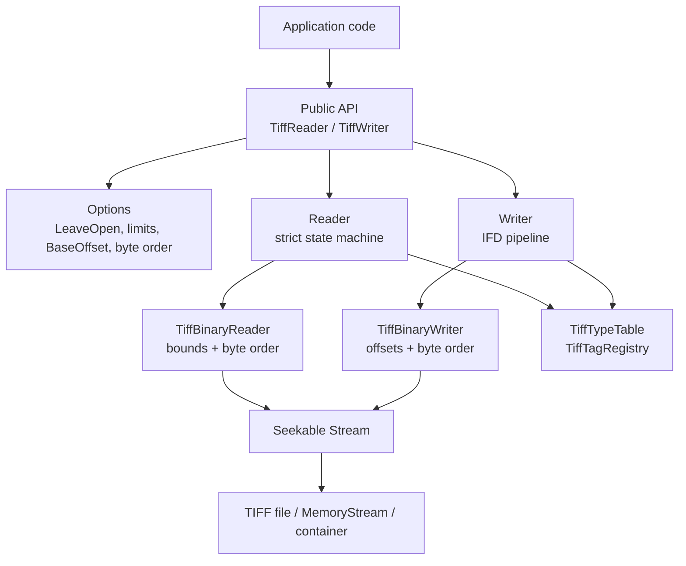

[All products](../)
# Saraff.Tiff.NET

[](https://www.nuget.org/packages/Saraff.Tiff/)
[](https://github.com/saraff-9EB1047A4BEB4cef8506B29BA325BD5A/Saraff.Tiff.NET/actions/workflows/ci.yml)


**Saraff.Tiff.NET** is a small, dependency-free C# library for low-level reading and writing
of classic TIFF files. It parses and writes headers, image file directories (IFDs), tags,
typed values and arbitrary binary blocks. It does **not** decode or encode pixels and does
**not** implement compression codecs.

| | |
|---|---|
| **Package** | [`Saraff.Tiff`](https://www.nuget.org/packages/Saraff.Tiff/) |
| **Version** | 2.0.0 |
| **Target frameworks** | `netstandard2.0`, `net48`, `net10.0` |
| **Namespaces** | `Saraff.Tiff`, `Saraff.Tiff.Core` |
| **TIFF support** | Classic TIFF 6.0, little-endian and big-endian |
| **Not supported** | BigTIFF, compression codecs, pixel conversion |
| **License** | LGPL-3.0-or-later |

> **Upgrading from 1.0.1.401?** Version 2.0 is a major update. ASCII values are returned as
> `string`, RATIONAL values as `TiffRational`, malformed input throws `TiffFormatException`,
> streams are not disposed by default, and the broken .NET 2.0 project was removed.
> See [Migration](./migration.md).

## Install

```powershell
dotnet add package Saraff.Tiff
```

Package Manager Console:

```powershell
Install-Package Saraff.Tiff
```

## The model in one picture



The reader and writer are **forward-only and non-cached** at the TIFF level. They do not build
an image object model and they do not touch pixel values unless you explicitly call `ReadData`
or `WriteData`.

## Quick start: writing

```csharp
using System.Collections.ObjectModel;
using System.IO;
using Saraff.Tiff;
using Saraff.Tiff.Core;

using var stream = File.Create("sample.tif");
using var writer = TiffWriter.Create(stream);

var owner = writer.WriteHeader();          // header at position 0
var pixels = writer.WriteData(pixelBytes); // raw strip/tile data

writer.WriteImageFileDirectory(owner, new Collection<ITag> {
    Tag<ushort>.Create(TiffTags.ImageWidth, 2),
    Tag<ushort>.Create(TiffTags.ImageLength, 2),
    Tag<ushort>.Create(TiffTags.BitsPerSample, 8, 8, 8),
    Tag<TiffCompression>.Create(TiffTags.Compression, TiffCompression.NONE),
    Tag<TiffPhotoMetric>.Create(TiffTags.PhotometricInterpretation, TiffPhotoMetric.RGB),
    Tag<TiffHandle>.Create(TiffTags.StripOffsets, pixels),
    Tag<ushort>.Create(TiffTags.SamplesPerPixel, 3),
    Tag<ushort>.Create(TiffTags.RowsPerStrip, 2),
    Tag<ushort>.Create(TiffTags.StripByteCounts, 12)
});

writer.Flush();
```

## Quick start: reading

```csharp
using System.IO;
using Saraff.Tiff;
using Saraff.Tiff.Core;

using var stream = File.OpenRead("sample.tif");
using var reader = TiffReader.Create(stream, new TiffReaderOptions {
    MaxValueBytes = 64 * 1024 * 1024,
    MaxPages = 1000
});

reader.ReadHeader();
for (var count = reader.ReadImageFileDirectory(); count != 0; count = reader.ReadImageFileDirectory()) {
    ITag? tag;
    while ((tag = reader.ReadTag()) != null) {
        object? value;
        while ((value = reader.ReadValue()) != null) {
            // ASCII -> string, RATIONAL/SRATIONAL -> TiffRational,
            // known tags -> CLR enums, other numeric values -> raw values.
        }
    }
}
```

## Documentation map

| Page | What it covers |
|---|---|
| [Architecture](./architecture.md) | Layers, reader state machine, writer pipeline, release pipeline |
| [TIFF data model](./data-model.md) | Header, IFD, entry layout, inline/out-of-line values, data types |
| [Reader](./reader.md) | Call order, values, handles, pixel blocks, options, errors |
| [Writer](./writer.md) | Header/data/IFD pipeline, multi-page files, offsets, limits |
| [Safety and limits](./safety.md) | Validation layers, threat model, limits, error taxonomy |
| [Migration to 2.0](./migration.md) | Breaking changes and before/after code |
| [API reference](./api.md) | Public types, members, options and exceptions |

## What 2.0 adds

| Area | Changes |
|---|---|
| **Correctness** | `T6Options` fixed to 293; `TIFF_IFD` is unsigned; header/version validation; IFD cycles and truncated data are rejected |
| **Safety** | Bounds checks, `MaxValueBytes`, `MaxPages`, checked counts, one bounded value block per tag |
| **I/O** | Little- and big-endian; `BaseOffset` for embedded TIFF; write at a non-zero stream position |
| **API** | `ITagInfo`, `ITagValues`, public `TiffDataType`, `TiffRational`, `TiffFormatException`, reader/writer options |
| **Ownership** | `LeaveOpen` defaults to `true`; writer no longer disposes caller `TiffHandle` objects |
| **Tooling** | Multi-target build, xUnit tests, golden/fuzz/interop tests, BenchmarkDotNet, CI, version verification, NuGet trusted publishing |

## Design principles

* **Low level, not an image library.** Tags, IFDs and raw strips/tiles are exposed as they are in TIFF.
* **Forward-only and non-cached.** The reader enforces a deterministic call order and does not
  build an in-memory TIFF tree.
* **Explicit ownership.** The caller owns the stream and the handles unless `LeaveOpen = false`.
* **Relative offsets.** Every offset is relative to the TIFF header. `BaseOffset` moves the
  header inside a larger container.
* **Bounded work.** All tag values are checked against `MaxValueBytes`; the IFD chain is bounded
  by `MaxPages`; all offsets and counts are validated before use.
* **No hidden dependencies.** The library has no runtime NuGet dependencies.

## Limitations

* Classic TIFF only. BigTIFF (version 43) is rejected with `NotSupportedException`.
* No LZW, JPEG, CCITT, Deflate or other compression codecs.
* No pixel decoding, color conversion, EXIF/GPS object model or rendering.
* Input/output streams must be readable/writable and seekable.
* Classic TIFF offsets are 32-bit: data beyond 4 GiB is not addressable.

## Links

* [NuGet package](https://www.nuget.org/packages/Saraff.Tiff/)
* [GitHub repository](https://github.com/saraff-9EB1047A4BEB4cef8506B29BA325BD5A/Saraff.Tiff.NET)
* [CI workflow](https://github.com/saraff-9EB1047A4BEB4cef8506B29BA325BD5A/Saraff.Tiff.NET/actions/workflows/ci.yml)
