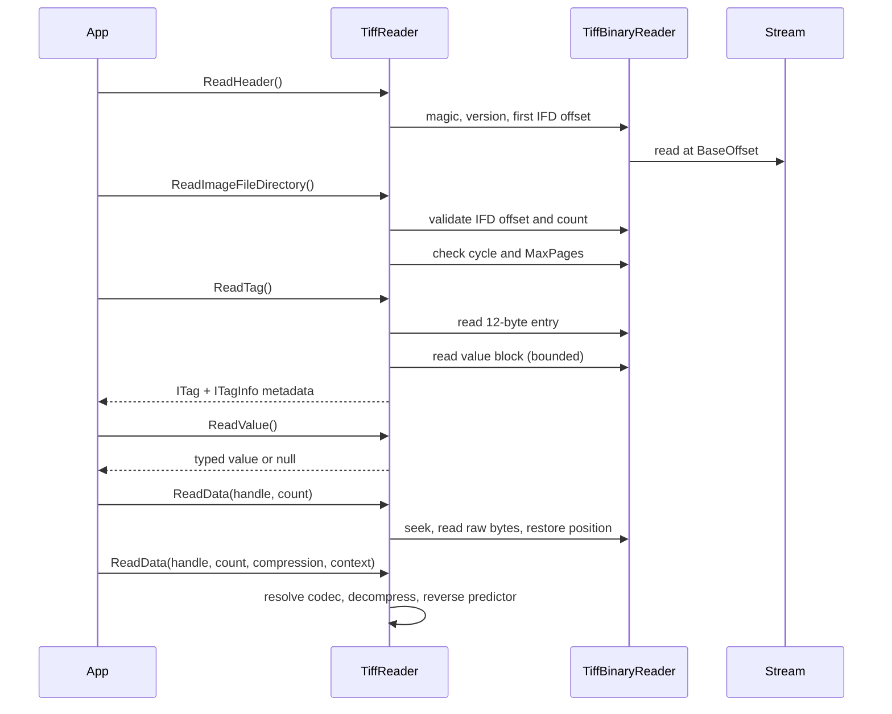
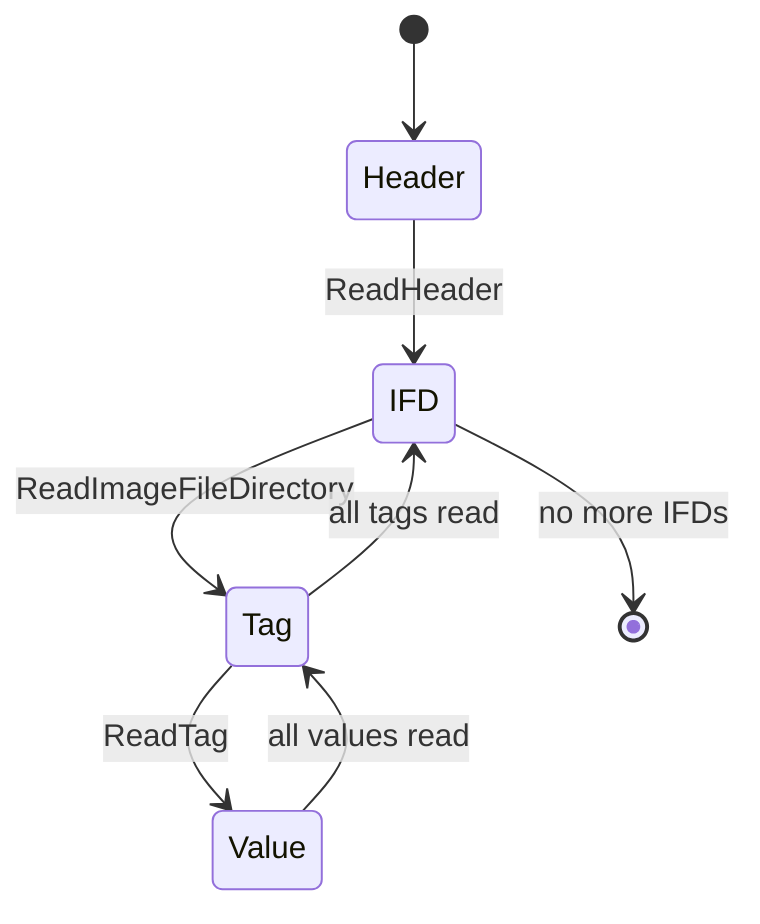

[All products](../) / [Saraff.Tiff.NET](./index.md)
# Reader

`TiffReader` gives forward-only, non-cached access to classic TIFF data. It reads the header,
then IFDs, then tags and values in a strict order. Tag values are buffered in one bounded block
per tag; pixel data is read separately through `ReadData`. Blocks can be returned raw or
decompressed with a registered codec.

## Reading lifecycle



## Quick start

```csharp
using System;
using System.Collections.Generic;
using System.IO;
using Saraff.Tiff;
using Saraff.Tiff.Core;

using var stream = File.OpenRead("sample.tif");
using var reader = TiffReader.Create(stream, new TiffReaderOptions {
    LeaveOpen = true,
    MaxValueBytes = 64 * 1024 * 1024,
    MaxDecodedBytes = 256 * 1024 * 1024,
    MaxPages = 1000,
    BaseOffset = 0
});

reader.ReadHeader();
Console.WriteLine($"TIFF version: {reader.TiffVersion}");

for (var tagCount = reader.ReadImageFileDirectory();
     tagCount != 0;
     tagCount = reader.ReadImageFileDirectory()) {

    Console.WriteLine($"IFD with {tagCount} tags");
    var values = new Dictionary<TiffTags, List<object>>();

    ITag? tag;
    while ((tag = reader.ReadTag()) != null) {
        var info = (ITagInfo)tag;
        var list = new List<object>();

        if (tag.TagId == TiffTags.StripOffsets) {
            TiffHandle? handle;
            while ((handle = reader.ReadHandle()) != null) {
                list.Add(handle);
            }
        } else {
            object? value;
            while ((value = reader.ReadValue()) != null) {
                list.Add(value);
            }
        }

        values[tag.TagId] = list;
        Console.WriteLine($"{tag.TagId}: {info.DataType}, {info.Count} value(s)");
    }

    // Read pixel strips after all tags have been consumed.
    if (values.TryGetValue(TiffTags.StripOffsets, out var offsets)
        && values.TryGetValue(TiffTags.StripByteCounts, out var counts)) {
        for (var i = 0; i < offsets.Count && i < counts.Count; i++) {
            var bytes = reader.ReadData(
                (TiffHandle)offsets[i],
                Convert.ToInt64(counts[i]));
            Console.WriteLine($"Strip {i}: {bytes.Length} bytes");
        }
    }
}
```

The strip data is read with `ReadData`, not with `ReadValue`. `ReadData` seeks to the handle
offset, reads the requested block, restores the reader position and does not change the tag state.

## Strict call order



Rules:

* `ReadValue()` must be called until it returns `null` before the next `ReadTag()`.
* `ReadHandle()` is a value read too; after it returns `null` the tag is exhausted.
* After all tags, `ReadTag()` returns `null` and advances to the next IFD offset.
* Calling a method in the wrong state throws `InvalidOperationException`.
* The reader does not recover from `TiffFormatException`; dispose it and start over.

## Values

| TIFF type | `ReadValue()` result |
|---|---|
| `TIFF_BYTE` | `byte` |
| `TIFF_ASCII` | `string` - the whole ASCII value, trimmed at the first NUL |
| `TIFF_SHORT` | `ushort` |
| `TIFF_LONG` | `uint` |
| `TIFF_RATIONAL` | `TiffRational` |
| `TIFF_SBYTE` | `sbyte` |
| `TIFF_UNDEFINED` | `byte` |
| `TIFF_SSHORT` | `short` |
| `TIFF_SLONG` | `int` |
| `TIFF_SRATIONAL` | `TiffRational` |
| `TIFF_FLOAT` | `float` |
| `TIFF_DOUBLE` | `double` |
| `TIFF_IFD` | `uint` |

Known tags are converted to CLR enums. For example, `Compression` returns `TiffCompression`,
`PhotometricInterpretation` returns `TiffPhotoMetric`, and `T6Options` returns
`TiffGroup6Options`. Custom TIFF data types can be decoded through `ITiffValueCodec`; see
[Codecs](./codecs.md).

> **ASCII is one value, not one character.** A single `ReadValue()` call consumes the whole
> ASCII block and returns a `string`. The next call returns `null` and moves back to the tag
> state. Use `Tag<string>` when writing; `Tag<char>` is still supported for byte-oriented data.

## Metadata

Every tag returned by `ReadTag()` also implements `ITagInfo`:

| Property | Meaning |
|---|---|
| `TagId` | `TiffTags` value |
| `DataType` | TIFF data type (`TiffDataType`) |
| `ItemType` | CLR type of one value, e.g. `ushort`, `string`, `TiffRational`, `uint` |
| `Count` | TIFF count: number of items; for ASCII, the number of bytes |

Example:

```csharp
var info = (ITagInfo)tag!;
Console.WriteLine($"{tag!.TagId}: type={info.DataType}, item={info.ItemType}, count={info.Count}");
```

## Handles and raw data

`ReadHandle()` converts the current value to a `TiffHandle` and validates that it is a
non-negative 32-bit offset. A handle is a lightweight value; the reader does not own it.

```csharp
// stripByteCount comes from the paired StripByteCounts tag.
TiffHandle? handle;
while ((handle = reader.ReadHandle()) != null) {
    var data = reader.ReadData(handle, stripByteCount);
    // process raw strip bytes
}
```

`ReadData` checks:

* the handle is open;
* the requested count is non-negative and fits into an `int`;
* `handleOffset + count` is inside the stream.

The codec-aware overload additionally validates the compressed stream, resolves the codec and
bounds the decoded result by `MaxDecodedBytes`. The sample image used on this site uses 16
strips. `ReadData(handle, count)` returns exactly the raw bytes of each strip; it does not
decompress. Use the codec-aware overload when the `Compression` tag is not `NONE`.

## Decoding compressed blocks

The codec-aware overload resolves the codec from `TiffReaderOptions.Codecs` (the built-in
registry by default) and passes `TiffCodecContext` to it. `count` is the **compressed** byte
count from `StripByteCounts` or `TileByteCounts`, not the decoded size.

```csharp
using System.Collections.Generic;
using Saraff.Tiff.Core;

var tagValues = new Dictionary<TiffTags, object> {
    [TiffTags.ImageWidth] = width,
    [TiffTags.ImageLength] = height,
    [TiffTags.BitsPerSample] = new[] { 8, 8, 8 },
    [TiffTags.SamplesPerPixel] = 3,
    [TiffTags.PlanarConfiguration] = 1,
    [TiffTags.Predictor] = 2
};

var context = new TiffCodecContext(reader.ByteOrder, tagValues);
var pixels = reader.ReadData(handle, compressedByteCount, TiffCompression.LZW, context);
```

Built-in codecs are PackBits, LZW, Deflate and `NONE`. A missing codec throws
`NotSupportedException`; malformed compressed data throws `TiffFormatException`; the decoded
result is bounded by `TiffReaderOptions.MaxDecodedBytes`. See [Codecs](./codecs.md) for the
full codec model and custom registries.

## Multi-page files

```csharp
reader.ReadHeader();

for (var count = reader.ReadImageFileDirectory();
     count != 0;
     count = reader.ReadImageFileDirectory()) {

    ITag? tag;
    while ((tag = reader.ReadTag()) != null) {
        while (reader.ReadValue() != null) { }
    }
}
```

`ReadImageFileDirectory()` follows the next-IFD offset automatically. A return value of `0`
means there are no more directories (or the current directory has no tags; that is unusual in
real files).

## Options

| Option | Default | Effect |
|---|---:|---|
| `LeaveOpen` | `true` | Do not dispose the source stream when the reader is disposed |
| `MaxValueBytes` | 64 MiB | Maximum size of one buffered tag value |
| `MaxDecodedBytes` | 256 MiB | Maximum decoded block size; `0` disables the limit |
| `MaxPages` | 1,000,000 | Maximum number of IFDs in the chain |
| `BaseOffset` | 0 | Absolute stream position of the TIFF header |
| `Codecs` | `TiffCodecRegistry.Default` | Compression codecs used by `ReadData` |
| `ValueCodecs` | `TiffValueCodecRegistry.Default` | Value codecs for custom TIFF data types |

The reader requires a **readable and seekable** stream. It seeks to `BaseOffset` when it is
created.

## Errors

| Exception | When |
|---|---|
| `TiffFormatException` | Bad magic/version, truncated data, out-of-range offset, cyclic IFD, zero-count tag, unsupported type, limit exceeded, invalid compressed data |
| `NotSupportedException` | BigTIFF (`version 43`), no codec for the compression, floating-point predictor |
| `InvalidOperationException` | Method called in the wrong state, or a codec returned `null` |
| `ArgumentException` | Closed `TiffHandle`, invalid handle data, missing predictor tags |
| `ArgumentOutOfRangeException` | Negative/invalid count or option |
| `ObjectDisposedException` | Reader used after `Dispose()` |
| `IOException` | Underlying stream failure |

## Ownership and threading

* The reader does not dispose the stream by default. Set `LeaveOpen = false` if the reader
  should own it.
* The reader does not dispose handles returned by `ReadHandle()`. `TiffHandle.Dispose()` only
  marks a handle closed.
* A `TiffReader` instance is not thread-safe. Create one reader per stream and serialize access.
* The static type/tag caches and codec registries are safe to use from multiple readers.
* A codec instance may be shared between readers; it must be stateless or keep state per call.

## Performance notes

The 2.x reader buffers each tag value once and parses from memory. In the included ShortRun
benchmark on .NET 10, reading a 1000-tag directory took roughly 128 microseconds (the exact
number depends on the machine). The key properties are:

* one bounded block read per tag, not one stream call per value;
* cached type and tag-to-enum mappings;
* no reflection during normal value reads;
* compression is performed only when the codec-aware overload is used.

See [Writer](./writer.md) for the write side, [Codecs](./codecs.md) for compression and
[Safety and limits](./safety.md) for the validation rules.
