[All products](../) / [Saraff.Tiff.NET](./index.md)
# Safety and limits

TIFF files are often untrusted input. The 2.x reader is designed to reject malformed data
before it can drive an unbounded allocation or an out-of-range seek. It is still a low-level
library: it validates the TIFF structure, not the meaning of your application tags.

## Threat model

The reader assumes that the bytes may be hostile. The main risks are:

* huge tag counts or values causing excessive allocation;
* decompression bombs producing output much larger than the compressed block;
* malformed or truncated compressed streams;
* offsets pointing outside the file;
* cyclic or very long IFD chains;
* truncated values and silent partial reads;
* integer overflow in `offset + size` or `count * itemSize`;
* malformed data types and zero-count tags.

## Validation layers

```mermaid
flowchart LR
    Input["Untrusted TIFF bytes"] --> Header["Header checks<br/>magic, version 42, first offset"]
    Header --> IFD["IFD checks<br/>offset, count*12+4, cycle, MaxPages"]
    IFD --> Entry["Entry checks<br/>known type, count > 0, MaxValueBytes"]
    Entry --> Value["Value checks<br/>offset + size within stream"]
    Value --> Data["ReadData checks<br/>handle open, count within stream"]
    Data --> Codec["Codec checks<br/>header, bounds, MaxDecodedBytes"]
    Codec --> Result["Typed values or TiffFormatException"]
```



| Layer | Checks |
|---|---|
| Header | Byte-order marker `II`/`MM`, version `42`, first IFD offset |
| IFD | Offset >= 8, tag count fits into the stream, cycle detection, `MaxPages` |
| Entry | Data type is known, count is non-zero, `count * itemSize <= MaxValueBytes` |
| Value | Out-of-line offset >= 8 and `offset + size <= stream length` |
| Handle data | Handle is open, count is non-negative and fits into `int`, range is valid |
| Codec | Header/checksum validation, table bounds, output bounded by `MaxDecodedBytes` |
| Writer | Owner is open, tag ids are unique, values are non-empty, offsets fit into 32 bits |

## Limits

| Option | Default | Applies to |
|---|---:|---|
| `TiffReaderOptions.MaxValueBytes` | 64 MiB | One buffered tag value |
| `TiffReaderOptions.MaxDecodedBytes` | 256 MiB | One decompressed block; `0` disables the limit |
| `TiffReaderOptions.MaxPages` | 1,000,000 | IFD chain length |
| `TiffReaderOptions.BaseOffset` | 0 | Header position in the stream |
| `TiffWriterOptions.MaxValueBytes` | 64 MiB | One buffered tag value |
| `TiffWriterOptions.BaseOffset` | 0 | Header position in the stream |

The limits are deliberately configurable. For a server processing arbitrary uploads, consider
lower values such as `MaxValueBytes = 8 * 1024 * 1024`, `MaxDecodedBytes = 32 * 1024 * 1024`
and `MaxPages = 64`. For trusted scientific or medical files, the defaults are usually
sufficient.

## Error taxonomy

| Exception | Meaning | Recovery |
|---|---|---|
| `TiffFormatException` | Malformed, truncated, cyclic or out-of-range TIFF data; compressed stream or checksum error; limit exceeded | Dispose the reader; fix or reject the file |
| `NotSupportedException` | BigTIFF (`version 43`), data beyond 4 GiB when writing, missing codec, floating-point predictor | Convert/reject the file or register a codec |
| `InvalidOperationException` | Reader/writer method called in the wrong state, or a codec returned `null` | Fix the call sequence or codec |
| `ArgumentException` | Closed handle, invalid tag set, duplicate tag, unsupported type, missing predictor tags | Fix the caller data |
| `ArgumentOutOfRangeException` | Negative count or invalid option | Fix the argument |
| `ObjectDisposedException` | Instance used after `Dispose()` | Create a new instance |
| `IOException` | The underlying stream failed | Handle at the application boundary |

## What is checked

* Every multi-byte primitive is read with an explicit byte order.
* `Stream.Read` is looped until the requested block is complete.
* `offset + size` and `count * itemSize` are checked in 64-bit arithmetic before allocation.
* An IFD cycle is detected with a set of visited offsets.
* Tag values are buffered in one block, bounded by `MaxValueBytes`.
* Handles used by `ReadData` must be open and inside the stream.
* Built-in codecs validate stream headers, tables and checksums, and bound decoded output by
  `MaxDecodedBytes`.
* The writer rejects duplicate tags, empty values and values that do not match their count.
* Package, assembly and file versions are checked in CI and before publishing.

## What is not checked

The library does not validate:

* whether the pixel layout, predictor and compression tags are semantically consistent;
* whether the pixel count matches `ImageWidth * ImageLength`;
* whether tag semantics are consistent (for example, whether `StripOffsets` covers all strips);
* whether the value of an application-specific tag is meaningful;
* EXIF/GPS/GeoTIFF semantic constraints.

If a compression scheme is not registered, decoding fails with `NotSupportedException`; the
library does not guess a codec. Those checks belong to the application or to a higher-level
image library.

## BigTIFF and 4 GiB

Classic TIFF uses 32-bit offsets. The reader rejects BigTIFF with `NotSupportedException`.
The writer rejects offsets beyond 4 GiB. This is a format limit, not a performance limit; use
a BigTIFF-capable library if you need larger files.

## Testing

The repository contains:

* unit tests for inline/out-of-line values, ASCII, rationals, handles and multi-page files;
* golden little-endian and big-endian files built independently of the writer;
* randomized round-trip tests;
* mutation fuzzing and random-byte fuzzing with bounded exceptions;
* codec round-trip, known-vector, truncation, checksum and decoded-limit tests;
* Deflate interop with `System.IO.Compression` and LZW interop with GDI+ in both directions;
* a GDI+ interop test on .NET Framework;
* BenchmarkDotNet read/write and codec benchmarks.

The fuzz tests accept only `TiffFormatException` and `NotSupportedException` for hostile
input; any other unexpected exception is a test failure.

## Recommended usage for untrusted input

```csharp
using var stream = File.OpenRead(uploadPath);
using var reader = TiffReader.Create(stream, new TiffReaderOptions {
    LeaveOpen = true,
    MaxValueBytes = 8 * 1024 * 1024,
    MaxDecodedBytes = 32 * 1024 * 1024,
    MaxPages = 64
});
```

Then:

1. Read the header and directories inside a `try/catch (TiffFormatException)`.
2. Keep `ReadData` counts under an application limit before allocating pixel buffers.
3. Set `MaxDecodedBytes` before decoding untrusted compressed blocks.
4. Do not assume that a tag value is meaningful just because it parsed.
5. Treat unsupported compression schemes as opaque bytes or register a codec explicitly.
