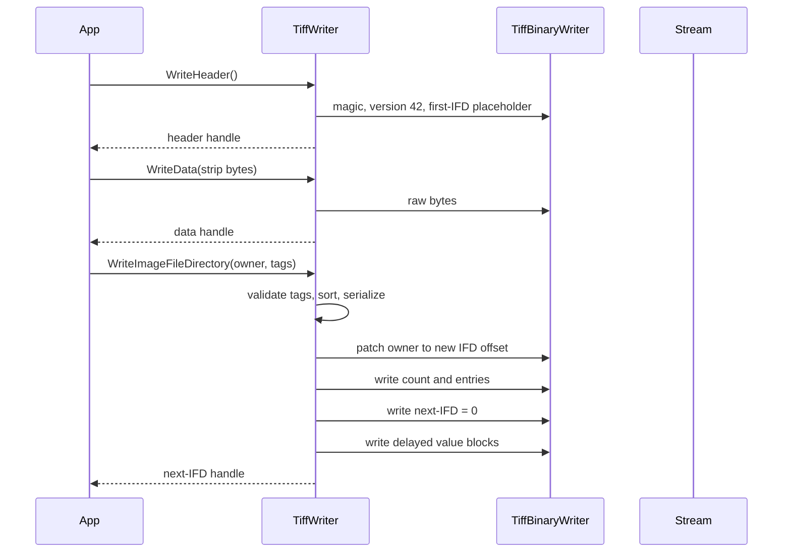
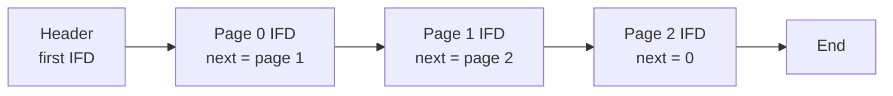
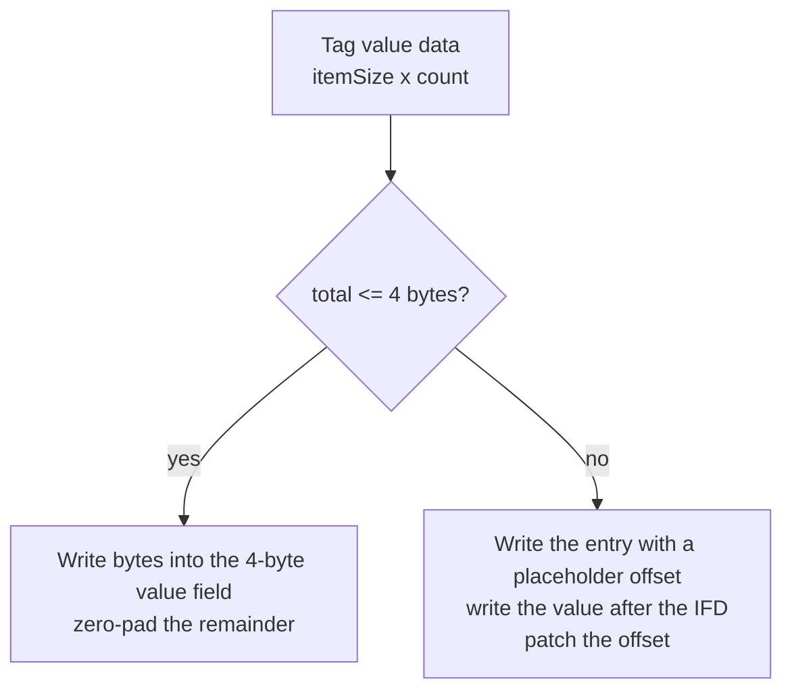
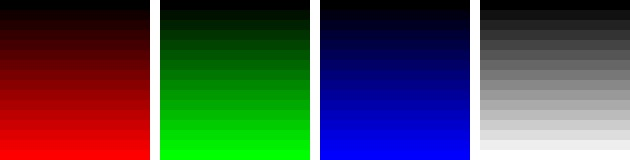

[All products](../) / [Saraff.Tiff.NET](./index.md)
# Writer

`TiffWriter` writes classic TIFF files in the order the format expects: header, raw data,
IFD entries and delayed value blocks. It validates the tag set, sorts entries by tag id,
writes small values inline, writes larger values out-of-line and patches every offset.
Data blocks can be written raw or compressed with a registered codec.

## Writing pipeline



The writer is forward-only. You cannot go back and rewrite an IFD after the next page has been
written; use the returned handle for chaining instead.

## Quick start

```csharp
using System;
using System.Collections.ObjectModel;
using System.IO;
using Saraff.Tiff;
using Saraff.Tiff.Core;

using var stream = File.Create("sample.tif");
using var writer = TiffWriter.Create(stream, new TiffWriterOptions {
    LeaveOpen = true,
    ByteOrder = TiffByteOrder.LittleEndian,
    MaxValueBytes = 64 * 1024 * 1024
});
var owner = writer.WriteHeader(); // header must be at relative position 0

var strips = new TiffHandle[stripCount];
var stripByteCounts = new uint[stripCount];
for (var i = 0; i < stripCount; i++) {
    var buffer = new byte[stripSize];
    // fill the strip with raw pixel bytes
    strips[i] = writer.WriteData(buffer);
    stripByteCounts[i] = (uint)buffer.Length;
}

var nextIfd = writer.WriteImageFileDirectory(owner, new Collection<ITag> {
    Tag<uint>.Create(TiffTags.ImageWidth, (uint)width),
    Tag<uint>.Create(TiffTags.ImageLength, (uint)height),
    Tag<ushort>.Create(TiffTags.BitsPerSample, 8, 8, 8),
    Tag<TiffCompression>.Create(TiffTags.Compression, TiffCompression.NONE),
    Tag<TiffPhotoMetric>.Create(TiffTags.PhotometricInterpretation, TiffPhotoMetric.RGB),
    Tag<TiffHandle>.Create(TiffTags.StripOffsets, strips),
    Tag<ushort>.Create(TiffTags.SamplesPerPixel, 3),
    Tag<uint>.Create(TiffTags.RowsPerStrip, (uint)rowsPerStrip),
    Tag<uint>.Create(TiffTags.StripByteCounts, stripByteCounts),
    Tag<TiffRational>.Create(TiffTags.XResolution, new TiffRational(300, 1)),
    Tag<TiffRational>.Create(TiffTags.YResolution, new TiffRational(300, 1)),
    Tag<TiffResolutionUnit>.Create(TiffTags.ResolutionUnit, TiffResolutionUnit.INCH),
    Tag<string>.Create(TiffTags.Software, "SARAFF SOFTWARE"),
    Tag<string>.Create(TiffTags.Copyright, "(c) SARAFF 2026")
});

writer.Flush();
```

`nextIfd` is a handle to the next-IFD offset field. It is not needed for a single-page file,
but it is the `owner` for the next page.

## Multi-page files

```csharp
var owner = writer.WriteHeader();

for (var page = 0; page < pageCount; page++) {
    var strips = new TiffHandle[stripCount];
    var stripByteCounts = new uint[stripCount];

    for (var i = 0; i < stripCount; i++) {
        var buffer = new byte[stripSize];
        // fill the strip with raw pixel bytes for this page
        strips[i] = writer.WriteData(buffer);
        stripByteCounts[i] = (uint)buffer.Length;
    }

    owner = writer.WriteImageFileDirectory(owner, new Collection<ITag> {
        Tag<uint>.Create(TiffTags.ImageWidth, (uint)width),
        Tag<uint>.Create(TiffTags.ImageLength, (uint)height),
        Tag<ushort>.Create(TiffTags.BitsPerSample, 8, 8, 8),
        Tag<TiffCompression>.Create(TiffTags.Compression, TiffCompression.NONE),
        Tag<TiffPhotoMetric>.Create(TiffTags.PhotometricInterpretation, TiffPhotoMetric.RGB),
        Tag<TiffHandle>.Create(TiffTags.StripOffsets, strips),
        Tag<ushort>.Create(TiffTags.SamplesPerPixel, 3),
        Tag<uint>.Create(TiffTags.RowsPerStrip, (uint)height),
        Tag<uint>.Create(TiffTags.StripByteCounts, stripByteCounts)
    });
}
```



Each call to `WriteImageFileDirectory` patches the previous owner with the new IFD offset.
The returned handle always points to the **next-IFD field** of the directory just written.

## Compressed blocks

`WriteData(byte[])` writes pre-compressed or uncompressed bytes. To compress a block, use the
codec-aware overload and write the matching `Compression` tag. `StripByteCounts` must contain
the compressed length:

```csharp
using System.Collections.Generic;
using Saraff.Tiff.Core;

var context = new TiffCodecContext(TiffByteOrder.LittleEndian,
    new Dictionary<TiffTags, object> {
        [TiffTags.ImageWidth] = width,
        [TiffTags.BitsPerSample] = new[] { 8, 8, 8 },
        [TiffTags.SamplesPerPixel] = 3,
        [TiffTags.PlanarConfiguration] = 1,
        [TiffTags.Predictor] = 2
    });

var header = writer.WriteHeader();
var dataOffset = stream.Position;
var strip = writer.WriteData(pixelBytes, TiffCompression.LZW, context);
var compressedLength = (int)(stream.Position - dataOffset);

var tags = new Collection<ITag> {
    Tag<ushort>.Create(TiffTags.ImageWidth, (ushort)width),
    Tag<ushort>.Create(TiffTags.ImageLength, (ushort)height),
    Tag<ushort>.Create(TiffTags.BitsPerSample, 8, 8, 8),
    Tag<TiffCompression>.Create(TiffTags.Compression, TiffCompression.LZW),
    Tag<TiffHandle>.Create(TiffTags.StripOffsets, strip),
    Tag<ushort>.Create(TiffTags.SamplesPerPixel, 3),
    Tag<ushort>.Create(TiffTags.RowsPerStrip, (ushort)height),
    Tag<uint>.Create(TiffTags.StripByteCounts, (uint)compressedLength),
    Tag<ushort>.Create(TiffTags.Predictor, 2)
};
```

The writer does not change `Compression` or `Predictor` tags automatically. If you pass a
predictor in the context, write the same predictor value in the directory. See
[Codecs](./codecs.md) for built-in codecs, predictor requirements and custom registries.

The writer exposes `Codecs` and `ValueCodecs` for the registries used by the instance, plus
`ByteOrder`. Custom value codecs for non-standard TIFF data types can be supplied through
`TiffWriterOptions.ValueCodecs`.

## Inline and out-of-line values

The writer decides automatically:



Out-of-line blocks are aligned to an even offset. Tag entries are sorted by tag id. Duplicate
tag ids are rejected.

See [TIFF data model](./data-model.md) for the exact type sizes and the entry layout.

## Tag value types

| CLR value | TIFF type | Notes |
|---|---|---|
| `string` | `ASCII` | NUL-terminated per string value |
| `char` | `ASCII` | One byte per character, no implicit terminator |
| `ushort`, `short` | `SHORT`, `SSHORT` | 2-byte integral values |
| `uint`, `int` | `LONG`, `SLONG` | 4-byte integral values |
| `TiffRational` | `RATIONAL` | Preferred for resolutions |
| `TiffHandle` | `LONG` | Writes the relative offset of the handle |
| enum | underlying integral type | For example `TiffCompression` -> `SHORT` |
| `float`, `double` | `FLOAT`, `DOUBLE` | IEEE values |
| `byte`, `sbyte` | `BYTE`, `SBYTE` | Raw bytes |

> Prefer `Tag<string>` for ASCII and `Tag<TiffRational>` for rational values. Writing raw
> `ulong`/`long` rationals is still accepted for legacy compatibility, but reading returns a
> `TiffRational`, so the round trip is not symmetrical.

## Embedded TIFF with `BaseOffset`

```csharp
using var stream = File.Create("container.bin");
stream.Write(containerPrefix); // write the outer container prefix

using var writer = TiffWriter.Create(stream, new TiffWriterOptions {
    BaseOffset = containerPrefix.Length
});

var owner = writer.WriteHeader(); // header at BaseOffset
```

All TIFF offsets are stored relative to the header. The physical stream position is
`BaseOffset + offset`. See [TIFF data model](./data-model.md) for a visual explanation.

## Big-endian output

```csharp
using var writer = TiffWriter.Create(stream, new TiffWriterOptions {
    ByteOrder = TiffByteOrder.BigEndian
});
```

The header starts with `MM`, multi-byte values are written most-significant-byte first, and
the reader auto-detects the order. Inline values are still written at the beginning of the
4-byte value field, as required by the TIFF layout.

## Validation rules

`WriteImageFileDirectory` validates the complete tag set before patching the owner:

| Rule | Result on violation |
|---|---|
| Owner handle is open | `ArgumentException` |
| Tags collection is not null | `ArgumentNullException` |
| Tag count <= 65535 | `ArgumentException` |
| Tag ids are unique | `ArgumentException` |
| Every tag implements `ITagValues` | `ArgumentException` |
| Every tag has at least one value | `ArgumentException` |
| Serialized length matches `Count` | `ArgumentException` |
| Data type is supported | `ArgumentException` |
| Value size <= `MaxValueBytes` | `ArgumentException` |
| File offsets fit into 32 bits | `NotSupportedException` |
| Header is written at relative position 0 | `InvalidOperationException` |

`Tag<T>.Create` also rejects null arrays, empty value arrays and unsupported CLR types early.

## Errors

| Exception | Typical cause |
|---|---|
| `ArgumentException` | Invalid tag set, duplicate tag, empty values, bad data type, missing predictor tags |
| `InvalidOperationException` | `WriteHeader()` not at relative position 0, or a codec returned `null` |
| `NotSupportedException` | Data beyond 4 GiB, no codec for the compression, floating-point predictor |
| `ArgumentNullException` | Null stream, options, tags or data |
| `ObjectDisposedException` | Writer used after `Dispose()` |
| `IOException` | Underlying stream failure |

## Ownership and disposal

* `LeaveOpen` defaults to `true`; the writer does not dispose the stream.
* The writer does not dispose `TiffHandle` objects supplied by the caller.
* `Dispose()` flushes the writer and then optionally disposes the stream.
* A `TiffWriter` is not thread-safe. Use one writer per stream.

## Sample output

The original sample image created by the writer:



[Download the sample TIFF file](./content/Home_test.tif)

Next: [Reader](./reader.md), [Codecs](./codecs.md) and [Safety and limits](./safety.md).
