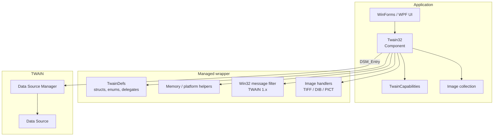
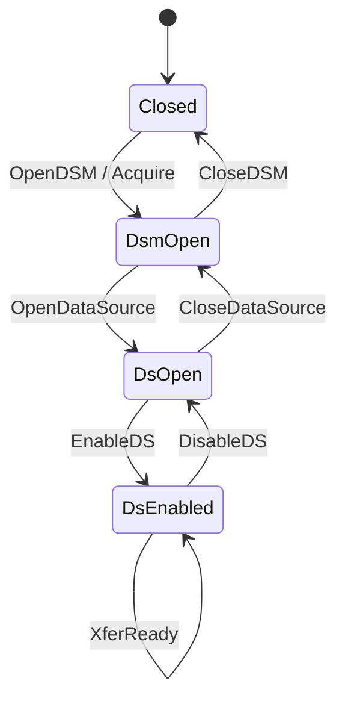
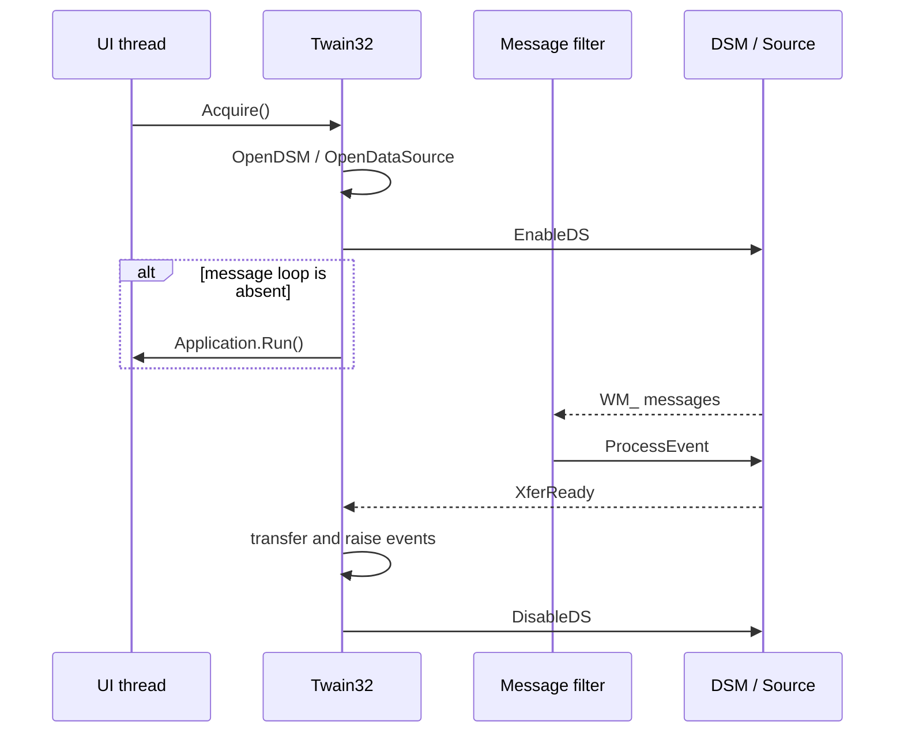
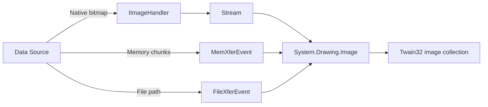
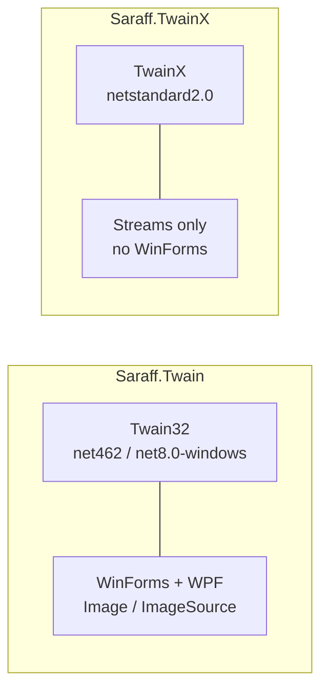

[All products](../) / [Saraff.Twain.NET](./index.md)
# Architecture

`Saraff.Twain.NET` is a thin, fully managed layer between .NET and the native TWAIN Data Source
Manager (DSM). The component does not implement a scanner driver; it implements the application
side of the TWAIN protocol.

## Components

### Main types

| Type | Role |
|---|---|
| `Twain32` | Session, source selection, transfer, events |
| `TwainCapabilities` | Strongly typed capability access |
| `Range`, `Enumeration` | Capability containers |
| `ImageInfo`, `ExtImageInfo` | Image metadata |
| `IImageHandler` | Native bitmap → stream processing |
| `IStreamProvider` | Stream selection for native transfer |
| `TwainException` | TWAIN error with status and return code |

## TWAIN session lifecycle

The component exposes the usual operations directly:

* `OpenDSM()` / `CloseDSM()`
* `SelectSource()`
* `OpenDataSource()` / `CloseDataSource()`
* `Acquire()`
* capability get/set/reset methods

`Acquire()` is a shortcut for opening the DSM and the data source, enabling it and starting the
TWAIN event flow.

## TWAIN 1.x and 2.x

On Windows the component can work in two modes:

| Mode | DSM | Event delivery | Typical use |
|---|---|---|---|
| TWAIN 1.x | `twain_32.dll` | Win32 messages + `IMessageFilter` | 32-bit legacy sources |
| TWAIN 2.x | `TWAINDSM.dll` | DSM callbacks | Modern sources, x64 |

`IsTwain2Enable` selects the mode. On x64 the default is TWAIN 2.x; on x86 the default is the legacy
`twain_32.dll` path. If `TWAINDSM.dll` is present and TWAIN 2.x is enabled, the DSM is loaded from
the system directory. `DsmPath` overrides the default library path.

For TWAIN 1.x the component installs a Win32 message filter and calls `ProcessEvent` for incoming
messages. This is why the component must be used on a thread with a message loop.

## Threading and UI

Rules:

* Create, use and dispose `Twain32` on the same UI/STA thread.
* `Parent` is a `System.Windows.Forms.IWin32Window`; WPF applications can pass the window handle
  through a small adapter.
* If the process has no message loop, `Acquire()` starts `Application.Run` itself.
* `Dispose()` must be called on the TWAIN thread; if it is called from another thread, native DSM
  resources are not released and a warning is written to `Trace`.

The component enforces thread affinity: an `InvalidOperationException` is thrown when session
operations are called from a different thread.

## Images and transfer

For native transfer the component locks the native bitmap, passes it to `IImageHandler` and stores
the resulting image. The default handlers are:

* `DibToImage` on Windows
* `Tiff` on Unix
* `Pict` on macOS

Custom handlers can be supplied through `GetService(typeof(IImageHandler))` if the component has a
container/site.

## Product boundaries

These are separate packages. `Saraff.Twain` is Windows-first; `Saraff.TwainX` is the TWAIN 2.x
stream-based product for .NET Standard. See [Saraff.TwainX](../sarafftwainx/index.md) for its
architecture and asynchronous session.

## Next

* [Scanning](./Scanning.md) — events, capabilities and transfer modes
* [Migration](./Migration.md) — moving from the old .NET 2.0 build
* [Troubleshooting](./Troubleshooting.md) — session and bitness problems
