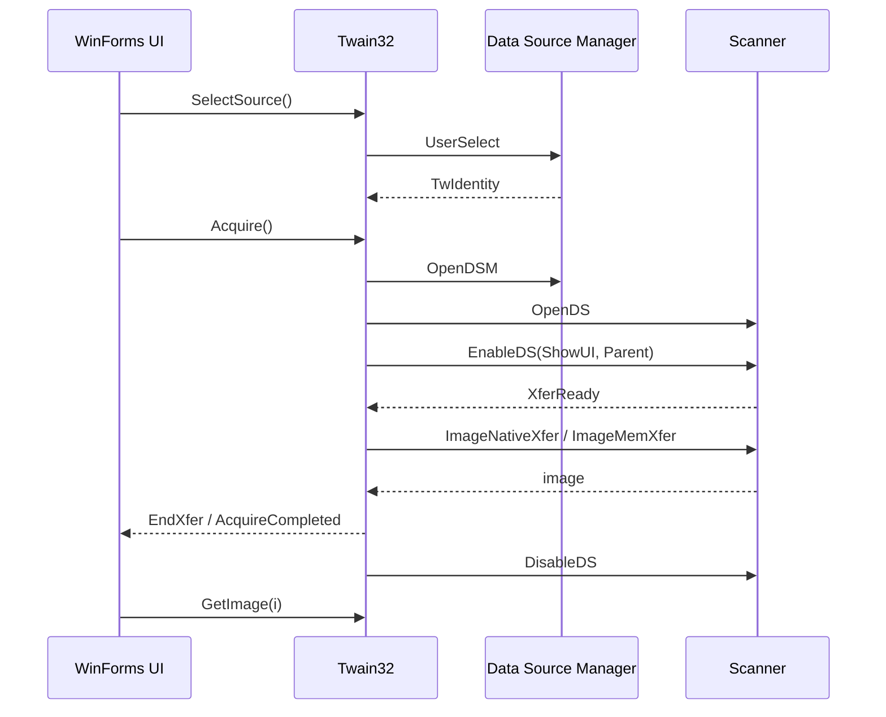

[All products](../) / [Saraff.Twain.NET](./index.md)
# Getting Started

This page takes you from an empty Windows project to a working scan with `Twain32`.

## 1. Install

```powershell
dotnet add package Saraff.Twain
```

Or add the package reference manually:

```xml
<ItemGroup>
  <PackageReference Include="Saraff.Twain" Version="1.0.33.756" />
</ItemGroup>
```

| Target framework | WinForms | WPF | TWAIN 1.x | TWAIN 2.x |
|---|---|---|---|---|
| `net462` | Yes | Yes | Yes | Yes |
| `net8.0-windows` | Yes | Yes | Yes | Yes |

The package contains both targets. The source tree also keeps a legacy `net48` project for old
Visual Studio solutions; the NuGet package is built from `Saraff.Twain.NET.csproj`.

## 2. Add a component

`Twain32` is a `Component`, so it can be created in code or dropped on a WinForms designer.

```csharp
using Saraff.Twain;

public partial class ScanForm : Form {
    private readonly Twain32 _twain = new Twain32();

    public ScanForm() {
        this.InitializeComponent();
        this._twain.Parent = this;
        this._twain.ShowUI = true;
        this._twain.DisableAfterAcquire = true;

        this._twain.AcquireCompleted += (sender, e) => {
            this.Text = $"Images: {this._twain.ImageCount}";
        };
        this._twain.AcquireError += (sender, e) => {
            MessageBox.Show(this, e.Exception.Message, "TWAIN error");
        };
    }

    protected override void Dispose(bool disposing) {
        if (disposing) {
            this._twain.Dispose();
        }
        base.Dispose(disposing);
    }
}
```

`Parent` is used as the owner of the TWAIN source UI. Without a parent the source dialog may appear
behind the application or without an owner.

## 3. Select a source and scan

```csharp
private void ScanButton_Click(object sender, EventArgs e) {
    if (!this._twain.SelectSource()) {
        return;
    }

    this._twain.Acquire();

    for (var i = 0; i < this._twain.ImageCount; i++) {
        using (var image = this._twain.GetImage(i)) {
            image.Save(Path.Combine(
                Environment.GetFolderPath(Environment.SpecialFolder.MyPictures),
                $"scan-{DateTime.Now:yyyyMMdd-HHmmss}-{i}.png"));
        }
    }
}
```



## 4. Configure scanning

Capabilities are strongly typed:

```csharp
this._twain.Capabilities.XResolution.Set(300f);
this._twain.Capabilities.YResolution.Set(300f);
this._twain.Capabilities.PixelType.Set(TwPixelType.RGB);
this._twain.Capabilities.FeederEnabled.Set(true);
this._twain.Capabilities.DuplexEnabled.Set(false);
this._twain.Capabilities.XferMech.Set(TwSX.Native);
```

Always check support before setting a capability if the scanner may not implement it:

```csharp
if ((this._twain.Capabilities.FeederEnabled.IsSupported() & TwQC.Set) != 0) {
    this._twain.Capabilities.FeederEnabled.Set(true);
}
```

## 5. Choose a transfer mode

| Mode | Capability value | Result |
|---|---|---|
| Native | `TwSX.Native` | Bitmap handle converted by an `IImageHandler` |
| Buffered memory | `TwSX.Memory` | Chunks through `MemXferEvent` |
| Disk file | `TwSX.File` | File path through `FileXferEvent` |
| Memory file | `TwSX.MemFile` | Encoded file in memory |

For most desktop scanners `TwSX.Native` is the simplest choice: `Twain32` converts the native
bitmap to `System.Drawing.Image` and stores it in the image collection.

## 6. Lifecycle rules


* Create and use `Twain32` on the same UI/STA thread.
* Do not call TWAIN methods from thread-pool threads.
* Dispose the component when the window closes.
* If `DisableAfterAcquire = false`, the source stays enabled; call `CloseDSM()` when finished.

## Next

* [Architecture](./Architecture.md) — how the session and message filter work
* [Scanning](./Scanning.md) — events, transfer modes and capabilities in detail
* [Troubleshooting](./Troubleshooting.md) — common TWAIN errors
