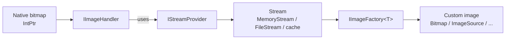
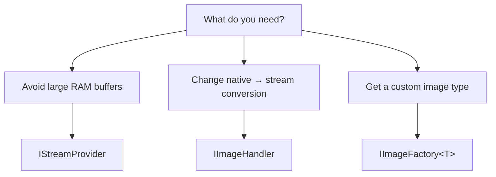

[All products](../) / [Saraff.Twain.NET](./index.md)
# Image Pipeline

Three extension points control how native image data becomes a .NET image:

| Interface | Role | Resolved by |
|---|---|---|
| `IStreamProvider` | Returns a stream for image data (RAM, temp file, cache) | `GetService(typeof(IStreamProvider))` |
| `IImageHandler` | Converts a native memory block to a stream | `GetService(typeof(IImageHandler))` |
| `IImageFactory<T>` | Converts a stream to a custom image type | `EndXferEventArgs.CreateImage<T>()` |



## 1. `IStreamProvider`

Use it when the acquired image should be cached outside RAM, for example in a temporary file.

```csharp
using System.IO;
using Saraff.Twain;

internal sealed class TempFileStreamProvider : IStreamProvider {
    public Stream GetStream() {
        return new FileStream(
            Path.GetTempFileName(),
            FileMode.Create,
            FileAccess.ReadWrite,
            FileShare.Read,
            64 * 1024,
            FileOptions.DeleteOnClose);
    }
}
```

If no provider is registered, the default handler writes to a `MemoryStream`.

## 2. `IImageHandler`

Use it to replace the conversion from native memory to a stream, for example for a private DIB,
TIFF or scanner-specific format.

```csharp
using System;
using System.IO;
using Saraff.Twain;

internal sealed class MyDibHandler : IImageHandler {
    public Stream PtrToStream(IntPtr ptr, IStreamProvider provider) {
        Stream stream = provider != null ? provider.GetStream() : new MemoryStream();

        // 1. Read the native header from ptr.
        // 2. Write a BMP/TIFF header.
        // 3. Copy the pixel data from ptr into stream.
        // 4. Rewind the stream.
        stream.Position = 0;
        return stream;
    }
}
```

The component calls this handler during native transfer:
`TwainSessionTransfer` → `IImageHandler.PtrToStream(...)` → `EndXfer`.

Default handlers:

* `DibToImage` on Windows;
* `Tiff` on Unix;
* `Pict` on macOS.

## 3. `IImageFactory<T>`

Use it in the `EndXfer` handler to turn the stream into an application-specific image type.

```csharp
using System.Drawing;
using System.IO;
using Saraff.Twain;

internal sealed class BitmapFactory : IImageFactory<Bitmap> {
    public Bitmap Create(Stream stream) {
        return new Bitmap(stream);
    }
}
```

```csharp
var factory = new BitmapFactory();

twain.EndXfer += (sender, e) => {
    if (e.Cancel) {
        return;
    }
    this.CurrentBitmap = e.CreateImage(factory);
};
```

## Registration

The component resolves `IStreamProvider` and `IImageHandler` through `Component.GetService`.
Register them in the site/container that creates the component.

```csharp
using Saraff.IoC;

var container = new ServiceContainer();
container.Bind<IStreamProvider, TempFileStreamProvider>();
container.Bind<IImageHandler, MyDibHandler>();

var twain = container.CreateInstance<Twain32>();
```

If you create `Twain32` manually, assign a site/service provider that exposes these services.
`IImageFactory<T>` is passed explicitly to `CreateImage<T>()`, so it does not need to be registered.

## Which interface should I use?



## Related

* [Scanning](./Scanning.md) — transfer modes and events
* [Architecture](./Architecture.md) — native transfer internals
* [Dependency Injection samples]()
* [Legacy wiki: IStreamProvider](./wiki/w2411.md)
* [Legacy wiki: IImageHandler](./wiki/w2412.md)
* [Legacy wiki: IImageFactory<T>](./wiki/w2413.md)
