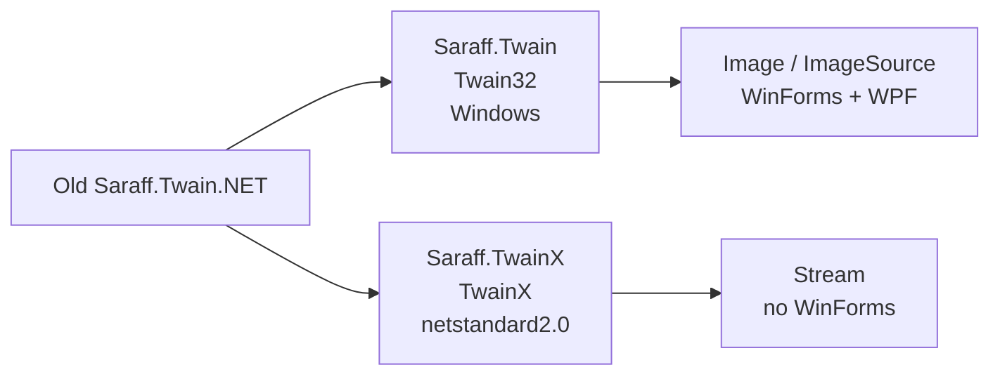
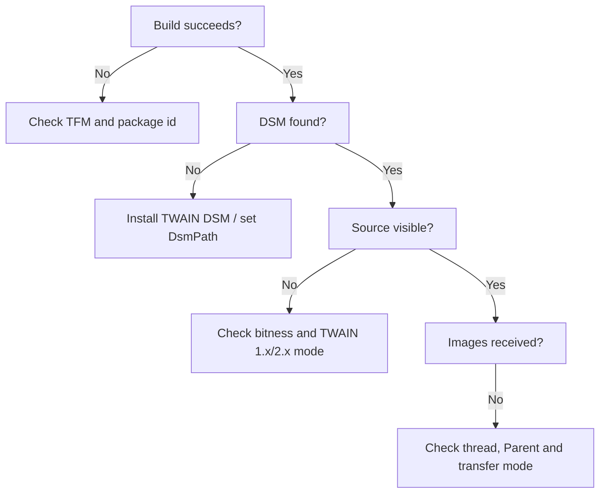

[All products](../) / [Saraff.Twain.NET](./index.md)
# Migration

## From .NET 2.0 / old package versions

Older documentation described `Saraff.Twain.NET` as a CLR 2.0 library for .NET 2.0–4.6. The current
package has a different target matrix and two source lines.

| | Old | Current |
|---|---|---|
| Package | `Saraff.Twain` | `Saraff.Twain` |
| Main class | `Twain32` | `Twain32` |
| Targets | .NET 2.0–4.6 | `net462`, `net8.0-windows` |
| UI | WinForms/WPF | WinForms/WPF |
| TWAIN | 1.x/2.x | 1.x/2.x |
| Legacy project | `Saraff.Twain.csproj` (`v2.0`) | `Saraff.Twain.csproj` (`net48`) |

The legacy project is still in the source tree for old Visual Studio solutions, but the modern
NuGet package is built from `Saraff.Twain.NET.csproj`.

## Product split

The repository now contains two separate products:

* Keep `Saraff.Twain` if you use WinForms/WPF and `Twain32`.
* Move to `Saraff.TwainX` if you need a .NET Standard TWAIN 2.x stream library.

They are not interchangeable: package ids, assembly names, namespaces and public types differ.

## What changed in `Twain32`

| Area | Change | Action |
|---|---|---|
| Target framework | `net462` / `net8.0-windows` | Retarget or multi-target your app |
| Package id | stays `Saraff.Twain` | No package change |
| Namespace | stays `Saraff.Twain` | No namespace change |
| Threading | session operations enforce one thread | Call from UI/STA thread |
| `Dispose` | idempotent; wrong-thread disposal does not release DSM | Dispose on the TWAIN thread |
| `DsmPath` | explicit DSM path | Use it for non-default DSM installations |
| TWAIN 2 mode | `IsTwain2Enable` / `IsTwain2Supported` | Check bitness and installed DSM |
| Shared internals | `Shared` source layer | No source-level action for consumers |

## What changed in `TwainX`

If you used the old `Saraff.TwainX.NET` package:

| Old | Current |
|---|---|
| Package `Saraff.TwainX.NET` | Package `Saraff.TwainX` |
| Namespace `Saraff.TwainX` | Namespace `Saraff.TwainX` |
| `TwainX` component | `TwainX` component |
| `Parent` — `IntPtr` | `Parent` — `IntPtr` |
| Stream-based `EndXfer` | Stream remains; `EndXferEventArgs.Stream` added |
| Synchronous `Acquire()` | Unchanged |
| Asynchronous acquisition | New `TwainXAcquisitionSession.AcquireAsync()` |

See the [TwainX migration page](../sarafftwainx/Migration.md) for details.

## Recommended migration path

1. Reference the current NuGet package.
2. Build for `net462` or `net8.0-windows`.
3. Ensure TWAIN calls happen on the UI/STA thread.
4. Replace manual `Application.DoEvents` hacks with `Acquire()` on a message-loop thread.
5. Verify the source selection and `Parent` window.
6. Test 32-bit and 64-bit processes separately.
7. If you only need streams and TWAIN 2.x, evaluate `Saraff.TwainX` instead of `Twain32`.

## Compatibility checklist

