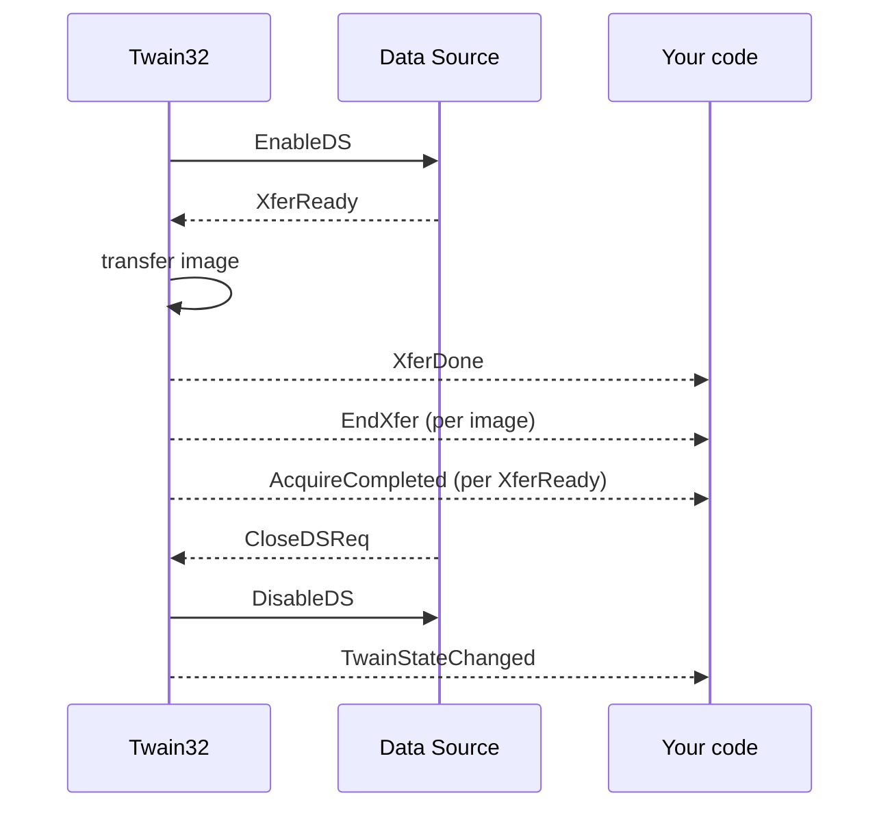
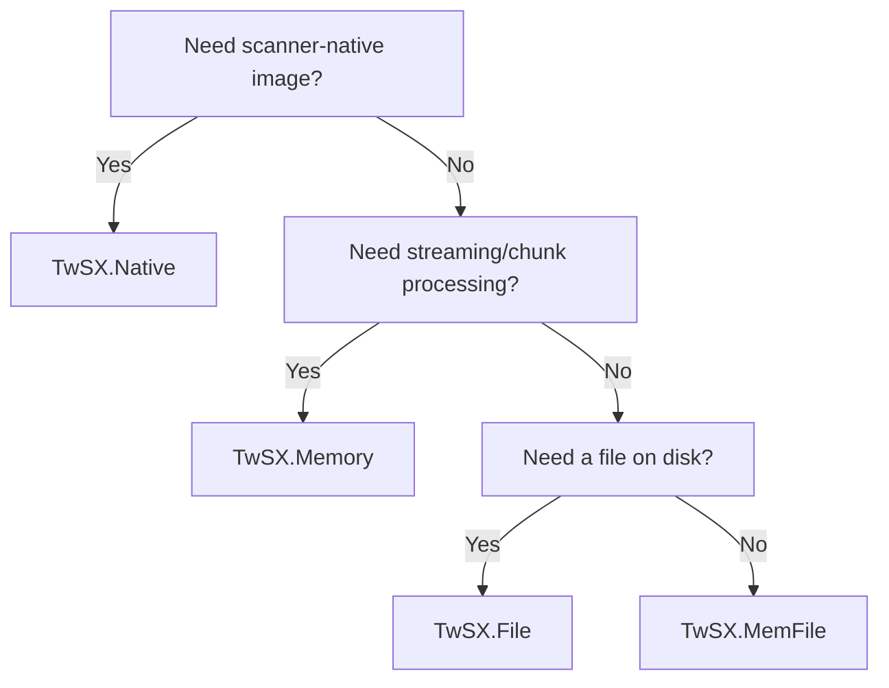

[All products](../) / [Saraff.Twain.NET](./index.md)
# Scanning

This page describes the event flow, image transfer and capability control in `Twain32`.

## Acquisition events



| Event | When it fires | Typical use |
|---|---|---|
| `XferDone` | Image data has been received | Inspect `ImageInfo`, cancel if needed |
| `EndXfer` | `Twain32` has converted the image | Add the image to your document |
| `MemXferEvent` | A buffered-memory chunk arrives | Collect chunks manually |
| `FileXferEvent` | A disk-file transfer completes | Move or rename the file |
| `AcquireCompleted` | A `XFerReady` cycle completed | Update UI or start the next page |
| `AcquireError` | DSM/DS returned an error | Show a message and close the session |
| `DeviceEvent` | Scanner sent a device event | Handle barcode/patch/battery events |
| `TwainStateChanged` | Session state changed | React to enable/disable transitions |

`AcquireCompleted` is raised for each `XFerReady`, not only once for the whole scan. If you need a
single “scan finished” signal, combine it with `TwainStateChanged` or `DisableAfterAcquire`.

## Native transfer

Native transfer is the default and the simplest path.

```csharp
this._twain.Capabilities.XferMech.Set(TwSX.Native);
this._twain.EndXfer += (sender, e) => {
    if (e.Cancel) {
        return;
    }
    // The image is already in the Twain32 collection.
};
this._twain.Acquire();
```

`EndXferEventArgs` exposes:

* `Image` — `System.Drawing.Image`
* `ImageSource` — WPF `ImageSource`
* `Cancel` — cancel the current transfer

The component also stores the image in its collection; use `ImageCount` and `GetImage(index)` after
the acquisition.

## Memory transfer

```csharp
this._twain.Capabilities.XferMech.Set(TwSX.Memory);
this._twain.SetupMemXferEvent += (sender, e) => {
    // e.ImageInfo / e.BufferSize
};
this._twain.MemXferEvent += (sender, e) => {
    // e.ImageMemXfer.ImageData / e.ImageMemXfer.BytesPerRow
};
```

Use memory transfer when you need to process chunks while the scanner is still sending data or when
the source does not support native transfer.

## File transfer

```csharp
this._twain.Capabilities.XferMech.Set(TwSX.File);
this._twain.SetupFileXferEvent += (sender, e) => {
    e.FileName = Path.Combine(tempDirectory, "scan.bmp");
};
this._twain.FileXferEvent += (sender, e) => {
    // e.ImageFileXfer.FileName contains the resulting file.
};
this._twain.Acquire();
```

If `FileName` is not set, the component uses a temporary file.

## Memory file transfer

`TwSX.MemFile` combines memory transfer with an encoded file format. Use it when the source returns
JPEG/TIFF/PDF in memory and you do not want a temporary file.

```csharp
this._twain.Capabilities.XferMech.Set(TwSX.MemFile);
this._twain.Capabilities.ImageFileFormat.Set(TwFF.Jpeg);
```

## Choosing a transfer mode



## Capabilities

### Strongly typed access

```csharp
if ((this._twain.Capabilities.XResolution.IsSupported() & TwQC.Set) != 0) {
    this._twain.Capabilities.XResolution.Set(300f);
}
if ((this._twain.Capabilities.PixelType.IsSupported() & TwQC.Set) != 0) {
    this._twain.Capabilities.PixelType.Set(TwPixelType.RGB);
}
```

### General access

```csharp
var supported = this._twain.IsCapSupported(TwCap.Resolution);
var value = this._twain.GetCap(TwCap.Resolution);
var current = this._twain.GetCurrentCap(TwCap.Resolution);
var defaultValue = this._twain.GetDefaultCap(TwCap.Resolution);

this._twain.SetCap(TwCap.Resolution, new Twain32.Range {
    MinValue = 100f,
    MaxValue = 600f,
    StepSize = 1f,
    DefaultValue = 300f,
    CurrentValue = 300f
});
```

### Range and enumeration

```csharp
var range = this._twain.GetCap(TwCap.Resolution) as Twain32.Range;
Console.WriteLine($"{range.MinValue}..{range.MaxValue}, step {range.StepSize}");

var values = this._twain.GetCap(TwCap.PixelType) as Twain32.Enumeration;
for (var i = 0; i < values.Count; i++) {
    Console.WriteLine(values[i]);
}
```

### Image layout

```csharp
this._twain.ImageLayout = new RectangleF(0f, 0f, 8.5f, 11f);
```

The units depend on the source. Check `Unit` through the capability/`ImageInfo` when you need
inches, centimeters or pixels.

### ADF and duplex

```csharp
this._twain.Capabilities.FeederEnabled.Set(true);
this._twain.Capabilities.DuplexEnabled.Set(false);
this._twain.DisableAfterAcquire = false;  // keep the session for the next page
```

When `DisableAfterAcquire` is `false`, the source stays enabled after each page. The user closes the
source UI, or your code calls `CloseDSM()` when the job is done.

## Image information

```csharp
this._twain.XferDone += (sender, e) => {
    var info = e.GetImageInfo();
    Console.WriteLine($"{info.ImageWidth} x {info.ImageLength}, {info.XResolution} dpi");
};
```

`ExtImageInfo` is available through `e.GetExtImageInfo()` when the source supports barcode, patch
code or other extended information.

## Cancellation and errors

```csharp
this._twain.XferDone += (sender, e) => {
    if (this._cancelRequested) {
        e.Cancel = true;
    }
};

this._twain.AcquireError += (sender, e) => {
    MessageBox.Show(this, e.Exception.Message, "TWAIN");
};
```

A cancelled `XferDone` stops the current transfer and releases the native bitmap. The DSM session
itself is closed by `Dispose()` or `CloseDSM()`.

## Custom scanner data

```csharp
byte[] settings = this._twain.CustomDSData;
this._twain.CustomDSData = settings;
```

Custom DS data stores source-specific settings such as colour tables and calibration.

## API summary

| Member | Meaning |
|---|---|
| `ImageCount` / `GetImage` | Acquired images in the current session |
| `SourceIndex` / `SourcesCount` | Available data sources |
| `SelectSource()` | Show the TWAIN source selection dialog |
| `SetDefaultSource()` / `GetDefaultSource()` | Default source management |
| `Acquire()` | Open DSM/DS, enable and scan |
| `CloseDSM()` | Close DSM and release native resources |
| `Dispose()` | Close session and release managed/native resources |

## Next

* [Getting Started](./GettingStarted.md) — a complete WinForms example
* [Architecture](./Architecture.md) — message filter and session internals
* [Migration](./Migration.md) — from .NET 2.0 / old package versions
