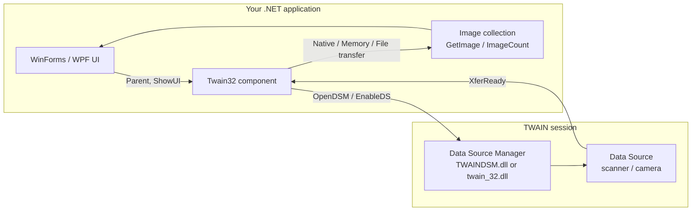

[All products](../)
# Saraff.Twain.NET

**Saraff.Twain.NET** is a managed TWAIN component for Windows. It gives a .NET application
control over flatbed scanners, web cameras, digital cameras and any other TWAIN device.

| | |
|---|---|
| **Package** | [`Saraff.Twain`](https://www.nuget.org/packages/Saraff.Twain/) |
| **Main class** | `Saraff.Twain.Twain32` |
| **Target frameworks** | `net462`, `net8.0-windows` |
| **UI integration** | WinForms (`IWin32Window`), WPF (`ImageSource`) |
| **TWAIN** | 1.x and 2.x data sources |
| **License** | LGPL-3.0-or-later |

> **Looking for the cross-platform TWAIN 2.x product?**
> It lives in a separate package and namespace: [Saraff.TwainX](../sarafftwainx/index.md).
> The two products are not interchangeable.

## The model in one picture



`Twain32` owns the DSM connection, the current data source and the acquired images. The UI thread
keeps the message loop, while `Twain32` translates TWAIN callbacks and capabilities into .NET events
and methods.

## Quick start

```csharp
using Saraff.Twain;

using (var twain = new Twain32()) {
    twain.Parent = this;              // WinForms window
    twain.ShowUI = true;
    twain.DisableAfterAcquire = true;

    twain.AcquireError += (sender, e) => {
        MessageBox.Show(e.Exception.Message);
    };

    twain.Acquire();

    for (var i = 0; i < twain.ImageCount; i++) {
        using (var image = twain.GetImage(i)) {
            image.Save($"scan-{i}.png");
        }
    }
}
```

`Acquire()` opens the DSM and the selected data source, enables it and starts the transfer.
On a UI thread the TWAIN UI runs modally; with `DisableAfterAcquire = true` the source is disabled
after the first transfer.

Install:

```powershell
dotnet add package Saraff.Twain
```

## Documentation map

### Start here

* [Getting Started](./GettingStarted.md) — install, first scan, save images
* [Architecture](./Architecture.md) — components, TWAIN stack and session lifecycle
* [Scanning](./Scanning.md) — acquisition, events, transfer modes and capabilities

### Everyday use

* [Capabilities](./Scanning.md#capabilities) — resolution, pixel type, ADF and other settings
* [Image transfer](./Scanning.md#image-transfer) — native, memory and file modes
* [Threading and UI](./Architecture.md#threading-and-ui) — parent window, message loop and `Dispose`
* [API Reference](./ApiReference.md) — public types at a glance

### Migration and support

* [Migration from 1.x / .NET 2.0](./Migration.md)
* [Troubleshooting](./Troubleshooting.md)
* [Legacy wiki](./wiki/index.md) — detailed TWAIN specification notes

## Features

* TWAIN specification 1.x and 2.x compatible
* `net462` and `net8.0-windows` assemblies in one package
* WinForms parent window and WPF image integration
* x86 and x64 support; TWAIN 1.x fallback through `twain_32.dll`
* Native, Buffered Memory, Disk File and Memory File transfer modes
* Source enumeration and selection
* Automatic Document Feeder control
* Strongly typed and general capability access
* Extended image information (barcode, patch code and other scanner data)
* Saving images as BMP, JPEG, PNG, GIF and TIFF

## Supported platforms

* Windows with .NET Framework 4.6.2+ or .NET 8+
* 32-bit and 64-bit processes
* A TWAIN data source manager and at least one TWAIN data source installed

The source tree contains Unix/macOS code paths for the shared TWAIN layer, but this product's
public surface is Windows-oriented because it integrates with WinForms and WPF.

## Samples

* [Saraff.Twain.NET C# samples]() **(UPDATED. 04.06.2016)**[...](https://goo.gl/info/doYrzd)
* [Saraff.Twain.NET Extensions samples (LINQ to TWAIN)]() **(NEW. 29.06.2017)**[...](https://goo.gl/info/nrZ11W)
* [Saraff.Twain.NET VB.NET samples]() **(UPDATED. 05.06.2016)**[...](https://goo.gl/info/DkedJN)
* [Saraff.Twain.NET WPF samples]() **(UPDATED. 22.10.2016)**[...](https://goo.gl/info/oNAs1N)
* [Saraff.Twain.NET Multithreading samples]() **(NEW. 04.12.2016)**[...](https://goo.gl/info/yprRFA)
* [Saraff.Twain.NET Outproc samples]() **(UPDATED. 22.10.2016)**[...](https://goo.gl/info/Ywc7Zz)
* [Saraff.Twain.NET Service samples]() **(UPDATED. 05.05.2017)**[...](https://goo.gl/info/6Z3Di7)
* [Saraff.Twain.NET Web samples]() **(UPDATED. 05.06.2016)**[...](https://goo.gl/info/6PzYP4)
* [Saraff.Twain.NET Silverlight samples]() **(UPDATED. 05.05.2017)**[...](https://goo.gl/info/gDh77c)
* [Saraff.Twain.NET UWP samples]() **(UPDATED. 05.05.2017)**[...](https://goo.gl/info/kvAabW)
* [Saraff.Twain.NET HTML samples]() **(UPDATED. 05.05.2017)**[...](https://goo.gl/info/R9nHJu)
* [Saraff.Twain.NET Dependency Injection samples]() **(NEW. 21.08.2017)**[...](https://goo.gl/info/mu2EPW)


**Figure 1 - Saraff.Twain.Sample2 on Windows 7**

_If you notice an error, please let me know about it._
