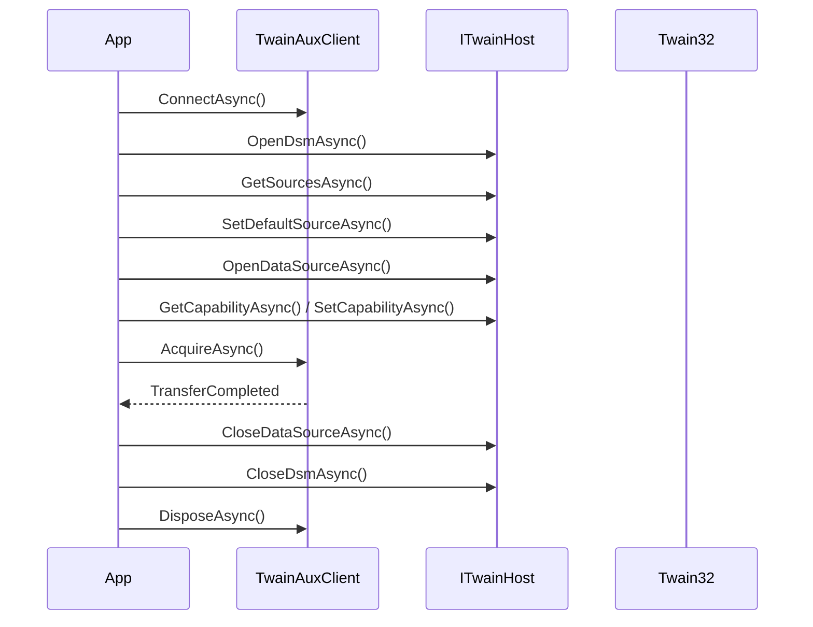

[All products](../) / [Saraff.Twain.Aux](./index.md)
# API Reference

The public surface is split into four namespaces:

| Namespace | Assembly | Purpose |
|---|---|---|
| `Saraff.Twain.Aux.Client` | `Saraff.Twain.Aux` | Async client, options, callbacks, results |
| `Saraff.Twain.Aux.Host` | `Saraff.Twain.Aux` | Host entry point, options, engine, file policy, codecs |
| `Saraff.Twain.Aux.Contracts` | `Saraff.Twain.Aux.Contracts` | Wire contracts and DTOs |
| `Saraff.Twain.Aux.Transfers`, `.Transport`, `.Rpc`, `.Threading`, `.Composition` | `Saraff.Twain.Aux` | Transfers, transports, RPC, STA and IoC helpers |

## Client

### `TwainAuxClient`

```csharp
public sealed class TwainAuxClient : IAsyncDisposable
{
    public ITwainHost Host { get; }
    public TwainClientCallbacks Callbacks { get; }
    public HostInfo Info { get; }
    public TransferResult? LastTransfer { get; }
    public TwainAuxClientSync Sync { get; }           // [Obsolete]
    public Saraff.IoC.ServiceContainer Services { get; }

    public event EventHandler<TransferResult>? TransferCompleted;
    public event EventHandler<XferDoneEventArgs>? XferDone;
    public event EventHandler<EndXferEventArgs>? EndXfer;
    public event EventHandler<SetupMemXferEventArgs>? SetupMemXfer;
    public event EventHandler<MemXferEventArgs>? MemXfer;
    public event EventHandler<MemTiffCompletedDto>? MemTiffCompleted;
    public event EventHandler<SetupFileXferEventArgs>? SetupFileXfer;
    public event EventHandler<FileXferEventArgs>? FileXfer;
    public event EventHandler<AcquireCompletedDto>? AcquireCompleted;
    public event EventHandler<AcquireErrorDto>? AcquireError;
    public event EventHandler<DeviceEventDto>? DeviceEvent;

    public static Task<TwainAuxClient> ConnectAsync(
        TwainAuxClientOptions options,
        CancellationToken cancellationToken = default);

    public Task OpenDsmAsync(CancellationToken cancellationToken = default);
    public Task CloseDsmAsync(CancellationToken cancellationToken = default);
    public Task<SourceInfo[]> GetSourcesAsync(CancellationToken cancellationToken = default);
    public Task<bool> OpenDataSourceAsync(CancellationToken cancellationToken = default);
    public Task<bool> CloseDataSourceAsync(CancellationToken cancellationToken = default);
    public Task AcquireAsync(AcquireRequest request, CancellationToken cancellationToken = default);
    public Task CancelAcquireAsync(CancellationToken cancellationToken = default);
    public Task<HostState> GetStateAsync(CancellationToken cancellationToken = default);
    public Task ShutdownAsync(CancellationToken cancellationToken = default);
    public ValueTask DisposeAsync();
}
```

`Host` exposes the full `ITwainHost` surface, including source selection, capabilities, palette,
image bytes and extended image info.

### `TwainAuxClientOptions`

| Property | Default | Meaning |
|---|---|---|
| `HostPath` | `null` | Host executable or directory with `x64`/`x86` subdirectories |
| `HostExecutableName` | `Saraff.Twain.Aux.Sample.Host.exe` | Executable name inside an architecture directory |
| `WorkingDirectory` | `null` | Host working directory |
| `Arguments` | `null` | Extra host command-line arguments |
| `ProtocolVersion` | `2.3` | Client protocol version |
| `ConnectTimeout` | 10 s | Handshake timeout |
| `TransportFactory` | `null` | Custom `IAuxTransport` factory |
| `ConfigureServices` | `null` | Client `ServiceContainer` configuration |
| `NativeFormat` | `Bmp` | Default native image format |
| `MaxNativeImageBytes` | 512 MiB | Native/TIFF read limit |
| `MaxMemoryImageBytes` | 256 MiB | Memory assembler limit |
| `PipeConnectTimeoutMs` | 30000 | Named pipe timeout |
| `TransferDirectory` | `null` | Client transfer directory; otherwise a session directory is created |
| `DeleteTransferredFiles` | `true` | Delete `File` results inside the session directory |
| `LaunchMode` | `Auto` | `Auto`, `CurrentUser`, `InteractiveUser` |
| `FallbackToCurrentUser` | `false` | Fall back when interactive launch fails |

### `TwainClientCallbacks`

`TwainClientCallbacks` implements `ITwainClientCallbacks` and raises the public events listed on
`TwainAuxClient`. Event args:

| Type | Key members |
|---|---|
| `XferDoneEventArgs` | `Dto`, `Cancel`, `NativeSink` |
| `EndXferEventArgs` | `Dto`, `Cancel` |
| `SetupMemXferEventArgs` | `Dto`, `Cancel`, `BufferSize`, `NativeSink` |
| `MemXferEventArgs` | `Dto`, `Cancel` |
| `SetupFileXferEventArgs` | `Dto`, `Cancel`, `FileName` |
| `FileXferEventArgs` | `Dto`, `Cancel` |

### `TransferResult`

| Property | Type | Meaning |
|---|---|---|
| `Mode` | `TransferMode` | Effective mode |
| `Format` | `NativeImageFormat` | BMP or TIFF |
| `Data` | `byte[]?` | Image/data bytes |
| `Image` | `Image?` | Materialized image |
| `FilePath` | `string?` | `File`/`MemFile` path |
| `ImageInfo` | `ImageInfoDto?` | Image metadata |
| `IsMemFile` | `bool` | MemFile marker |
| `PageCount` | `int` | Pages in the result |
| `TiffCompression` | `string?` | Selected TIFF compression |
| `Error` | `string?` | Error text |

### `TwainAuxClientSync`

A blocking compatibility facade over the async client. It is marked `[Obsolete]`; use the async API.

## Host

### `TwainAuxHost`

```csharp
public static class TwainAuxHost
{
    public static Task RunAsync(
        HostOptions options,
        Action<ServiceContainer>? configure = null,
        CancellationToken cancellationToken = default);

    public static Task RunAsync(
        HostOptions options,
        Func<ITwainClientCallbacks, ITwainEngine> engineFactory,
        Action<ServiceContainer>? configure = null,
        CancellationToken cancellationToken = default);
}
```

The first overload creates the real `Twain32Engine`. The second overload accepts a custom
`ITwainEngine`, which is useful for fake-engine tests.

### `HostOptions`

| Property | Default | Meaning |
|---|---|---|
| `ProtocolVersion` | `2.3` | Host protocol version |
| `TwainPackageVersion` | `1.0.34` | Reported TWAIN package version |
| `DsmPath` | `null` | Explicit DSM library path |
| `ParentWindow` | `null` | Reserved parent-window option |
| `NativeFormat` | `Bmp` | Default native format |
| `MaxMessageBytes` | 64 MiB | Reserved message limit |
| `MaxNativeImageBytes` | 512 MiB | TIFF/native size limit |
| `ConnectTimeoutMs` | 10000 | Reserved transport timeout |
| `ReadTimeoutMs` | 60000 | Reserved transport timeout |
| `WriteTimeoutMs` | 60000 | Reserved transport timeout |
| `ShutdownTimeoutMs` | 5000 | Reserved shutdown timeout |
| `TransferDirectory` | `null` | Host fallback transfer directory |
| `FallbackToMemory` | `true` | Reserved fallback option |
| `EnableDeviceEvents` | `true` | Reserved device-event option |
| `MaterializeImages` | `true` | Reserved image-materialization option |
| `CodecPluginDirectory` | `null` | TIFF codec plugin directory |
| `EnableCodecPlugins` | `true` | Scan plugins at startup |
| `AllowCodecOverrides` | `false` | Allow replacing a registered codec |
| `ContinueOnCodecPluginError` | `false` | Skip broken plugin assemblies |

### `ITwainEngine`

The engine abstraction used by `TwainHostTarget`:

* DSM/source lifecycle: `OpenDsm`, `CloseDsm`, `OpenDataSource`, `CloseDataSource`;
* sources: `GetSources`, `GetDefaultSource`, `SetDefaultSource`, `SelectSource`;
* capabilities: `GetCapability`, `SetCapability`, `ResetCapability`, `ResetAllCapabilities`,
  `IsCapabilitySupported`;
* acquisition: `Acquire`, `CancelAcquire`;
* image info: `GetImageInfo`, `GetExtImageInfo`, `GetImageBytes`, `GetImageFile`;
* source metadata: `GetSourceProductName`, `GetSourceIdentity`, `GetIsSourceTwain2Compatible`;
* palette: `GetPalette`, `GetDefaultPalette`, `SetPalette`, `ResetPalette`;
* state and host info: `GetState`, `GetHostInfo`.

`Twain32Engine` implements the interface on top of `Saraff.Twain.Twain32`.

### `FileTransferPolicy`

```csharp
public sealed class FileTransferPolicy
{
    public FileTransferPolicy(string? requestedRoot, string? fallbackRoot, string? clientSid = null);
    public string Root { get; }
    public string GetFilePath(int imageIndex, string? requestedPath, string? format);
    public void Cleanup();
}
```

### `CodecPluginLoader`

```csharp
public static IReadOnlyList<ITiffCompressionCodec> Load(
    ServiceContainer container,
    TiffCompressionService service,
    HostOptions options);
```

## Contracts

### `ITwainHost`

The full host RPC surface described in [Protocol](./Protocol.md#rpc-surface). Request objects:

| Request | Fields |
|---|---|
| `HelloRequest` | `ProtocolVersion`, `ClientVersion`, `ClientUserSid`, `TransferDirectory` |
| `EmptyRequest` | singleton `Instance` |
| `SetSourceRequest` | `Index` |
| `SourceIndexRequest` | `Index` |
| `ImageIndexRequest` | `Index` |
| `CapabilityRequest` | `Name`, `Operation` |
| `SetCapabilityRequest` | `Name`, `Operation`, `Value` |
| `SetPaletteRequest` | `Palette` |
| `AcquireRequest` | `Mode`, `ShowUI`, `DisableAfterAcquire`, `ParentWindow`, `Transfer` |

### `AcquireRequest` and `TransferOptions`

`AcquireRequest` defaults: `Mode = Auto`, `ShowUI = true`, `DisableAfterAcquire = true`,
`ParentWindow = null`, `Transfer = null`.

| `TransferOptions` property | Default | Meaning |
|---|---|---|
| `NativeFormat` | `Bmp` | Native BMP/TIFF |
| `PipeConnectTimeoutMs` | `null` | Pipe timeout override |
| `MaxNativeImageBytes` | `null` | Reserved native limit field |
| `FilePath` | `null` | Reserved file path field |
| `TransferDirectory` | `null` | Client transfer directory |
| `MaxMemoryBytes` | `null` | Memory transfer limit |
| `MaxTiffBytes` | `null` | TIFF size limit |
| `ClientUserSid` | `null` | Client SID for file ACLs |
| `TiffCompression` | `null` | Codec name or id; `null` = `NONE` |
| `DeleteAfterTransfer` | `true` | Reserved delete flag |

`ParentWindowDto.Mode` is `Host` (invisible host form), `Desktop` (no parent) or `Handle`
(explicit window handle).

### Host and source DTOs

| Type | Fields |
|---|---|
| `HostInfo` | protocol, aux/TWAIN versions, bitness, user SID, DSM path, features, codecs |
| `SourceInfo` | index, product name, TWAIN 2 compatibility, identity |
| `SourceIdentityDto` | id, version, protocol version, groups, manufacturer, family, product |
| `HostState` | DSM open, source open, acquiring, image count, DSM path |
| `TiffCompressionInfo` | id, name, built-in flag |

### Transfer DTOs

| Type | Purpose |
|---|---|
| `ImageInfoDto` | Width, length, bpp, samples, compression, pixel type, planar, resolution |
| `ExtImageInfoDto` | Extended info id and string value (base64 for bytes) |
| `ColorPaletteDto` | ARGB palette entries |
| `NativeSinkDto` | Pipe name, format, timeout |
| `XferDoneDto` / `XferDoneReply` | Metadata / cancel + native sink |
| `EndXferDto` / `EventReply` | Transfer completion / cancel |
| `SetupMemXferDto` / `SetupMemXferReply` | Memory setup / buffer size + sink |
| `MemChunkDto` | Image index, chunk index, offsets, dimensions, stride, compression, data |
| `MemTiffCompletedDto` | Image index, format, byte count, page count, compression, error |
| `MemTiffReadyDto` | Page count |
| `SetupFileXferDto` / `SetupFileXferReply` | File setup / file name |
| `FileXferDto` / `FileInfoDto` | File transfer info / file info |

### Event DTOs

| Type | Fields |
|---|---|
| `TwainStateDto` | `Flags` |
| `AcquireCompletedDto` | `ImageCount` |
| `AcquireErrorDto` | `Error` (`Type`, `Message`, `TwRC`, `TwCC`) |
| `DeviceEventDto` | event, device name, battery, power, resolution, flash, capture timing |
| `LogDto` | level, message, category |

### Enums

| Enum | Values |
|---|---|
| `TransferMode` | `Auto`, `Native`, `Memory`, `MemoryTiff`, `MemoryMultipageTiff`, `MemFile`, `File` |
| `NativeImageFormat` | `Bmp`, `Tiff` |
| `ParentWindowMode` | `Host`, `Desktop`, `Handle` |
| `CapabilityOperation` | `Get`, `GetCurrent`, `GetDefault`, `Set`, `SetConstraint`, `Reset`, `ResetAll`, `IsSupported` |
| `CapabilityValueKind` | `Null`, `Bool`, `Int`, `Float`, `String`, `Enum`, `Array`, `FloatArray`, `Range`, `Rectangle` |
| `LogLevel` | `Trace`, `Debug`, `Information`, `Warning`, `Error` |
| `AuxFeatures` | `None`, `NativeTransfer`, `MemoryTransfer`, `FileTransfer`, `MemFile`, `DeviceEvent`, `DsmPath`, `MemoryTiff`, `MemoryMultipageTiff`, `TiffCompression` |

### `JsonDefaults`

`JsonDefaults.Options` is the shared `JsonSerializerOptions` used on both sides: web defaults,
camelCase, null omission, case-insensitive reads and string enums.

## Transfers, transport and RPC

### Transfers

| Type | Public members |
|---|---|
| `TransferSession` | `Format`, `PendingSink`, `LastNativeBytes`, `LastFile`, `LastTransferUsedPipe`, `BytesWritten`, `SetMemoryStream`, `SetPipeStream`, `Complete`, `Reset`, `AddBytes` |
| `NativePipeServer` | `Create`, `Sink`, `ReadTask`, `StartRead`, `DisposeAsync` |
| `NativePipeClientWriter` | `Write(NativeSinkDto, byte[])` |
| `NamedPipeStreamProvider` | `GetStream()` |
| `DibImageConverter` | `WriteBmp(IntPtr, Stream)` |
| `BmpImageHandler`, `TiffImageHandler` | `IImageHandler.PtrToStream` |
| `ImageHandlerFactory` | `Create(NativeImageFormat)` |
| `MemoryTransferAssembler` | `ImageInfo`, `Add`, `Build` |
| `MemoryTiffAccumulator` | `Add`, `BuildTiff` |
| `MemoryMultipageTiffAccumulator` | `PageCount`, `AddPage`, `Finish`, `Dispose` |
| `TiffCompressionService` | `GetSupported`, `Resolve`, `Compress`, `Register`, `Registry` |
| `ITiffCompressionService` | `GetSupported`, `Resolve`, `Compress` |

### Transport

| Type | Public members |
|---|---|
| `IAuxTransport` | `Input`, `Output`, `WaitForExitAsync`, `Kill`, `DisposeAsync` |
| `ProcessTransport` | `Start`, `Input`, `Output`, `ErrorLog`, `WaitForExitAsync`, `Kill` |
| `ImpersonatedProcessTransport` | `Start`, `Input`, `Output`, `ProcessId`, `ErrorLog`, `WaitForExitAsync`, `Kill` |
| `StdioTransport` | `Create`, `Input`, `Output`, `WaitForExitAsync`, `Kill` |
| `InMemoryTransport` | `CreatePair` |
| `RpcConnection` | `Create`, `Rpc`, `Completion`, `AddLocalTarget`, `StartAsync` |
| `TwainRemoteException` | `RemoteTypeName` |

### Threading and composition

| Type | Public members |
|---|---|
| `StaDispatcher` | `IsCurrent`, `Start`, `InvokeAsync`, `Post`, `RunNestedUntil`, `DisposeAsync` |
| `AuxServiceSite` | `ISite` implementation; `GetService` forwards to `IServiceProvider` |

## Typical call order



## Extension points

| Extension | Use |
|---|---|
| `ServiceContainer` configure callback (host) | Replace `IStreamProvider`/`IImageHandler`, add services |
| `ServiceContainer` `ConfigureServices` (client) | Add client services, custom coordinator dependencies |
| `TransportFactory` | Custom `IAuxTransport` (for example, an IPC channel) |
| `ITwainEngine` factory | Fake engine or custom engine for tests |
| `ITiffCompressionCodec` plugin | Add TIFF compression without rebuilding the host |
| Application-provided `NativeSink` | Take over the native pipe instead of the automatic coordinator |

## Next

* [Protocol](./Protocol.md) — wire details and callback contracts
* [Transfers](./Transfers.md) — mode-specific behavior
* [Build and Test](./BuildAndTest.md) — build and validation commands
